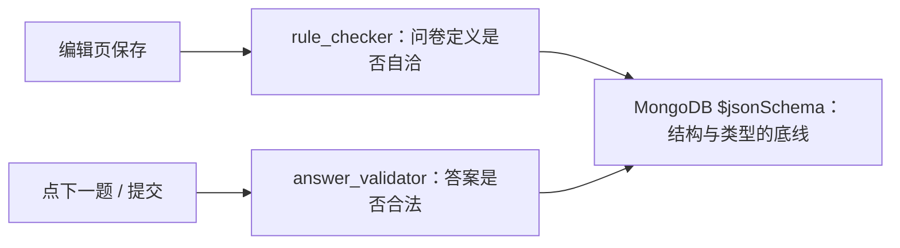
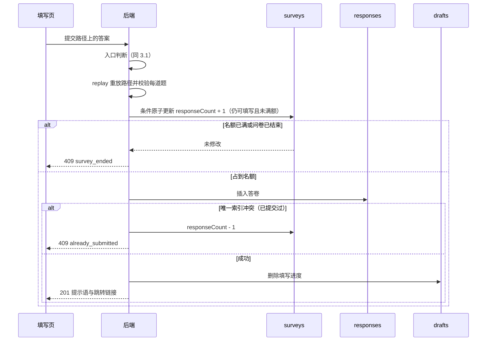
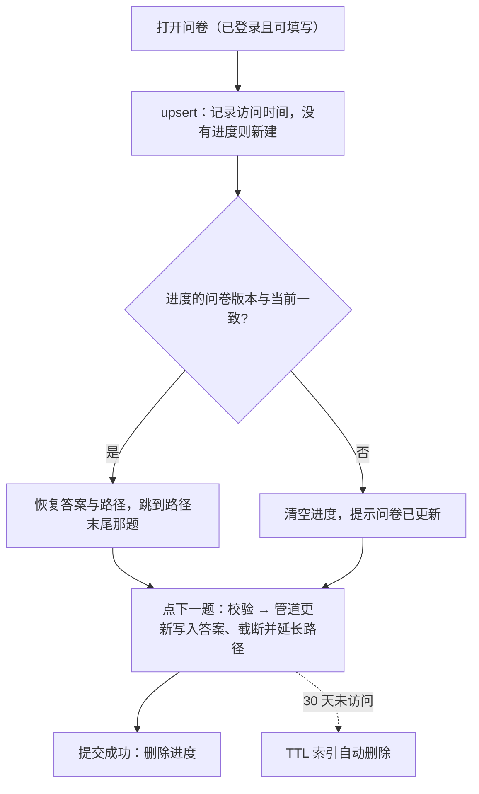
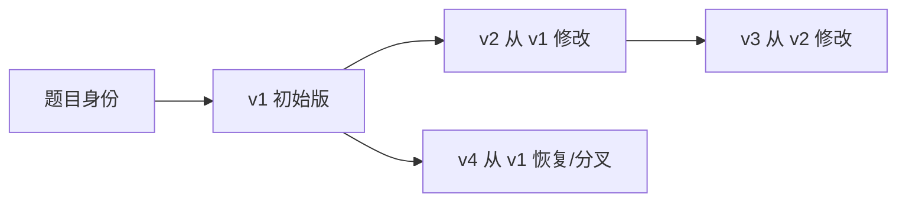
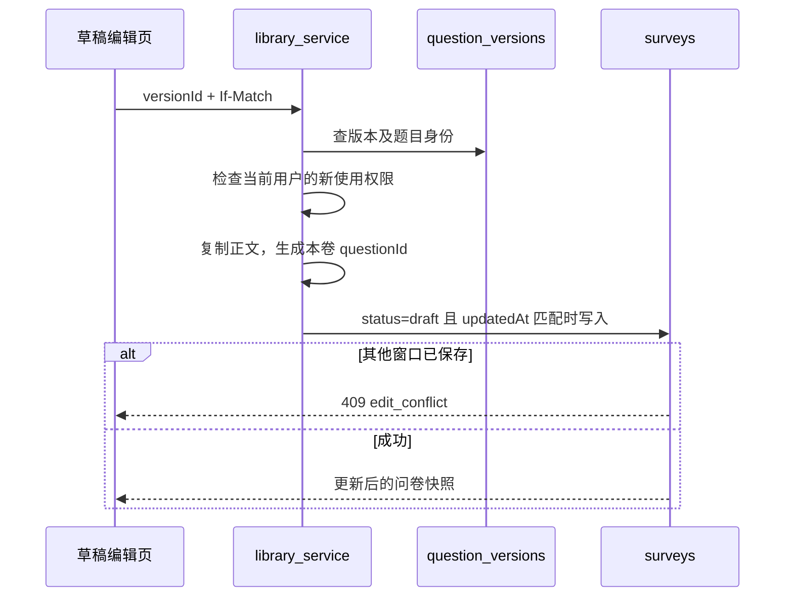
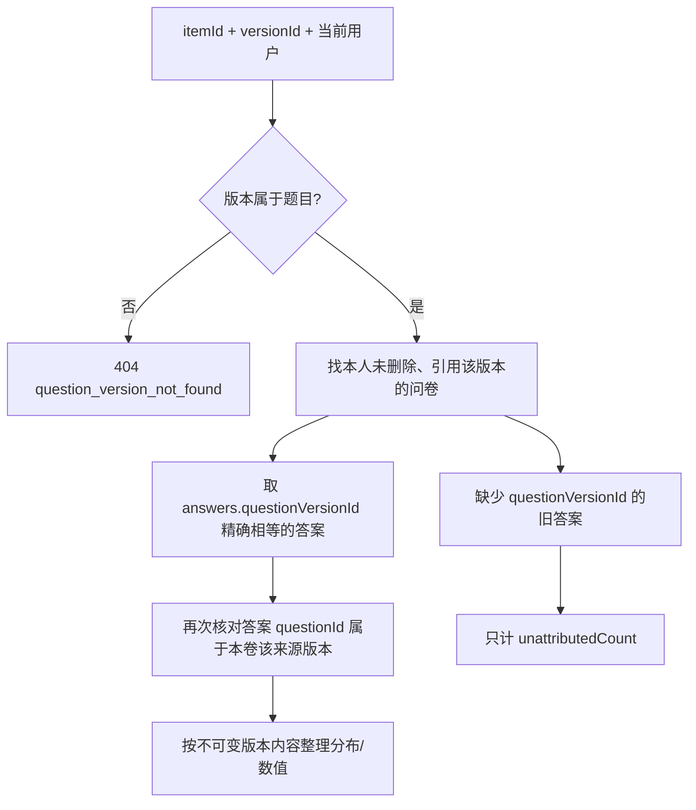

# 关键逻辑说明

第 1–6 节保留 V1 的跳转、校验、提交、编辑一致性、单卷统计和断点续填；第 7–8 节以“【V2：第二阶段新增】”续写题目版本、题库引用、发布冻结、新答卷归版和跨卷统计。数据结构与索引见[数据库设计](数据库设计.md)，接口格式见[API 说明](API说明.md)。

## 1. 跳转逻辑

代码：`backend/app/services/logic_engine.py`（纯函数，不访问数据库）。

### 1.1 规则存在数据里，程序只有一个解释器

需求要求"跳转不写死在程序里，而是可以在问卷中设置"。每道题的跳转规则存储在问卷文档的 `questions[].logic` 中，编辑页的一行"如果答案 [条件] [值] 则跳到 [目标]"就是数组中的一个元素：

```json
{"questionId": "q1", "type": "single",
 "logic": [{"when": {"op": "eq", "value": "o_男"}, "goto": "q3"},
           {"when": {"op": "eq", "value": "o_女"}, "goto": "q2"}],
 "defaultGoto": null}
```

程序中没有任何针对某份问卷的判断，只有一个通用的规则解释器。

### 1.2 计算下一题

```
next_question_id(问卷, 当前题, 规范化后的答案):
    如果本题已作答:
        依次检查 logic 中的每条规则，命中第一条就返回 resolve(规则.goto)
    如果设置了 defaultGoto: 返回 resolve(defaultGoto)
    返回 order 比当前题大的第一道未隐藏的题；没有则返回 END

resolve(目标):
    目标是 END → END
    目标题未隐藏 → 目标题
    目标题已隐藏 → 目标题之后第一道未隐藏的题（顺延）
```

匹配条件由题型决定：

| 题型 | 运算符 | 命中条件 |
|------|--------|---------|
| 单选 | `eq` / `ne` / `in` | 选中项等于 / 不等于 / 属于比较值 |
| 多选 | `includes` / `includesAny` / `includesAll` / `equalsSet` | 选中集合包含该项 / 与比较值有交集 / 包含比较值全部 / 与比较值完全相同 |
| 数字 | `eq` `ne` `gt` `gte` `lt` `lte` / `between` | 数值比较 / 闭区间 |

几个细节：

- **规则按顺序匹配，命中第一条即停止**：创作者可以把更具体的条件放在前面。
- **未作答不匹配任何规则**：选填题留空时走 `defaultGoto` 或按顺序进入下一题。
- **目标题被隐藏时顺延**：已发布问卷中删除题目只是隐藏，指向它的旧规则保留，填写时自动顺延到其后第一道可见的题，不会跳进一道看不见的题。

### 1.3 只能向后跳，从结构上杜绝死循环

保存规则时（见第 2.1 节）要求 `goto` 的目标题 `order` 必须大于当前题，或为 `END`。这样每走一步，题号都严格增大，路径长度不超过题目数，一定会结束。

比起允许任意跳转再在运行时检测环：
- 这条规则在编辑页上就能直观体现，目标下拉框只列出后面的题；
- 调整题目顺序时若出现向前跳，保存会被拒绝并指出是哪条规则。

### 1.4 示例

作业需求中的示例问卷（Q1 性别：男 → Q3，女 → Q2；Q2 水果：含葡萄 → 结束；Q3 年龄：< 18 → 结束；Q4 建议）的几条作答路径：

| 作答 | 路径 | 说明 |
|------|------|------|
| 女 → 苹果、香蕉 → 25 → "多点水果" | Q1 → Q2 → Q3 → Q4 | Q2 没有命中规则，按顺序进入 Q3 |
| 男 → 15 | Q1 → Q3 → 结束 | 男跳过 Q2；15 < 18 结束 |
| 男 → 40 →（Q4 不填） | Q1 → Q3 → Q4 | Q4 选填，留空直接结束 |
| 其他 → 苹果、葡萄 | Q1 → Q2 → 结束 | "其他"无规则按顺序；含葡萄结束 |

### 1.5 前端只显示，后端负责计算和最终核对

- 填写时每点一次"下一题"，前端把当前题的答案发给后端（`POST /next`），后端校验并返回下一题。跳转逻辑只有后端一份实现，前端拿到的题目里也不包含规则。
- 提交时，前端只提交当前路径上的答案。后端**不信任**前端给出的路径，调用 `replay` 从第一题重新走一遍：

```
replay(问卷, 全部答案):
    从第一道可见题开始:
        校验这道题（必答 + 约束），不通过则停止并报错
        记入路径；计算下一题
    答案中出现了路径之外的题 → 报错"该题不在作答路径上"
```

例如选了"男"（应跳过 Q2）却附带了 Q2 的答案，会被拒绝。重放得到的路径存入答卷的 `path` 字段。

## 2. 校验

校验分三层，分别在不同时机拦截不同的问题。



### 2.1 问卷定义校验（保存时）

代码：`backend/app/services/rule_checker.py`。编辑页的每次保存都会检查**整份问卷**，而不只是改动的那道题，保证任何时刻库中的问卷都是自洽的。

| 检查 | 错误示例 |
|------|---------|
| 选择题至少 2 个未隐藏的选项 | "选择题至少需要 2 个选项" |
| 填空题不能有选项 | "填空题不能设置选项" |
| 约束只能用于对应题型 | 单选题设置 `minSelect`：不支持约束 |
| 约束自洽 | 至少选 3、最多选 2；`maxSelect` 超过选项数；最少字数大于最多字数；最小值大于最大值；"必须选 N 项"与至少 / 最多同时设置 |
| 运算符适用于题型 | 单选题用 `gt`；文本题设置任何规则 |
| 比较值类型正确 | 单选 `eq` 的值不是本题选项；`in` 为空或重复；`between` 下限大于上限；数字规则的值是字符串或布尔值 |
| 跳转目标合法 | 目标不存在；目标在本题之前或就是本题 |
| 结构完整 | 题目 ID 重复；`order` 不是从 1 开始的连续整数；超过 200 道题 |

错误以 `{questionId, field, message}` 列表返回，编辑页逐条显示。

为了让保存后问卷依然自洽，编辑操作会自动处理连带影响：草稿中删除题目时，指向它的规则和"否则跳到"一并删除，后续题目重新编号；删除选项时，引用该选项的规则一并删除；修改题型时，清空本题原有规则。

### 2.2 答案校验（填写和提交时）

代码：`backend/app/services/answer_validator.py`、`logic_engine.check_one`。

| 题型 | 检查 | 提示 |
|------|------|------|
| 所有题 | 必答题不能为空（空字符串、空列表、`null` 都算空） | 此题为必答题 |
| 单选 | 值必须是本题一个未隐藏的选项 | 请选择一个有效的选项 |
| 多选 | 必须是选项列表、不能重复、都属于本题、数量满足约束 | 至少选择 N 项 / 最多选择 N 项 / 必须选择 N 项 / 选项不能重复 / 包含无效的选项 |
| 文本 | 先去掉首尾空格再数字数；默认最多 5000 字 | 至少输入 N 个字（当前 M 个）/ 最多输入 N 个字（当前 M 个） |
| 数字 | 接受数字或数字字符串；拒绝布尔值、NaN、无穷大；`25.0` 规范化为整数 25；整数超出 64 位时拒绝 | 请输入有效的数字 / 必须为整数 / 不能小于 N / 不能大于 N / 数值过大 |

校验通过后返回**规范化的值**，例如字符串 `"25"` 变为整数 25、文本去掉首尾空格，跳转判断和入库都使用规范化后的值，所以数字答案存为数值类型，统计时可以直接求平均。

### 2.3 数据库层校验

七个集合都注册了 `$jsonSchema`（`schema/*.json`，`validationLevel: strict`）：必填字段、字段类型、枚举值、字符串长度和格式，并且禁止未定义字段。即使绕过后端直接写库，也写不进结构错误的数据。它无法表达“跳转目标必须是另一道题”这类跨字段规则，所以与前两层配合使用，分工见[数据库设计](数据库设计.md)第 10 节。

## 3. 填写与提交流程

代码：`backend/app/services/fill_service.py`。

### 3.1 填写入口的判断顺序

与页面流程图一致，依次判断：

1. 问卷不存在、已删除或是草稿：404。
2. 已关闭、已过截止时间、答卷数已达上限：`ended`，并给出原因。
3. 需要登录而未登录：`login_required`。
4. 每人一次且此人已提交过：`already_submitted`。
5. 否则 `ok`，返回题目；已登录时同时返回上次的填写进度。

### 3.2 提交



要点：

- **先占名额再写答卷**："检查是否可填写"与"计数加 1"在同一条更新语句中完成，多人同时提交也不会超过上限。如果先写答卷再计数，就可能超额。
- **失败归还**：插入答卷失败（重复提交或其他异常）时把计数减回去。本地 MongoDB 为单机部署，没有多文档事务，所以用"占位、写入、失败归还"代替事务；最坏情况是进程在两步之间崩溃，计数器多 1，只会让上限略偏保守，可用管理页的"重新计数"修正。
- **"每人一次"由数据库兜底**：应用层先查一次只是为了在入口给出"你已填写过"的提示；真正保证唯一的是 `{surveyId, submitterKey}` 的唯一部分索引，两次请求同时到达也只有一份能写入。

### 3.3 填写者标识与匿名

| 情况 | `respondentId` | `submitterKey` |
|------|---------------|----------------|
| 登录、实名 | 用户 ID | `u:<用户ID>` |
| 登录、匿名 | `null` | `a:<HMAC(密钥, 用户ID:问卷ID)>` |
| 未登录（问卷关闭了登录要求） | `null` | `g:<随机 UUID>` |

HMAC 对同一人、同一问卷总是得到同一个值，可以去重；没有密钥无法反推用户 ID，所以匿名成立。未登录时无法识别同一个人，因此关闭登录要求时必须允许重复填写，保存设置时会检查这一点。

## 4. 编辑的一致性

> 【V2：第二阶段修订】下文关于已发布问卷“删除改为隐藏、文字可修改”的段落保留第一阶段原逻辑。V2 实际冻结和复制流程见第 7 节。

代码：`backend/app/services/question_service.py`、`repositories/surveys.py`。

每次编辑都按"读出问卷 → 在内存中修改题目数组 → 整体做定义校验 → 写回"进行，写回时以读出时的 `updatedAt` 为条件（乐观锁）：

- 两个窗口同时编辑时，后保存的一方条件不匹配，收到"问卷已在其他地方被修改，请刷新后再编辑"，不会悄悄覆盖对方的修改。
- `updatedAt` 每次更新都严格变大，取"当前时间"和"旧值 + 1 毫秒"中的较大者，避免同一毫秒内两次保存得到相同的值而绕过检测。
- 发布后的问卷可能已有答卷，因此：删除题目或选项改为隐藏；不允许修改题型；新增 / 隐藏题目或选项、修改约束、必答、跳转规则、顺序时 `version` 加 1；只改文字不加。答卷记录作答时的 `version`，填写进度在版本变化后作废。

## 5. 统计

代码：`backend/app/repositories/responses.py`（`stats_pipeline`）、`services/stats_service.py`。

1. 一条聚合管道：`$match surveyId` → `$sort` → `$facet`，在一次查询中分别算出答卷总数、每题回答人数、每个选项被选次数、数字题的平均值 / 最小值 / 最大值、填空题全部内容。单选的值是字符串，`$unwind` 会把它当作单元素数组处理，所以单选和多选共用一个计数分支。
2. 单题统计只是在每个分支的 `$unwind answers` 之后多加一个 `$match`，管道其余部分完全复用。
3. 应用层以问卷当前的题目和选项为准合并结果：补齐 0 次的选项；保留已隐藏的题目和选项并标注；计算占比（选择人数 / 本题回答人数）和未作答人数（总数 - 回答人数）。被跳转跳过的题在答卷中没有对应元素，自然不计入回答人数。

导出 CSV 用游标按 `{submittedAt, _id}` 顺序分批读取，每 200 条批量查一次填写者用户名，边读边输出，内存占用与答卷总数无关。

## 6. 断点续填

代码：`backend/app/repositories/drafts.py`、`fill_service.py`、`frontend/static/fill.js`。



- 保存一题时，若这道题已在路径中（用户点"上一题"改了答案），路径截断到这道题再接上新的下一题，旧的后续路径作废。这一步用聚合管道更新在一条语句内完成，两个标签页同时操作也不会互相覆盖。
- 首页"我参与的问卷"用 `$lookup` 关联问卷标题和状态；已删除的问卷不显示；已关闭或已截止的显示为不可继续。

## 7. 【V2：第二阶段新增】题目版本、题库引用与发布冻结

### 7.1 题目身份和不可变版本

`question_items` 只回答“是不是同一道题、属于谁、谁有权限”；`question_versions` 才保存题型、标题、说明、必答、选项和约束。创建新版本只插入，不更新父版本正文。



版本号只表示创建顺序，所以 v4 可以指向 v1。创建版本时先检查父版本属于当前题目，再读取最新版本号并尝试插入；`itemId+versionNo` 唯一索引处理并发，冲突后最多重试 8 次。恢复旧版使用同一逻辑，只是省略新内容，把父版正文复制到新节点。

### 7.2 从具体版本生成问卷快照



快照保留版本的选项 ID，另记 `sourceItemId/sourceVersionId`。问卷内的 `questionId/order/hidden/logic/defaultGoto` 独立存在，因为顺序和跳转目标只对本卷有意义。

替换草稿中的关联题时，保留本卷题目 ID、顺序和隐藏状态，清空该题规则。旧规则的比较值可能是旧版本选项 ID，不清空会造成规则引用不存在的选项。关联题正文不能原位改，接口返回 `versioned_question_locked`，要求用户先创建新版本再替换。

### 7.3 发布时固定来源

发布流程在第一阶段状态检查前增加“确保每道题有来源版本”：

1. 已带来源的题：核对身份、版本关系以及版本正文与当前快照完全一致；不一致返回 `invalid_question_source`。
2. 未带来源的题：以 `(surveyId, questionId)` 查找或创建私有题目身份，再建立与当前快照相同的版本。
3. 所有题来源准备完成后，以 `ownerId + status=draft + updatedAt` 为条件，一次写入来源数组并把状态改为 `published`。
4. 发布成功后，增删题目、改正文、选项、顺序、隐藏状态和跳转规则统一返回 `published_question_locked`。

来源身份可能在第 2 步已经创建，而第 3 步因另一个窗口修改草稿而失败。重试时按唯一来源键找到原身份；若原首版与新快照不同，保留首版并追加匹配当前快照的新版本，不覆盖历史。

### 7.4 复制问卷为新草稿

复制问卷保留标题、说明、设置、题目快照、来源版本和本卷跳转规则；生成新的 `_id` 与 slug，状态设为 `draft`，`responseCount=0`，不复制答卷和填写进度。原问卷、原链接、答卷与统计完全不变。副本中的版本引用仍指向同一不可变版本，用户可在草稿中显式替换。

### 7.5 共享撤销和引用隐私

“当前有权新使用”与“已有本人问卷需要解释历史”分开判断：

| 场景 | 版本历史/引用/本人统计 | 新选题、复制、收录 |
|---|---|---|
| 题主 | 允许 | 允许 |
| 当前公开或定向共享用户 | 允许 | 允许 |
| 共享已撤销，但本人有未删除引用问卷 | 允许，`canSelectNew=false` | 拒绝 |
| 无权限且无本人引用 | 404 | 404 |

引用查询的本人问卷返回标题、状态和使用版本；其他用户的问卷只返回去重数量。这样可以回答“有多少别人的问卷在用”，不泄露问卷标题、所有者和答卷。

## 8. 【V2：第二阶段新增】新答卷归版与同版跨卷统计

### 8.1 新答案如何记录具体版本

提交仍先调用 `logic_engine.replay`，从第一题重放路径、规范化并校验答案。只有重放成功后，才按冻结问卷的 `questionId → sourceVersionId` 映射，为 `result.answers` 中实际出现的答案附上 `questionVersionId`。被跳过的题没有答案，也不会伪造版本记录。

```javascript
{
  questionId: "q_ab12",              // 本卷题目 ID，供原单卷逻辑使用
  questionVersionId: ObjectId("..."), // V2 具体版本，供跨卷统计使用
  type: "single",
  value: "o_adult"
}
```

### 8.2 跨卷统计筛选顺序



再次核对 `questionId` 是为了处理同一问卷多次使用同一题目版本的情况，并阻止该问卷中其他答案混入。统计范围固定为当前用户自己的问卷；题目共享不会让题主看到使用者的答卷。

### 8.3 各题型的统计口径

| 题型 | V2 跨卷结果 | 口径 |
|---|---|---|
| 单选 | 每个版本选项的 `count/ratio` | `ratio = count / answeredCount` |
| 多选 | 每个版本选项的被选次数和比例 | 一人可贡献多个选项，比例和可超过 100% |
| 数字 | `values/average/min/max` | 只使用可归版数值答案 |
| 文本 | `values` | 保留规范化后的文本列表 |

选项文字始终取 `question_versions` 的不可变内容，不取当前其他问卷的文字。`ownerSurveyCount` 是本人引用该版本的未删除问卷数；`answeredCount` 是可归版答案数；`unattributedCount` 是可能属于这些问卷题、但缺少版本证据的旧答案数。

### 8.4 为什么旧答案不补版本

第一阶段答卷只保存本卷题目 ID、类型和值，没有提交时的题目或选项快照。若该问卷曾在发布后改过文字、选项或规则，迁移时看到的当前题目不一定是当时作答的版本。根据标题或当前 `surveyVersion` 推测会制造看似精确但无法证明的统计。因此 V2 采取两条并行口径：

- 原 `/api/surveys/{id}/stats` 继续按第一阶段方式统计该卷全部历史答卷；
- V2 跨卷统计只汇总带有确切 `questionVersionId` 的新答案，旧答案单列说明。
