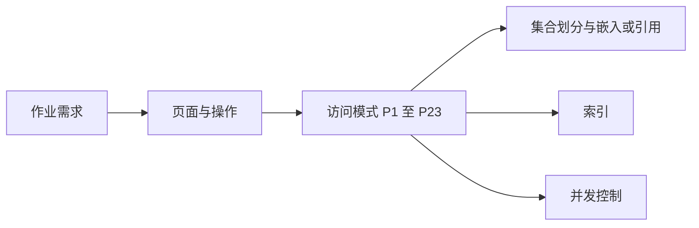
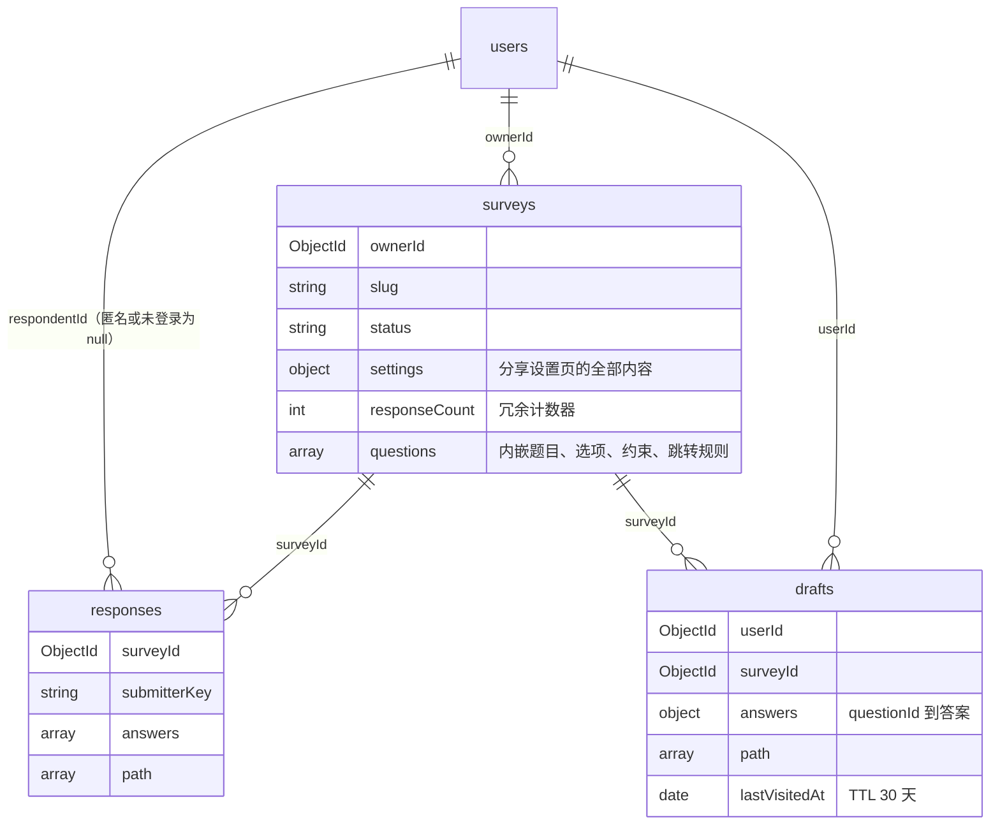
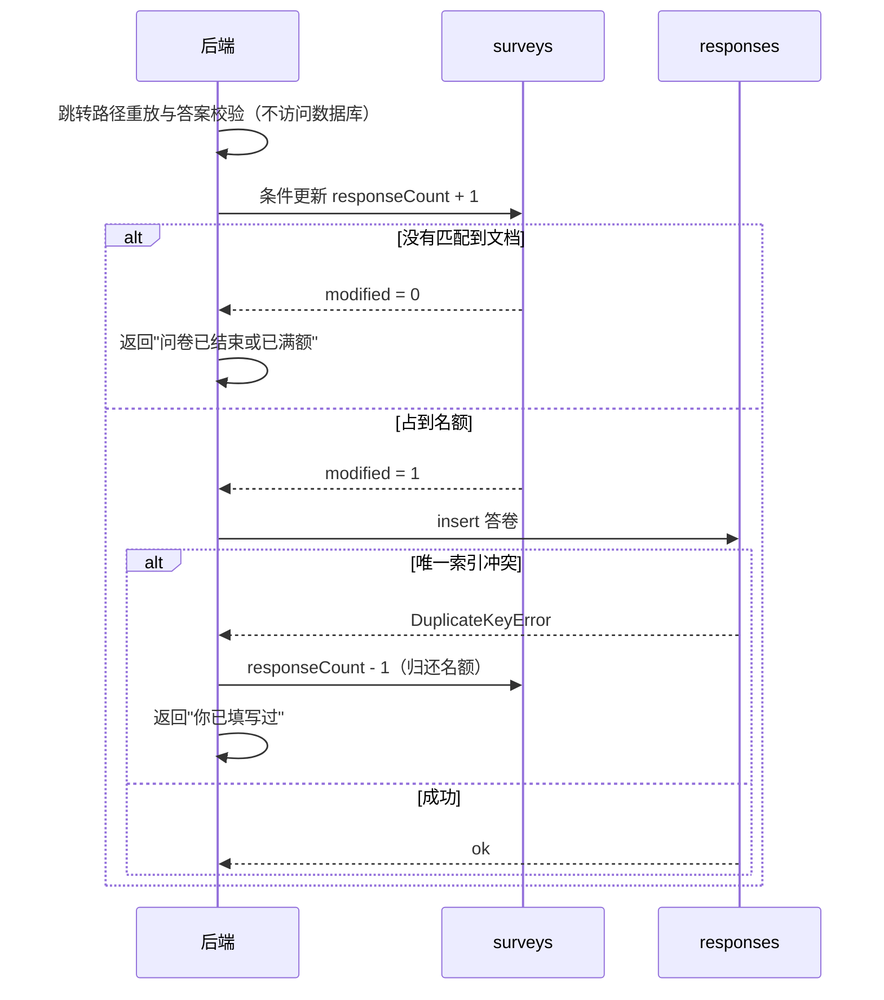
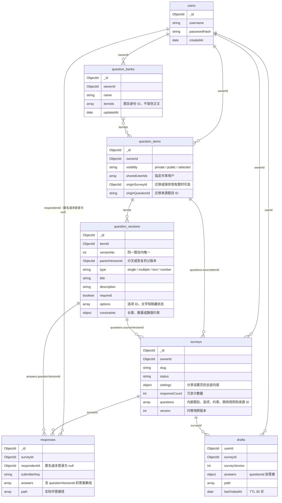

# 数据库设计（V1 基线 + V2 数据演进）

数据库：MongoDB 9.0.2（单机部署），库名 `survey_system`（测试库 `survey_system_test`）。

> 第 1–12 节保留第一次作业的 `schemaVersion=1` 设计、理由和写作记录；第 13 节以“【V2：第二阶段新增】”续写题目身份、不可变版本、多题库、来源字段、迁移和跨卷统计。V2 不删除原四集合。

相关文件：

- 页面与访问模式：`docs/需求分析与界面设计.md`（V1 为 P1–P23，V2 为 P24–P34）
- 集合校验规则：`schema/` 下 7 个 JSON；V2 新增 `question_items`、`question_versions`、`question_banks`
- 建集合、注册校验器、同步索引：`backend/app/db.py`（可重复执行：`python -m app.db`，后端启动时也会自动执行）
- 校验、索引与迁移测试：`backend/tests/test_schema.py`、`test_stage2_storage.py`、`test_stage2_library.py`

## 1. 设计方法

MongoDB 的建模原则是"按应用如何读写数据来组织数据"，而不是像关系型数据库那样先做范式化。因此设计按以下顺序进行：



从访问模式中得出的三个关键结论：

1. **问卷和题目总是一起读写**（P7 至 P9、P12、P14 都需要整套题目），所以题目内嵌在问卷文档中。
2. **答卷数量无上限、只追加、按问卷聚合**（P15 至 P18），所以答卷单独成集合。
3. **列表页要显示答卷数，提交时要检查上限**（P3、P15），所以在问卷上维护一个冗余计数器，用原子更新保证并发正确。
4. **填写进度是"每人每问卷一份、会被反复覆盖、过期可丢弃"的临时数据**（P19 至 P22），生命周期和答卷完全不同，所以单独放在 `drafts` 集合，用唯一索引加 upsert 保证一人一份，用 TTL 索引自动过期。

## 2. 总体结构



| 集合 | 存什么 | 文档数量级 | 服务的访问模式 |
|------|--------|-----------|---------------|
| users | 账号 | 用户数 | P1、P2、P18（导出时查用户名） |
| surveys | 问卷、设置、内嵌的全部题目 | 每个用户若干 | P3 至 P12、P14、P15（占名额） |
| responses | 每次提交一份答卷 | 无上限 | P13、P15 至 P18、P23 |
| drafts | 每人每份问卷一份填写进度 | 活跃填写人数，过期自动删除 | P19 至 P22 |

## 3. users

```json
{
  "_id": ObjectId("..."),
  "username": "alice",
  "passwordHash": "$2b$12$....",
  "createdAt": ISODate("2026-10-20T12:00:00Z"),
  "schemaVersion": 1
}
```

- `username` 3 至 32 个字符，唯一索引保证不重复。应用层先查一次只是为了给出友好提示，真正兜底的是索引，可防止并发注册同名（P1）。
- 只存 bcrypt 哈希。`additionalProperties: false` 使得误写入 `password` 之类的字段会被数据库直接拒绝。

## 4. surveys（问卷 + 设置 + 内嵌题目）

```json
{
  "_id": ObjectId("..."),
  "ownerId": ObjectId("<users._id>"),
  "slug": "k3Xp9aQ2",
  "title": "水果偏好调查",
  "description": "大约 1 分钟",
  "status": "published",
  "settings": {
    "requireLogin": true,
    "allowAnonymous": true,
    "allowMultipleSubmit": false,
    "deadline": ISODate("2026-11-01T00:00:00Z"),
    "maxResponses": 200,
    "completion": {"message": "感谢参与！", "redirectUrl": "https://example.com"}
  },
  "publishedAt": ISODate("..."),
  "closedAt": null,
  "version": 3,
  "responseCount": 57,
  "questions": [
    {
      "questionId": "q_7f2c",
      "order": 1,
      "type": "single",
      "title": "你的性别",
      "required": true,
      "hidden": false,
      "options": [
        {"optionId": "o_a", "text": "男", "hidden": false},
        {"optionId": "o_b", "text": "女", "hidden": false},
        {"optionId": "o_c", "text": "其他", "hidden": false}
      ],
      "constraints": {},
      "logic": [
        {"when": {"op": "eq", "value": "o_a"}, "goto": "q_9d01"},
        {"when": {"op": "eq", "value": "o_b"}, "goto": "q_51ee"}
      ],
      "defaultGoto": null
    },
    {
      "questionId": "q_51ee",
      "order": 2,
      "type": "multiple",
      "title": "你喜欢的水果",
      "required": true,
      "hidden": false,
      "options": [
        {"optionId": "o_1", "text": "苹果", "hidden": false},
        {"optionId": "o_2", "text": "香蕉", "hidden": false},
        {"optionId": "o_3", "text": "西瓜", "hidden": false},
        {"optionId": "o_4", "text": "葡萄", "hidden": false}
      ],
      "constraints": {"minSelect": 2, "maxSelect": 3},
      "logic": [{"when": {"op": "includes", "value": "o_4"}, "goto": "END"}]
    },
    {
      "questionId": "q_9d01",
      "order": 3,
      "type": "number",
      "title": "年龄",
      "required": true,
      "hidden": false,
      "options": [],
      "constraints": {"min": 0, "max": 120, "integerOnly": true},
      "logic": [{"when": {"op": "lt", "value": 18}, "goto": "END"}]
    },
    {
      "questionId": "q_c3a8",
      "order": 4,
      "type": "text",
      "title": "其他建议",
      "required": false,
      "hidden": false,
      "options": [],
      "constraints": {"minLength": 0, "maxLength": 200},
      "logic": []
    }
  ],
  "createdAt": ISODate("..."),
  "updatedAt": ISODate("..."),
  "deletedAt": null,
  "schemaVersion": 1
}
```

### 4.1 字段说明

| 字段 | 说明 | 来自哪个页面需求 |
|------|------|-----------------|
| `slug` | 对外链接 `/survey/{slug}` 中的随机串，唯一索引。不暴露 `_id`，链接更短，也避免他人按 ObjectId 的时间规律枚举问卷 | 分享设置、填写入口 |
| `status` | `draft` / `published` / `closed`，只存创作者主动触发的状态 | 管理页的发布、关闭、重新开放 |
| `settings` | 分享设置页的全部设置项，作为一个子文档整体读写 | 分享设置页（P10、P11） |
| `settings.requireLogin` | 填写前是否必须登录，第一阶段默认 `true`（需求原文要求） | 流程图中的"需要登录?"判断 |
| `settings.allowAnonymous` | `true` 时答卷不保存填写者身份 | 分享设置 |
| `settings.allowMultipleSubmit` | 为 `false` 时 `requireLogin` 必须为 `true`（应用层检查） | 流程图中的"你已填写过" |
| `settings.deadline` | 截止时间，`null` 表示不限。过期不改 `status`，入口处实时判断 | 流程图中的"已截止" |
| `settings.maxResponses` | 答卷数上限，`null` 表示不限 | 流程图中的"已达上限" |
| `settings.completion` | 提交成功提示语、结束后跳转的外部链接（`$jsonSchema` 用正则限制只能是 http/https，防止 `javascript:` 链接） | 提交成功页、结束页 |
| `version` | 题目结构每变更一次加 1，答卷里记录作答时的版本 | 编辑页（已发布时仍可编辑） |
| `responseCount` | 冗余的答卷计数器，见第 6、8 节 | 列表页、管理页、上限控制 |
| `questions[].questionId` | 稳定的字符串 ID，生成后不再改变。跳转规则和答卷都引用它，调整题目顺序不会让规则或历史答卷错位 | 编辑页的上移下移 |
| `questions[].order` | 显示顺序，也是"没有命中跳转规则时进入下一题"的依据 | 填写页 |
| `questions[].hidden`、`options[].hidden` | 已发布问卷中"删除"题目或选项时改为隐藏：填写页不再显示，统计页保留历史数据 | 编辑页（已发布）、统计页 |
| `questions[].constraints` | 按题型取用：多选 `minSelect / maxSelect / exactSelect`；文本 `minLength / maxLength`；数字 `min / max / integerOnly` | 编辑页的题目卡片 |
| `questions[].logic`、`defaultGoto` | 跳转规则，见 4.2 | 编辑页的跳转规则区 |
| `deletedAt` | 软删除时间。非 `null` 时链接返回 404、列表不显示，但答卷保留 | 管理页的删除、流程图中的"已删除" |

### 4.2 跳转规则的数据结构

跳转规则完全存储在问卷文档中，程序里只有一个通用的规则解释器（`logic_engine`），不写死任何具体跳转。编辑页的每一行"如果答案 [条件] [值] 则跳到 [目标]"对应数组中的一个元素：

```json
{"when": {"op": "<运算符>", "value": <比较值>}, "goto": "<questionId 或 END>"}
```

- 同一题的多条规则按数组顺序匹配，命中第一条即跳转。
- 没有任何规则命中时走 `defaultGoto`（编辑页的"否则跳到"），再没有就按 `order` 进入下一道未隐藏的题，最后一题之后结束。
- 题目没有作答（选填题被跳过）时，不匹配任何规则。
- 跳转目标是已隐藏的题目时，顺延到它之后的第一道未隐藏的题；引用已隐藏选项的规则永远不会命中。

各题型可用的运算符：

| 题型 | 运算符 | value | 编辑页显示为 |
|------|--------|-------|-------------|
| single | `eq` / `ne` | optionId | 选了 / 没选 |
| single | `in` | optionId 数组 | 选了其中之一 |
| multiple | `includes` | optionId | 包含 |
| multiple | `includesAny` | optionId 数组 | 包含任一 |
| multiple | `includesAll` | optionId 数组 | 包含全部 |
| multiple | `equalsSet` | optionId 数组 | 恰好是（与顺序无关） |
| number | `eq` `ne` `gt` `gte` `lt` `lte` | 数字 | 等于 / 不等于 / 大于 / 大于等于 / 小于 / 小于等于 |
| number | `between` | `[下限, 上限]` | 介于（闭区间） |

**只允许向后跳**：`goto` 必须指向 `order` 更大的题目或 `END`。这样所有可能的作答路径构成一个有向无环图，从结构上杜绝死循环。编辑页的目标下拉框也只列出后面的题，界面和数据规则一致。保存时应用层检查：目标题存在、目标在当前题之后、运算符适用于该题型、value 的类型正确（例如 optionId 必须属于本题）。调整题目顺序后若有规则变成向前跳，保存会被拒绝并提示是哪条规则。

### 4.3 为什么题目内嵌在问卷里

- **访问模式决定**：编辑页（P7、P8）、预览页（P9）、填写页（P12、P14）都需要整套题目。内嵌后一次查询拿全，保存也只更新一个文档。若题目单独成集合，每次打开都要多一次查询或 `$lookup`。
- **原子性**：修改题目和跳转规则只改一个文档，MongoDB 对单文档的写入是原子的，不会出现"题目删了但指向它的跳转规则还在"这种中间状态。
- **题型差异大**：四种题型的约束字段各不相同，文档模型允许每道题只带自己需要的字段。
- **体量可控**：一份问卷一般几十道题，远小于 16MB 的文档上限。

### 4.4 为什么设置项放在 `settings` 子文档

分享设置页一次编辑、一次保存全部设置项（P10、P11）。放在一个子文档里，读取时用投影 `{settings: 1}` 只取这一块，保存时一次 `$set: {settings: ...}`，页面结构和数据结构一一对应。第二阶段新增设置项也只需要扩展这个子文档。

## 5. responses（答卷）

```json
{
  "_id": ObjectId("..."),
  "surveyId": ObjectId("<surveys._id>"),
  "surveyVersion": 3,
  "respondentId": null,
  "submitterKey": "a:5b1f...e9",
  "singleSubmission": true,
  "submittedAt": ISODate("..."),
  "answers": [
    {"questionId": "q_7f2c", "type": "single",   "value": "o_b"},
    {"questionId": "q_51ee", "type": "multiple", "value": ["o_1", "o_3"]},
    {"questionId": "q_9d01", "type": "number",   "value": 25},
    {"questionId": "q_c3a8", "type": "text",     "value": "希望多点水果"}
  ],
  "path": ["q_7f2c", "q_51ee", "q_9d01", "q_c3a8"],
  "schemaVersion": 1
}
```

| 字段 | 说明 |
|------|------|
| `answers[].value` | 单选存 optionId；多选存 optionId 数组；文本存字符串；数字存数值类型（不存字符串，统计时可直接 `$avg`） |
| `answers[].type` | 冗余了题型，见第 8 节 |
| `path` | 服务端按跳转规则重放得出的实际经过的题目序列，便于审计和第二阶段做路径分析 |
| `surveyVersion` | 作答时问卷的 `version`。已发布后修改约束或规则时，可以区分新旧答卷 |
| `respondentId` | 登录且实名时为用户 ID；匿名问卷或未登录填写为 `null` |
| `submitterKey` | 用于识别"同一个填写者"，按三种情况生成，见下表 |
| `singleSubmission` | 提交时问卷是否限制每人一次，决定是否受唯一部分索引约束 |

| 情况 | `respondentId` | `submitterKey` | 能否限制每人一次 |
|------|---------------|----------------|-----------------|
| 登录、实名 | 用户 ID | `u:<用户ID>` | 能 |
| 登录、匿名 | `null` | `a:<HMAC(服务器密钥, 用户ID + 问卷ID)>` | 能，而且数据库里查不出是谁 |
| 未登录（`requireLogin = false`，为后续预留） | `null` | `g:<随机 UUID>` | 不能，所以这种情况必须允许多次填写 |

HMAC 的特点是：同一个人对同一份问卷总是得到同一个值，所以可以去重；没有服务器密钥就无法从这个值反推出用户 ID，所以匿名成立。

### 5.1 为什么答卷单独成集合

- 答卷数量没有上限，若内嵌在问卷文档中会不断膨胀，最终超过 16MB 上限；而且编辑页、填写页每次读取问卷都会被迫带上所有答卷。
- 多人同时填写时，每次提交是一次独立的 `insert`，互不竞争同一个文档。
- 统计（P16、P17）和导出（P18）都是"按问卷过滤后遍历全部答卷"，单独集合配合 `{surveyId, submittedAt}` 索引最合适。

## 5A. drafts（填写进度，扩展功能）

```json
{
  "_id": ObjectId("..."),
  "userId": ObjectId("<users._id>"),
  "surveyId": ObjectId("<surveys._id>"),
  "surveyVersion": 3,
  "answers": {"q_7f2c": "o_b", "q_51ee": ["o_1", "o_3"]},
  "path": ["q_7f2c", "q_51ee", "q_9d01"],
  "createdAt": ISODate("..."),
  "lastVisitedAt": ISODate("..."),
  "schemaVersion": 1
}
```

| 字段 | 说明 |
|------|------|
| `answers` | 以 `questionId` 为键的子文档，存已通过校验、规范化后的答案。用对象而不是数组，是因为每次只改一道题，`$set: {"answers.q_x": 值}` 可以直接定位，不用在数组里查找 |
| `path` | 服务端按跳转规则算出的路径，末尾是下一道要答的题，恢复进度时直接跳到这里 |
| `surveyVersion` | 保存进度时的问卷版本；再次打开时版本不一致就丢弃进度，避免旧答案对不上新题目 |
| `lastVisitedAt` | 上次访问时间，既用于"我参与的问卷"排序，也是 TTL 索引的字段 |

### 5A.1 为什么单独成集合，而不是放进 responses 或 users

| 方案 | 问题 |
|------|------|
| 放进 responses，加一个 `status: "draft"` | responses 上有统计、导出、计数器、"每人一次"的唯一索引，所有这些查询都要额外排除草稿，稍有遗漏就会把未提交的数据算进统计；草稿要过期删除，答卷要永久保存，生命周期不同 |
| 内嵌在 users 文档里 | 一个人参与的问卷数量没有上限，用户文档会不断变大；每答一题都要改写用户文档，登录查询也会带上这些数据 |
| 单独的 drafts 集合（采用） | 一人一问卷一份文档，读写都是按 `{userId, surveyId}` 定位；可以单独加 TTL 索引自动过期 |

### 5A.2 一人一份：唯一索引 + upsert

```js
db.drafts.createIndex({ userId: 1, surveyId: 1 }, { unique: true, name: "uniq_user_survey" })
```

打开问卷（P19）用 upsert：有进度就更新访问时间，没有就新建。`$setOnInsert` 中的字段只在新建时写入，不会覆盖已有进度：

```js
db.drafts.updateOne(
  { userId, surveyId },
  { $set: { lastVisitedAt: now },
    $setOnInsert: { surveyVersion, answers: {}, path: [firstQuestionId], createdAt: now, schemaVersion: 1 } },
  { upsert: true }
)
```

两个标签页同时打开时，唯一索引保证最终只有一份文档（MongoDB 会自动重试因唯一索引冲突而失败的 upsert）。

### 5A.3 保存一题：管道更新，在数据库中完成路径截断

用户可能点"上一题"改了前面的答案，此时这道题之后的旧路径要作废。若在程序里"读出路径、截断、拼接、写回"，两个标签页同时操作会互相覆盖。这里用聚合管道形式的更新，在一条语句里原子地完成：

```js
db.drafts.updateOne(
  { userId, surveyId },
  [{ $set: {
      path: { $let: { vars: { p: { $ifNull: ["$path", []] } },
        in: { $let: { vars: { i: { $indexOfArray: ["$$p", qid] } },
          in: { $concatArrays: [
            { $cond: [{ $gt: ["$$i", 0] }, { $slice: ["$$p", "$$i"] },     // 截到这道题之前
              { $cond: [{ $eq: ["$$i", 0] }, [], "$$p"] }] },
            [qid], nextList                                                 // 接上这道题和下一题
          ] } } } } },
      "answers.<qid>": { $literal: value },   // $literal 防止以 $ 开头的文本答案被当成字段引用
      lastVisitedAt: now,
      surveyVersion: { $ifNull: ["$surveyVersion", version] },
      createdAt: { $ifNull: ["$createdAt", now] }
  } }],
  { upsert: true }
)
```

### 5A.4 自动过期：TTL 索引

```js
db.drafts.createIndex({ lastVisitedAt: 1 }, { expireAfterSeconds: 2592000, name: "ttl_last_visited" })  // 30 天
```

MongoDB 的后台任务每分钟检查一次，删除 `lastVisitedAt` 早于 30 天前的文档。不需要写定时清理脚本，也不会影响答卷数据。过期时长在配置项 `DRAFT_TTL_DAYS` 中，修改后重新执行 `init_db` 即可（`init_db` 发现索引选项不同会重建）。

### 5A.5 隐私

- 匿名问卷的进度在提交前与用户关联（否则无法续填），提交成功后立即删除进度，答卷本身仍不含身份。
- "我参与的问卷"中已提交的部分只查 `respondentId = 本人` 的答卷，匿名答卷的 `respondentId` 为 null，自然不会出现。

## 6. 并发控制：答卷上限与每人一次

提交（P15）需要同时满足三件事：问卷仍可填写、没有超过答卷上限、不允许多次时此人没填过。多人同时提交时，"先查再写"会出现两个请求都检查通过、然后都写入的情况。处理方式：



第一步的条件更新：

```js
db.surveys.updateOne(
  {
    _id: surveyId,
    status: "published",
    deletedAt: null,
    $and: [
      { $or: [ { "settings.deadline": null }, { "settings.deadline": { $gt: now } } ] },
      { $or: [ { "settings.maxResponses": null },
               { $expr: { $lt: ["$responseCount", "$settings.maxResponses"] } } ] }
    ]
  },
  { $inc: { responseCount: 1 } }
)
```

- MongoDB 对单个文档的"检查条件并修改"是原子的，所以无论多少请求同时到达，计数器都不会超过上限。测试 `test_max_responses_quota_under_concurrency` 用 20 个线程同时抢 5 个名额，结果恰好 5 个成功。
- "每人一次"由唯一部分索引兜底：

```js
db.responses.createIndex(
  { surveyId: 1, submitterKey: 1 },
  { unique: true, partialFilterExpression: { singleSubmission: true }, name: "uniq_single_submission" }
)
```

只有 `singleSubmission: true` 的答卷参与唯一约束，允许多次提交的问卷不受影响。

**为什么不用事务**：本地 MongoDB 是单机部署，多文档事务需要副本集。上面的方案只用单文档原子操作，不依赖事务。代价是：若占到名额后、插入答卷前进程崩溃，计数器会比实际多 1。这只会让上限略微偏保守，不会超额；统计页始终以 responses 中的实际数量为准；管理页提供"重新校准"操作，用 `countDocuments({surveyId})` 修正计数器。

### 6.1 状态流转同样用条件更新

发布、关闭、重新开放都把"前置条件"写进更新语句的过滤条件里，检查和修改在一次原子操作中完成。例如发布：

```js
db.surveys.findOneAndUpdate(
  {
    _id: surveyId, ownerId: userId, deletedAt: null,
    status: { $in: ["draft"] },                          // 只有草稿可以发布
    questions: { $elemMatch: { hidden: false } },        // 至少一道未隐藏的题
    $or: [ { "settings.deadline": null }, { "settings.deadline": { $gt: now } } ]
  },
  { $set: { status: "published", publishedAt: now, updatedAt: now } },
  { returnDocument: "after" }
)
```

- 条件中带 `ownerId`，所以权限检查也在同一条语句里，不存在"先查权限再修改"的空档。
- 没有匹配到文档时才再读一次问卷，判断具体原因（不是本人的、状态不对、没有题目、已过截止时间），给出对应的错误提示。
- 如果用"先读状态、在程序里判断、再写入"的写法，两个窗口同时点"发布"和"删除"时可能出现非法状态；条件更新从根本上避免了这种情况。

## 7. 索引

每个索引都对应具体的访问模式，没有访问模式支撑的索引不建（索引会拖慢写入）。

| 集合 | 索引 | 服务的访问模式 | 说明 |
|------|------|---------------|------|
| users | `{username: 1}` 唯一 | P1、P2 | 登录查询、防止重名 |
| surveys | `{slug: 1}` 唯一 | P12、P14 | 通过链接打开问卷，填写者访问量最大的查询 |
| surveys | `{ownerId: 1, deletedAt: 1, createdAt: -1}` | P3 | 见下方说明 |
| responses | `{surveyId: 1, submittedAt: 1, _id: 1}` | P16、P17、P18 | 统计和导出按问卷过滤、按提交时间排序，见下方说明 |
| responses | `{surveyId: 1, submitterKey: 1}` 唯一，部分索引 | P13、P15 | 检查是否填过；每人限填一次 |
| responses | `{respondentId: 1, submittedAt: -1}` | P23 | "我参与的问卷"中已提交的实名答卷，按提交时间倒序。原先预留的 `{respondentId: 1}` 稀疏索引被它取代（复合索引中有一个字段始终存在时稀疏选项不起作用，所以改为普通索引） |
| drafts | `{userId: 1, surveyId: 1}` 唯一 | P19 至 P21 | 一人一问卷一份进度；upsert 定位 |
| drafts | `{userId: 1, lastVisitedAt: -1}` | P22 | "我参与的问卷"中填写中的部分，按上次访问倒序 |
| drafts | `{lastVisitedAt: 1}` TTL 30 天 | 无 | 过期进度自动删除 |

`{ownerId, deletedAt, createdAt}` 的字段顺序遵循 MongoDB 的 ESR 原则（先等值条件、再排序字段、最后范围条件）：列表查询是 `ownerId` 等值、`deletedAt: null` 等值、按 `createdAt` 倒序排序。按这个顺序建索引，MongoDB 可以直接按索引顺序返回结果，不需要在内存中排序。测试 `test_owner_list_uses_index_without_sort` 用 `explain()` 验证了查询计划使用了该索引并且没有 `SORT` 阶段。

`{surveyId, submittedAt, _id}` 中的 `_id` 是实现统计导出时补上的：测试中多份答卷在同一毫秒内提交，`submittedAt` 相同，导出顺序变得不确定。把 `_id` 作为第二排序键（ObjectId 在同一进程内单调递增）即可得到稳定顺序；把它也放进索引，排序仍然可以直接由索引完成。测试 `test_export_query_sorted_by_index` 验证导出查询没有 `SORT` 阶段。

**部分索引只对满足其过滤条件的查询生效。**"是否已填过"（P13）的查询必须写成 `{surveyId, submitterKey, singleSubmission: true}`，MongoDB 才会选用 `uniq_single_submission`；若省略 `singleSubmission: true`，查询无法证明结果都在部分索引覆盖的范围内，会退化为扫描 `survey_responses` 索引再逐条过滤。测试 `test_has_single_submission_uses_partial_index` 验证了这一点。

`init_db` 以代码中的 `INDEXES` 为唯一来源：未声明的旧索引会被删除；同名但键或选项（unique、sparse、partialFilterExpression）不同的索引会被删除后重建。修订列表索引、答卷索引时，重新执行 `init_db` 即自动完成。

## 7.1 统计聚合管道

统计页（P16、P17）用一条聚合完成全部计算：

```js
db.responses.aggregate([
  { $match: { surveyId } },                      // 走 survey_responses 索引
  { $sort: { submittedAt: 1, _id: 1 } },
  { $facet: {
      total:        [ { $count: "n" } ],
      answered:     [ { $unwind: "$answers" },
                      { $group: { _id: "$answers.questionId", n: { $sum: 1 } } } ],
      optionCounts: [ { $unwind: "$answers" },
                      { $match: { "answers.type": { $in: ["single", "multiple"] } } },
                      { $unwind: "$answers.value" },   // 单选的字符串被当作单元素数组
                      { $group: { _id: { q: "$answers.questionId", o: "$answers.value" }, n: { $sum: 1 } } } ],
      numbers:      [ { $unwind: "$answers" }, { $match: { "answers.type": "number" } },
                      { $group: { _id: "$answers.questionId", avg: { $avg: "$answers.value" },
                                  min: { $min: "$answers.value" }, max: { $max: "$answers.value" } } } ],
      values:       [ { $unwind: "$answers" }, { $match: { "answers.type": { $in: ["text", "number"] } } },
                      { $group: { _id: "$answers.questionId", values: { $push: "$answers.value" } } } ]
  } }
])
```

- 单题统计（P17）在每个分支的 `$unwind` 之后多加 `{ $match: { "answers.questionId": qid } }`，其余完全复用。
- 答卷中数字题存的是数值类型，`$avg` 可以直接计算；如果当初存成字符串，这里就要先 `$toDouble`。
- 被跳转跳过或选填未答的题，答卷中没有对应元素，自然不计入"回答人数"，因此单选题的占比是"选该项人数 / 本题回答人数"。
- 聚合只返回出现过的选项，应用层再以问卷当前题目为准补齐 0 次的选项，并保留已隐藏的题目和选项。
- 已知限制：`$facet` 的输出是一个文档，受 16MB 限制。填空内容极多时（约数万条长文本）需要改为分页读取 `values`，第一阶段的数据量不会触及。

导出（P18）不用聚合，而是用游标按 `{submittedAt, _id}` 顺序分批读取（每批 500 条），每 200 条批量查询一次填写者用户名（`$in`），边读边输出 CSV，内存占用与答卷总数无关。

## 7.2 编辑页的写入方式

编辑页的每次保存（P8）都是"读出问卷 → 在内存中修改题目数组 → 整体检查 → 写回"，写回语句以读取时的 `updatedAt` 为条件：

```js
db.surveys.findOneAndUpdate(
  { _id, ownerId, deletedAt: null, updatedAt: <读取时的值> },
  { $set: { questions: [...], updatedAt: now }, $inc: { version: 1 } }
)
```

- 选择整体写回题目数组而不是用 `questions.$[elem]` 逐项修改，是因为一次编辑常常牵连多处（删除题目要同时删掉指向它的规则、调整顺序要重排所有 `order`），整体写回加整体检查最容易保证问卷始终自洽；问卷文档只有几十 KB，整体写回的开销可以忽略。
- `updatedAt` 作为乐观锁：两个窗口同时编辑时，后保存的一方条件不匹配，返回"问卷已在其他地方被修改"，而不是悄悄覆盖前一方的修改。前端通过 `If-Match` 请求头传回打开编辑页时读到的 `updatedAt`。
- MongoDB 的日期只精确到毫秒，因此生成 `updatedAt` 时先截断到毫秒，保证返回给前端的值与库中一致。
- `updatedAt` 必须每次更新都**严格变大**。如果同一毫秒内发生两次保存，两次的 `updatedAt` 相同，持有旧值的窗口就能绕过冲突检测（这个问题是在一次偶发失败的测试中发现的）。因此所有问卷更新都写成管道更新，在同一条语句里取"当前时间"和"旧值加 1 毫秒"中较大的一个：

```js
db.surveys.findOneAndUpdate(
  { _id, ownerId, deletedAt: null, updatedAt: expected },
  [{ $set: { questions: { $literal: [...] },
             version: { $add: ["$version", 1] },
             updatedAt: { $max: [now, { $add: ["$updatedAt", 1] }] } } }]
)
```

  管道更新中，写入的值要用 `$literal` 包裹，否则以 `$` 开头的标题（例如 `$version`）会被当成字段引用。测试 `test_optimistic_lock_within_same_millisecond` 把时钟固定在同一毫秒验证冲突仍能被检测，`test_title_starting_with_dollar_is_stored_literally` 验证文本按原样保存。

## 8. 冗余设计的取舍

| 冗余字段 | 是否冗余 | 理由 | 一致性如何保证 |
|---------|---------|------|---------------|
| `surveys.responseCount` | 冗余 | 列表页要显示每份问卷的答卷数（P3），若每次都去 responses 统计，列表有 N 份问卷就要做 N 次计数；上限控制也需要一个能原子比较和修改的值 | 与插入答卷配对更新，失败时归还；统计页不依赖它；可用 `countDocuments` 重新校准 |
| `responses.answers[].type` | 冗余 | 统计时可以直接按题型分支，不用再关联问卷 | 题型发布后不允许修改，不会不一致 |
| `responses.singleSubmission` | 冗余 | 部分索引只能根据本文档的字段过滤，必须把问卷设置复制到答卷里 | 写入时从问卷设置复制，之后不再修改 |
| `responses.surveyVersion` | 冗余 | 区分问卷修改前后的答卷 | 写入时复制，之后不再修改 |
| 题目标题、选项文字 | 不冗余 | 统计和导出以问卷当前内容为准，修改错别字立即生效；题目和选项只隐藏不删除，ID 总能找到对应内容 | 不需要 |
| 创建者用户名 | 不冗余 | 列表和统计都用不到 | 不需要 |

## 9. 软删除

删除问卷只写入 `deletedAt`，不真正删除文档：

- 答卷引用着问卷的题目和选项 ID，硬删除问卷后这些答卷将无法解读。
- 链接访问已删除的问卷返回 404（P12 检查 `deletedAt`），列表通过 `deletedAt: null` 条件过滤（且该条件已包含在列表索引中）。
- `slug` 保持占用，避免旧链接将来指向别人的新问卷。

## 10. 数据校验的分工

| 层次 | 负责什么 | 例子 |
|------|---------|------|
| 数据库 `$jsonSchema` | 结构与类型的底线：必填字段、字段类型、枚举值、禁止未知字段、字符串长度与格式 | `status` 只能是三个值之一；题型只能是四种；`constraints` 中不能出现未定义的键；`maxResponses` 至少为 1；`redirectUrl` 必须以 http/https 开头 |
| 数据库唯一索引与原子更新 | 并发下的正确性 | 用户名、slug 唯一；每人一份答卷；答卷数不超过上限 |
| 应用层（Pydantic + 校验服务） | 跨字段、跨文档的业务规则 | 多选题 `minSelect <= maxSelect`；跳转目标存在且在当前题之后；答卷中的 optionId 属于该题且未隐藏；数字范围与整数；必答题已作答；`allowMultipleSubmit = false` 时必须 `requireLogin = true` |

`$jsonSchema` 无法表达"跳转目标必须是本问卷中另一道题"这类跨字段约束，但它能保证任何途径写入的数据（包括手工用 mongosh 修改、以后新增的脚本）都不会破坏基本结构，是最后一道防线。

## 11. 为什么用 MongoDB 而不是关系型结构

如果用关系型数据库实现同样的页面，至少需要以下表：`users`、`surveys`、`survey_settings`、`questions`、`options`、`question_constraints`（或在 questions 表留大量可空列）、`logic_rules`、`responses`、`answers`、`answer_options`（多选的多值）。

对照访问模式比较：

| 访问模式 | 关系型 | MongoDB（本设计） |
|---------|--------|------------------|
| 打开编辑页 / 填写页（P7、P12） | JOIN questions、options、constraints、logic_rules 四五张表，再在程序里拼装成树 | 按 `_id` 或 `slug` 查一个文档，结构与页面一致 |
| 保存编辑页（P8） | 多张表的增删改，需要事务保证一致 | 更新一个文档，单文档原子 |
| 题型异构 | 约束表要么留大量可空列，要么用 EAV 键值对表 | 每道题只带自己的约束字段，`$jsonSchema` 限定允许的键 |
| 提交答卷（P15） | answers 表按题插入多行，多选再拆到 answer_options | 插入一个文档，多选直接存数组 |
| 统计（P16） | GROUP BY + JOIN | 聚合管道 `$match`、`$unwind`、`$group` |
| 需求变化（第二阶段） | 改表结构，通常需要迁移全部数据 | 新增字段时旧文档可按默认值处理，配合 `schemaVersion` 渐进迁移 |

MongoDB 的不足以及应对：

| 不足 | 应对 |
|------|------|
| 没有外键约束 | 引用关系由应用层检查；题目和选项只隐藏不删除，问卷只软删除，避免答卷引用悬空 |
| 灵活结构容易写入脏数据 | `$jsonSchema` + `validationLevel: strict` 强制结构 |
| 单机部署无多文档事务 | 设计上让每个业务操作只依赖单文档原子性（第 6 节） |

## 12. 为第二阶段预留的扩展点

> 【V2：第二阶段修订】本节是第一阶段交付时的预想。后续需求证明，仅有稳定 ID、隐藏标记和 `surveyVersion` 不能还原已经修改过的题目文字与选项文字；V2 实际数据演进与历史限制见第 13 节。

- 所有文档带 `schemaVersion`，数据结构变更时可以写迁移脚本按版本升级，或在读取时兼容旧版本。
- 题目、选项都用稳定 ID，并且只隐藏不删除，调整顺序、改文字、删除都不会破坏跳转规则和历史答卷。
- 答卷记录 `surveyVersion` 和 `path`，支持按版本统计或路径分析。
- `settings.requireLogin` 和 `submitterKey` 的三种形式已为"免登录填写"预留。
- 校验规则放在 `schema/*.json` 中，索引在 `INDEXES` 中声明，由 `init_db` 统一同步；修改结构时改声明并重新执行即可。

## 13. 【V2：第二阶段新增】题目库、版本与跨卷统计的数据设计

第一阶段 `surveys.questions` 保留：填写页、预览、跳转重放和单卷统计仍以问卷内嵌快照为主。第二阶段新增题目身份和不可变版本，供跨问卷复用；问卷题目只增加 `sourceItemId`、`sourceVersionId` 两个可选来源字段，不移动或删除原有题目内容。`responses.answers` 增加可选 `questionVersionId`，由后续提交逻辑写入；第一阶段旧答案不会事后推测版本。

### 13.0 V2 Schema 字段流图

下图严格沿用第一阶段的 Mermaid `erDiagram` 写法，把 V2 七个集合的关键字段、类型、含义和集合关系放在同一张 Schema 图中。`surveys.questions[]` 与 `responses.answers[]` 是 `surveys`、`responses` 内嵌数组，不是额外集合；来源字段和归版字段用关系标签标明，下面的字段表是同一结构的文字版依据。



图中数据职责对应如下：`question_items` 只保存题目身份和共享权限；`question_versions` 保存不可变正文；`question_banks.itemIds[]` 只做分类；选题时把版本正文复制进 `surveys.questions[]`，并增加来源 ID；新答卷再从冻结快照把版本 ID 写入 `responses.answers[]`。因此同一具体版本可以统计，而已发布问卷仍不会随题库新版本改变。

图中最关键的结构不是“把题目从问卷里拆走”，而是保留两份职责不同的数据：`question_versions` 是可复用、不可变的标准正文，`surveys.questions[]` 是某份问卷发布时冻结的运行快照。填写、跳转和单卷统计只读快照；题库、版本历史、引用和跨卷统计才读取独立版本及来源 ID。

### 13.1 七个集合的实际构造

| 集合 | 顶层内容 | 内嵌内容或引用 | 生命周期和主要读取 |
|---|---|---|---|
| `users` | 用户名、密码哈希、创建时间 | 无业务数组 | 账号长期存在；被问卷、题目、题库和草稿用 ObjectId 引用 |
| `surveys` | 所有者、slug、标题、状态、计数器、版本、时间 | `settings` 子文档；`questions[]` 内嵌完整快照、选项、约束和跳转；V2 增加来源 ID | 一次读取即可编辑、预览或填写整卷；软删除 |
| `responses` | 问卷 ID、提交者、提交时间、问卷版本 | `answers[]`、实际 `path[]`；V2 答案可带 `questionVersionId` | 独立追加，供单卷统计、导出和精确同版统计 |
| `drafts` | 用户、问卷、问卷版本、访问时间 | 当前答案映射与路径 | 一人一问卷一份，反复覆盖；TTL 自动过期 |
| `question_items` | 题目身份、所有者、共享方式、共享用户、可选迁移来源 | 不保存题目正文 | 身份长期稳定；共享设置允许修改 |
| `question_versions` | 所属题目、版本号、父版本、完整题目正文 | 选项数组和约束子文档 | 只插入不覆盖；一个身份对应多个版本 |
| `question_banks` | 所有者、名称、时间 | `itemIds[]` 只引用题目身份 | 轻量分类；删除题库不删除题目或版本 |

V2 新增集合的职责如下：

| 集合 | 文档内容与边界 | 查询方式 |
|---|---|---|
| `question_items` | 题目的身份、所有者、私有/公开/指定用户共享；旧题迁移及从问卷保存的题额外记录原问卷和题目 ID。共享设置可更新，来源键唯一 | 本人题目、公开题、指定共享题、问卷来源去重 |
| `question_versions` | 题型、标题、说明、必答、选项、约束及父版本；每个版本正文只插入不覆盖。问卷专属的题号、隐藏和跳转规则不放入此集合 | 按题目身份和版本号列历史或取最新版；同一身份下版本号唯一 |
| `question_banks` | 本人命名题库及题目身份 ID 数组；`$addToSet/$pull` 原子维护归类 | 按所有者和名称查询，名称在同一所有者内唯一 |

### 13.2 V2 引用链和写入后的数据形态

从题库把某个具体版本加入草稿时，系统不是只在问卷中保存两个 ID。它先读取 `question_versions`，把题型、标题、说明、必答、选项和约束复制进 `surveys.questions[]`，再生成本卷 `questionId`，保留 `sourceItemId/sourceVersionId`，最后由本卷单独保存顺序、隐藏和跳转规则。发布后即使题主创建新版本或撤销共享，这份快照也不会改变。

提交答卷时，服务端先按冻结快照重放实际路径并校验答案；只有实际回答、且问卷快照带有来源版本的题，才在 `responses.answers[]` 中写 `questionVersionId`。因此形成下面的可追踪链：

```text
question_items._id
    ├── question_versions.itemId
    ├── question_banks.itemIds[]
    └── surveys.questions[].sourceItemId
             └── surveys.questions[].sourceVersionId -> question_versions._id
                      └── responses.answers[].questionVersionId -> question_versions._id
```

这条链同时满足两种相反的要求：问卷必须冻结并独立运行，而同一具体版本的答案又必须能够跨问卷汇总。旧答卷没有最后一段引用，所以不会被伪造归版。

### 13.3 索引如何支撑 V2 访问模式

| 集合 | V2 新索引 | 字段 | 对应操作 |
|---|---|---|---|
| `surveys` | `question_usage` | `questions.sourceItemId, ownerId, deletedAt` | 引用查询、本人问卷过滤、排除软删除 |
| `responses` | `version_survey_answers` | `answers.questionVersionId, surveyId` | 在本人问卷集合中汇总具体版本答案 |
| `question_items` | `owner_items` | `ownerId, createdAt desc` | 我的题目列表 |
| `question_items` | `public_items` | `visibility, createdAt desc` | 全站登录用户共享列表 |
| `question_items` | `shared_items` | `sharedUserIds, createdAt desc` | 指定用户共享列表 |
| `question_items` | `uniq_legacy_origin` | `originSurveyId, originQuestionId`，唯一部分索引 | 幂等迁移和重复保存现有题目 |
| `question_versions` | `uniq_item_version` | `itemId, versionNo desc`，唯一 | 版本历史和并发版本号冲突兜底 |
| `question_banks` | `uniq_owner_bank_name` | `ownerId, name`，唯一 | 本人命名题库和同名冲突 |

V2 新增 8 个索引，第一阶段 9 个索引保留，合计 17 个业务索引（均不计 `_id`）。索引定义以 `backend/app/db.py` 的 `INDEXES` 为唯一来源，Schema 结构以 `schema/*.schema.json` 为准；初始化时会同步校验器和索引，而不是只写在文档中。

MongoDB 适合此处的不同访问模式：打开问卷时继续一次读取完整内嵌快照；题目历史是独立、可增长的文档流；题库仅存身份引用；答卷仍独立追加。相比把所有版本嵌进问卷或单个题目文档，这样不会让一个文档随着复用次数和版本数无限增长。MongoDB 不提供这些集合间的外键，后续服务层须在选题、分叉和共享时检查所有者、版本归属与权限；数据库 `$jsonSchema` 保证各集合内部结构，唯一索引负责并发冲突。

### 13.4 兼容和迁移

- `SCHEMA_VERSION` 已升为 2，新集合要求版本 2；四个旧集合的校验器仍接受 `schemaVersion=1`。旧问卷与旧答卷可直接读取。
- 迁移前先用 `scripts.backup_mongo` 创建 BSON 压缩备份，并以每集合 SHA-256 验证；备份在被 Git 忽略的 `backups/`，不提交用户数据。
- `scripts.migrate_stage2 --check` 只读预检；`--apply --backup` 先验证备份，再按 `(surveyId, questionId)` 的唯一来源键，为每道旧题创建私有身份和第 1 版，给问卷补来源 ID。问卷更新使用原 `updatedAt` 和 `version` 作为并发条件；不改变题目内容、问卷结构版本号、答卷或草稿。中途失败可重跑。
- `--audit --backup` 比较旧的 `users/responses/drafts` 的 BSON 哈希，并将问卷去掉新增来源字段后与备份逐文档比较。正式库本次迁移的实测结果见[迁移执行记录](第二阶段/迁移执行记录.md)。
- 无法从旧 `surveyVersion` 还原发布后曾经修改过的文字与选项。旧答案继续参与第一阶段单卷统计；第二阶段精确版本跨卷统计只计有可核实版本 ID 的新答案，旧答案单列，不伪造历史。

### 13.5 V2 三个新集合的文档示例

`question_items` 只保存“这道题是谁的、谁能看”，不重复保存题目正文。直接新建题目时没有 `originSurveyId/originQuestionId`；迁移旧题或从问卷保存现有题时才设置来源键。

```javascript
{
  _id: ObjectId("..."),
  ownerId: ObjectId("..."),
  visibility: "selected",              // private / public / selected
  sharedUserIds: [ObjectId("...")],
  originSurveyId: ObjectId("..."),     // 可选
  originQuestionId: "q_ab12",          // 可选，与上一字段同时出现
  createdAt: ISODate("2026-10-28T10:00:00Z"),
  updatedAt: ISODate("2026-10-28T10:05:00Z"),
  schemaVersion: 2
}
```

`question_versions` 每个文档是一份不可变正文。`versionNo` 是同一题目内的创建顺序，`parentVersionId` 才表示从哪个版本分叉；所以 v4 可以从 v1 分叉，不要求父版本一定是 v3。

```javascript
{
  _id: ObjectId("...v2"),
  itemId: ObjectId("...item"),
  versionNo: 2,
  parentVersionId: ObjectId("...v1"),
  type: "single",
  title: "你的年龄段",
  description: "请选择最符合的一项",
  required: true,
  options: [
    {optionId: "o_adult", text: "成年", hidden: false},
    {optionId: "o_minor", text: "未成年", hidden: false}
  ],
  constraints: {},
  createdAt: ISODate("2026-10-28T10:06:00Z"),
  schemaVersion: 2
}
```

`question_banks` 是轻量分类，只存题目身份 ID。题库不拥有题目生命周期：删除题库不会级联删除题目和版本，同一道题可以同时属于“课堂常用”和“人口信息”两个题库。

```javascript
{
  _id: ObjectId("..."),
  ownerId: ObjectId("..."),
  name: "课堂常用",
  itemIds: [ObjectId("...item1"), ObjectId("...item2")],
  createdAt: ISODate("2026-10-28T10:10:00Z"),
  updatedAt: ISODate("2026-10-28T10:12:00Z"),
  schemaVersion: 2
}
```

### 13.6 V2 对旧集合的最小扩展

| 位置 | V2 新字段 | 写入时机 | 缺失时的兼容行为 |
|---|---|---|---|
| `surveys.questions[]` | `sourceItemId`、`sourceVersionId` | 迁移、从题库选题、保存现有题、发布未关联草稿题 | 第一阶段旧文档仍可读；迁移脚本补来源 |
| `responses.answers[]` | `questionVersionId` | V2 提交时，仅给实际作答且来源已固定的题写入 | 原单卷统计照常；跨卷统计计入无法归版数量 |
| 旧四集合 | `schemaVersion` 可为 1 或 2 | 新写入使用 2，迁移不强行重写所有旧文档 | 读取服务兼容两个版本 |

题目版本不保存 `questionId/order/hidden/logic/defaultGoto`。这些字段依赖具体问卷：同一个版本在 A 卷可能是第 1 题，在 B 卷可能是第 5 题，跳转目标也是本卷其他题的 ID。选入问卷时生成新的本卷 `questionId`，复制版本正文，再由问卷保存自己的顺序和规则。

### 13.7 V2 写入边界与一致性

| 操作 | 涉及文档 | 原子性和冲突处理 |
|---|---|---|
| 创建题目 | 1 个 `question_items` + 1 个 `question_versions` | 身份先建、首版后插；版本唯一索引兜底；失败不产生可用的空题 |
| 创建新版本 | 新增 1 个 `question_versions` | 旧版本不更新；`itemId+versionNo` 唯一冲突后重读最新版并重试 |
| 修改共享 | 1 个 `question_items` | 查询条件同时带 `_id+ownerId`，只有题主能更新 |
| 题库加/移题 | 1 个 `question_banks` | `$addToSet/$pull`，重复加入不会产生重复 ID |
| 从题库选题 | 1 个 `surveys` | 先检查当前版本访问权，再以 `status=draft+updatedAt` 乐观锁写快照 |
| 发布草稿 | 必要时创建来源，再更新 1 个 `surveys` | 来源键和版本唯一索引使重试可复用；问卷状态与全部来源字段一次写入 |
| 提交答卷 | 原占名额流程 + 新答案字段 | 重放成功后，从冻结快照为每条实际答案附版本 ID |

发布过程中可能先创建来源版本、问卷更新却因乐观锁失败。下次重试按 `(originSurveyId, originQuestionId)` 查到已有身份，并比较版本正文后复用或追加匹配版本，不覆盖先前内容。

### 13.8 V2 查询和隐私边界

- **题目列表**：本人题按 `ownerId+createdAt`；公开题按 `visibility+createdAt`；定向题按多键 `sharedUserIds+createdAt`。
- **引用查询**：由 `surveys.questions.sourceItemId` 找问卷；本人返回标题和版本，其他所有者只返回去重数量。
- **跨卷统计**：先得到当前用户自己、未软删除且引用具体版本的问卷 ID，再按 `answers.questionVersionId+surveyId` 取答案。
- **撤销共享**：访问权判断区分“新引用”与“已有本人问卷的历史查看”。后者可读版本和本人统计，不能复制或再次选题。
- **软删除**：已软删除问卷不进入引用数量和跨卷统计；原答卷仍按第一阶段保留策略存在。
