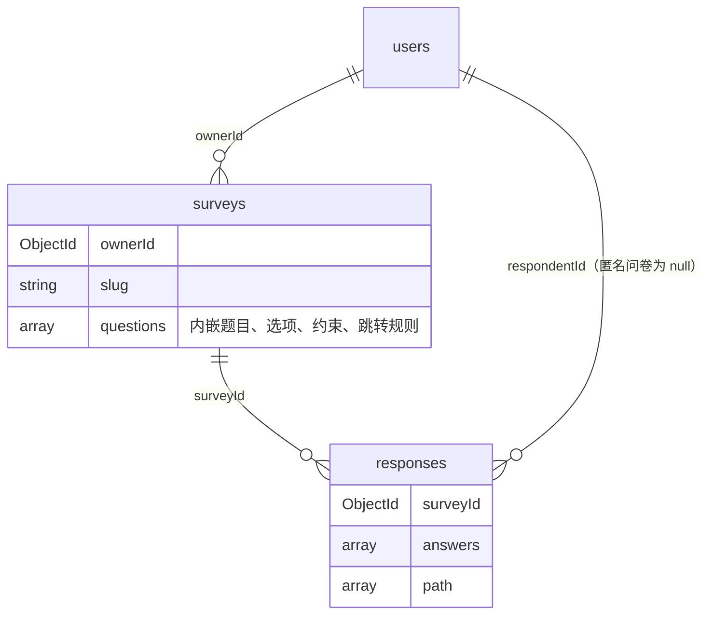

# 数据库设计（第一阶段，schemaVersion = 1）

数据库：MongoDB 9.0.2，库名 `survey_system`（测试库 `survey_system_test`）。

相关文件：

- 集合校验规则：`schema/users.schema.json`、`schema/surveys.schema.json`、`schema/responses.schema.json`
- 建集合、注册校验器、建索引：`backend/app/db.py`（可重复执行：`python -m app.db`，后端启动时也会自动执行）
- 校验规则与索引的测试：`backend/tests/test_schema.py`

## 1. 总体结构

共三个集合，按"谁和谁一起读写、谁会无限增长"来划分：



| 集合 | 存什么 | 文档数量级 | 主要访问方式 |
|------|--------|-----------|-------------|
| users | 账号 | 用户数 | 按用户名登录 |
| surveys | 问卷 + 内嵌的全部题目 | 每个用户若干 | 按 slug 打开问卷、按 ownerId 列出"我的问卷" |
| responses | 每次提交一份答卷 | 无上限 | 按 surveyId 统计 |

## 2. users

```json
{
  "_id": ObjectId("..."),
  "username": "alice",
  "passwordHash": "$2b$12$....",
  "createdAt": ISODate("2026-10-20T12:00:00Z"),
  "schemaVersion": 1
}
```

- `username` 3 至 32 个字符，唯一索引 `uniq_username` 保证不重复（应用层先查一次只是为了给出友好提示，真正兜底的是索引，可防止并发注册同名）。
- 只存 bcrypt 哈希。`additionalProperties: false` 使得误写入 `password` 之类的字段会被数据库直接拒绝。

## 3. surveys（问卷 + 内嵌题目）

```json
{
  "_id": ObjectId("..."),
  "ownerId": ObjectId("<users._id>"),
  "slug": "k3Xp9aQ2",
  "title": "水果偏好调查",
  "description": "大约 1 分钟",
  "allowAnonymous": true,
  "allowMultipleSubmit": false,
  "status": "published",
  "deadline": ISODate("2026-11-01T00:00:00Z"),
  "publishedAt": ISODate("..."),
  "closedAt": null,
  "version": 3,
  "questions": [
    {
      "questionId": "q_7f2c",
      "order": 1,
      "type": "single",
      "title": "你的性别",
      "required": true,
      "options": [
        {"optionId": "o_a", "text": "男"},
        {"optionId": "o_b", "text": "女"},
        {"optionId": "o_c", "text": "其他"}
      ],
      "constraints": {},
      "logic": [
        {"when": {"op": "eq", "value": "o_a"}, "goto": "q_9d01"},
        {"when": {"op": "eq", "value": "o_b"}, "goto": "q_51ee"}
      ],
      "defaultGoto": null
    },
    {
      "questionId": "q_51ee",
      "order": 2,
      "type": "multiple",
      "title": "你喜欢的水果",
      "required": true,
      "options": [
        {"optionId": "o_1", "text": "苹果"}, {"optionId": "o_2", "text": "香蕉"},
        {"optionId": "o_3", "text": "西瓜"}, {"optionId": "o_4", "text": "葡萄"}
      ],
      "constraints": {"minSelect": 2, "maxSelect": 3},
      "logic": [{"when": {"op": "includes", "value": "o_4"}, "goto": "END"}]
    },
    {
      "questionId": "q_9d01",
      "order": 3,
      "type": "number",
      "title": "年龄",
      "required": true,
      "options": [],
      "constraints": {"min": 0, "max": 120, "integerOnly": true},
      "logic": [{"when": {"op": "lt", "value": 18}, "goto": "END"}]
    },
    {
      "questionId": "q_c3a8",
      "order": 4,
      "type": "text",
      "title": "其他建议",
      "required": false,
      "options": [],
      "constraints": {"minLength": 0, "maxLength": 200},
      "logic": []
    }
  ],
  "createdAt": ISODate("..."),
  "updatedAt": ISODate("..."),
  "schemaVersion": 1
}
```

### 3.1 字段说明

| 字段 | 说明 |
|------|------|
| `slug` | 对外链接 `/survey/{slug}` 中的随机串，6 至 32 位字母数字，唯一索引。不直接暴露 `_id`，链接更短，也避免他人按 ObjectId 的时间规律枚举问卷 |
| `status` | `draft`（草稿，可编辑题目）、`published`（可填写）、`closed`（手动关闭） |
| `deadline` | 截止时间，`null` 表示不限。过了截止时间即使状态是 published 也不能提交（应用层判断，不靠定时任务改状态） |
| `version` | 题目结构（增删改题、改跳转）每变更一次加 1，答卷里记录作答时的版本 |
| `questions[].questionId` | 稳定的字符串 ID，生成后不再改变。跳转规则和答卷都引用它，所以调整题目顺序不会让规则或历史答卷错位 |
| `questions[].order` | 显示顺序，也是"没有命中跳转规则时进入下一题"的依据 |
| `questions[].options[].optionId` | 选项的稳定 ID。答卷存 optionId 而不是选项文字，修改选项文字不会影响统计 |
| `questions[].constraints` | 按题型取用：单选无；多选 `minSelect / maxSelect / exactSelect`；文本 `minLength / maxLength`；数字 `min / max / integerOnly` |
| `questions[].logic` | 跳转规则数组，见 3.2 |
| `questions[].defaultGoto` | 所有规则都没命中时的去向，`null` 或缺省表示按 `order` 进入下一题 |

### 3.2 跳转规则的数据结构

跳转规则完全存储在问卷文档中，程序里只有一个通用的规则解释器（`logic_engine`），不写死任何具体跳转。

```json
{"when": {"op": "<运算符>", "value": <比较值>}, "goto": "<questionId 或 END>"}
```

- 同一题的多条规则按数组顺序匹配，命中第一条即跳转。
- 没有任何规则命中时走 `defaultGoto`，再没有就按 `order` 进入下一题，最后一题之后结束。
- 题目没有作答（选填题被跳过）时，不匹配任何规则。

各题型可用的运算符：

| 题型 | 运算符 | value | 含义 |
|------|--------|-------|------|
| single | `eq` / `ne` | optionId | 选了 / 没选某个选项 |
| single | `in` | optionId 数组 | 选中的是其中之一 |
| multiple | `includes` | optionId | 选择中包含某项 |
| multiple | `includesAny` | optionId 数组 | 包含其中任意一项 |
| multiple | `includesAll` | optionId 数组 | 包含其中全部 |
| multiple | `equalsSet` | optionId 数组 | 恰好选了这些（与顺序无关） |
| number | `eq` `ne` `gt` `gte` `lt` `lte` | 数字 | 数值比较 |
| number | `between` | `[下限, 上限]` | 闭区间 |

**只允许向后跳**：`goto` 必须指向 `order` 更大的题目或 `END`。这样所有可能的作答路径构成一个有向无环图，从结构上杜绝死循环，比运行时再检测环更简单、更容易向用户解释。保存跳转规则时应用层会检查：目标题存在、目标在当前题之后、运算符适用于该题型、value 的类型正确（例如 optionId 必须属于本题）。

### 3.3 为什么题目内嵌在问卷里

- **总是一起读写**：打开问卷、填写、提交校验、统计都需要整套题目，内嵌后一次查询拿全，不需要额外查询或 `$lookup`。
- **原子性**：修改题目和跳转规则只改一个文档，MongoDB 对单文档的写入是原子的，不会出现"题目删了但指向它的跳转规则还在"这种中间状态。
- **题型差异大**：四种题型的约束字段各不相同，文档模型允许每道题只带自己需要的字段，不必像关系表那样留一堆空列。
- **体量可控**：一份问卷一般几十道题，远小于 16MB 的文档上限。

## 4. responses（答卷）

```json
{
  "_id": ObjectId("..."),
  "surveyId": ObjectId("<surveys._id>"),
  "surveyVersion": 3,
  "respondentId": null,
  "submitterKey": "5b1f...e9 (HMAC)",
  "singleSubmission": true,
  "submittedAt": ISODate("..."),
  "answers": [
    {"questionId": "q_7f2c", "type": "single",   "value": "o_b"},
    {"questionId": "q_51ee", "type": "multiple", "value": ["o_1", "o_3"]},
    {"questionId": "q_9d01", "type": "number",   "value": 25},
    {"questionId": "q_c3a8", "type": "text",     "value": "希望多点水果"}
  ],
  "path": ["q_7f2c", "q_51ee", "q_9d01", "q_c3a8"],
  "schemaVersion": 1
}
```

| 字段 | 说明 |
|------|------|
| `answers[].value` | 单选存 optionId；多选存 optionId 数组；文本存字符串；数字存数值类型（不存字符串，统计时可直接 `$avg`） |
| `answers[].type` | 冗余了题型，见第 6 节 |
| `path` | 服务端按跳转规则重放得出的实际经过的题目序列，便于审计和第二阶段做路径分析 |
| `respondentId` | 实名问卷记录填写者；匿名问卷为 `null` |
| `submitterKey` | 实名时为用户 ID 字符串；匿名时为 `HMAC(服务器密钥, 用户ID + 问卷ID)`，同一个人对同一问卷总是得到同一个值，可用来限制重复提交，但无法反推出是谁 |
| `singleSubmission` | 提交时问卷是否限制每人一次 |

### 4.1 为什么答卷单独成集合

- 答卷数量没有上限，若内嵌在问卷文档中会不断膨胀，最终超过 16MB 上限；问卷文档每次读取也会被迫带上所有答卷。
- 多人同时填写时，每次提交是一次独立的 `insert`，互不竞争同一个文档；若内嵌，则所有人都在 `$push` 同一个问卷文档，产生写冲突。
- 统计用聚合管道按 `surveyId` 过滤后 `$unwind answers` 再 `$group`，单独集合配合索引最合适。

### 4.2 匿名与"每人只能填一次"

需求要求填写者必须先登录，所以"匿名"在本系统中的含义是：**问卷创建者看不到是谁填的，数据库里也不保存填写者身份**。

"不允许多次提交"由唯一部分索引在数据库层兜底：

```js
db.responses.createIndex(
  { surveyId: 1, submitterKey: 1 },
  { unique: true, partialFilterExpression: { singleSubmission: true }, name: "uniq_single_submission" }
)
```

- 只有 `singleSubmission: true` 的答卷参与唯一约束，允许多次提交的问卷不受影响。
- 应用层"先查是否提交过"只能给出友好提示，两次请求同时到达时两次检查都可能通过；唯一索引保证即使并发也只有一份能写入成功。
- 匿名问卷用 HMAC 生成的 `submitterKey`，所以匿名和去重可以同时成立。

## 5. 索引

| 集合 | 索引 | 用途 |
|------|------|------|
| users | `{username: 1}` 唯一 | 登录查询、防止重名 |
| surveys | `{slug: 1}` 唯一 | 通过链接打开问卷 |
| surveys | `{ownerId: 1, createdAt: -1}` | "我的问卷"列表，按创建时间倒序，覆盖过滤和排序 |
| responses | `{surveyId: 1, submittedAt: -1}` | 统计时按问卷过滤、按时间查看答卷 |
| responses | `{surveyId: 1, submitterKey: 1}` 唯一，部分索引 `singleSubmission: true` | 每人限填一次 |
| responses | `{respondentId: 1}` 稀疏 | 查询某个用户填过的问卷（为后续需求预留，匿名答卷不进索引） |

## 6. 冗余设计的取舍

| 冗余字段 | 是否冗余 | 理由 |
|---------|---------|------|
| `responses.answers[].type` | 冗余 | 统计时可以直接按题型分支，不用再关联问卷；题型在发布后不允许修改，不存在不一致的风险 |
| `responses.singleSubmission` | 冗余 | 部分索引只能根据本文档的字段过滤，必须把问卷设置复制到答卷里 |
| `responses.surveyVersion` | 冗余 | 记录作答时的问卷版本，第二阶段如果允许发布后修改题目，可以据此区分新旧答卷 |
| 题目标题、选项文字 | 不冗余 | 统计时以问卷当前内容为准，修改选项错别字可以立即反映到统计中；发布后不允许删除题目和选项，所以 ID 总能找到对应内容 |
| 创建者用户名 | 不冗余 | 用户名可能修改，且列表展示用不到 |

## 7. 数据校验的分工

| 层次 | 负责什么 | 例子 |
|------|---------|------|
| 数据库 `$jsonSchema` | 结构与类型的底线：必填字段、字段类型、枚举值、禁止未知字段、字符串长度 | `status` 只能是三个值之一；`type` 只能是四种题型；`constraints` 中不能出现未定义的键；`respondentId` 必须是 ObjectId 或 null |
| 数据库唯一索引 | 并发下的唯一性 | 用户名、slug、每人一份答卷 |
| 应用层（Pydantic + validator） | 跨字段、跨文档的业务规则 | 多选题 `minSelect <= maxSelect`；跳转目标必须存在并在当前题之后；答卷中的 optionId 必须属于该题；数字是否在范围内、是否整数；必答题是否作答 |

这样分工的原因：`$jsonSchema` 无法表达"跳转目标必须是本问卷中另一道题"这类跨字段约束，但它能保证任何途径写入的数据（包括手工用 mongosh 修改、以后新增的脚本）都不会破坏基本结构，是最后一道防线。

## 8. 为什么用 MongoDB 而不是关系型结构

如果用关系型数据库实现同样的功能，至少需要以下表：

`users`、`surveys`、`questions`、`options`、`question_constraints`（或在 questions 表留大量可空列）、`logic_rules`、`responses`、`answers`、`answer_options`（多选的多值）。

问题在于：

1. **题型异构**：不同题型的约束不同，关系表要么留大量可空列，要么用 EAV（键值对）表，两者查询和校验都很别扭。
2. **读取一份问卷要 JOIN 五六张表**，而这是系统最频繁的操作（每个填写者打开一次）。MongoDB 中是一次按 slug 的查询。
3. **答案的值类型不统一**：单选是一个 ID，多选是多个 ID，填空是文本或数字。关系型通常需要把答案拆成多行或存成字符串，统计数字平均值还要转换类型；MongoDB 可以按原类型存储数组、字符串和数值。
4. **需求会变化**：第二阶段很可能新增题型或字段。文档模型新增字段不需要迁移已有数据（旧文档没有该字段时按默认值处理），配合 `schemaVersion` 可以渐进迁移。

MongoDB 的不足以及我们的应对：

| 不足 | 应对 |
|------|------|
| 没有外键约束 | 引用关系（ownerId、surveyId、questionId）由应用层检查；题目发布后不允许删除，避免答卷引用悬空 |
| 灵活结构容易写入脏数据 | 用 `$jsonSchema` + `validationLevel: strict` 强制结构 |
| 跨文档事务开销大 | 设计上让每个业务操作只写一个文档（改题目只写 surveys，提交只写 responses），不需要事务 |

## 9. 为第二阶段预留的扩展点

- 所有文档带 `schemaVersion`，数据结构变更时可以写迁移脚本按版本升级，或在读取时兼容旧版本。
- 题目、选项都用稳定 ID，调整顺序、改文字都不会破坏跳转规则和历史答卷。
- 答卷记录 `surveyVersion` 和 `path`，以后若要支持发布后修改问卷、按版本统计或路径分析，数据已经具备。
- 校验规则放在 `schema/*.json` 文件里并由 `init_db` 通过 `collMod` 更新，修改结构时只需改 JSON 文件并重启（或执行 `python -m app.db`）。
