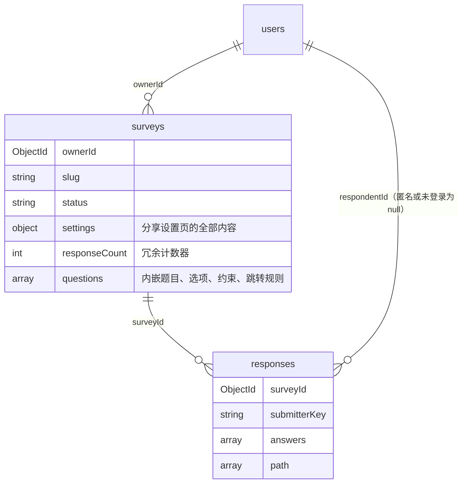
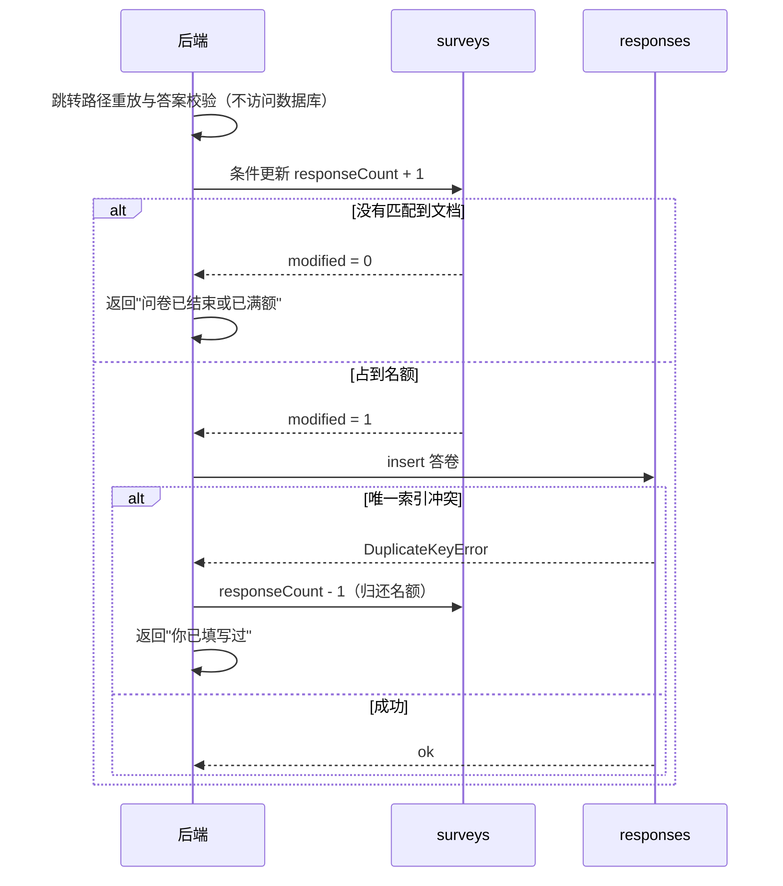

# 数据库设计（第一阶段，schemaVersion = 1）

数据库：MongoDB 9.0.2（单机部署），库名 `survey_system`（测试库 `survey_system_test`）。

相关文件：

- 页面与访问模式：`docs/需求分析与界面设计.md`（本文中的 P1 至 P18 均指该文档中的编号）
- 集合校验规则：`schema/users.schema.json`、`schema/surveys.schema.json`、`schema/responses.schema.json`
- 建集合、注册校验器、同步索引：`backend/app/db.py`（可重复执行：`python -m app.db`，后端启动时也会自动执行）
- 校验规则、索引与并发控制的测试：`backend/tests/test_schema.py`

## 1. 设计方法

MongoDB 的建模原则是"按应用如何读写数据来组织数据"，而不是像关系型数据库那样先做范式化。因此设计按以下顺序进行：


从访问模式中得出的三个关键结论：

1. **问卷和题目总是一起读写**（P7 至 P9、P12、P14 都需要整套题目），所以题目内嵌在问卷文档中。
2. **答卷数量无上限、只追加、按问卷聚合**（P15 至 P18），所以答卷单独成集合。
3. **列表页要显示答卷数，提交时要检查上限**（P3、P15），所以在问卷上维护一个冗余计数器，用原子更新保证并发正确。

## 2. 总体结构



| 集合 | 存什么 | 文档数量级 | 服务的访问模式 |
|------|--------|-----------|---------------|
| users | 账号 | 用户数 | P1、P2、P18（导出时查用户名） |
| surveys | 问卷、设置、内嵌的全部题目 | 每个用户若干 | P3 至 P12、P14、P15（占名额） |
| responses | 每次提交一份答卷 | 无上限 | P13、P15 至 P18 |

## 3. users

```json
{
  "_id": ObjectId("..."),
  "username": "alice",
  "passwordHash": "$2b$12$....",
  "createdAt": ISODate("2026-10-20T12:00:00Z"),
  "schemaVersion": 1
}
```

- `username` 3 至 32 个字符，唯一索引保证不重复。应用层先查一次只是为了给出友好提示，真正兜底的是索引，可防止并发注册同名（P1）。
- 只存 bcrypt 哈希。`additionalProperties: false` 使得误写入 `password` 之类的字段会被数据库直接拒绝。

## 4. surveys（问卷 + 设置 + 内嵌题目）

```json
{
  "_id": ObjectId("..."),
  "ownerId": ObjectId("<users._id>"),
  "slug": "k3Xp9aQ2",
  "title": "水果偏好调查",
  "description": "大约 1 分钟",
  "status": "published",
  "settings": {
    "requireLogin": true,
    "allowAnonymous": true,
    "allowMultipleSubmit": false,
    "deadline": ISODate("2026-11-01T00:00:00Z"),
    "maxResponses": 200,
    "completion": {"message": "感谢参与！", "redirectUrl": "https://example.com"}
  },
  "publishedAt": ISODate("..."),
  "closedAt": null,
  "version": 3,
  "responseCount": 57,
  "questions": [
    {
      "questionId": "q_7f2c",
      "order": 1,
      "type": "single",
      "title": "你的性别",
      "required": true,
      "hidden": false,
      "options": [
        {"optionId": "o_a", "text": "男", "hidden": false},
        {"optionId": "o_b", "text": "女", "hidden": false},
        {"optionId": "o_c", "text": "其他", "hidden": false}
      ],
      "constraints": {},
      "logic": [
        {"when": {"op": "eq", "value": "o_a"}, "goto": "q_9d01"},
        {"when": {"op": "eq", "value": "o_b"}, "goto": "q_51ee"}
      ],
      "defaultGoto": null
    },
    {
      "questionId": "q_51ee",
      "order": 2,
      "type": "multiple",
      "title": "你喜欢的水果",
      "required": true,
      "hidden": false,
      "options": [
        {"optionId": "o_1", "text": "苹果", "hidden": false},
        {"optionId": "o_2", "text": "香蕉", "hidden": false},
        {"optionId": "o_3", "text": "西瓜", "hidden": false},
        {"optionId": "o_4", "text": "葡萄", "hidden": false}
      ],
      "constraints": {"minSelect": 2, "maxSelect": 3},
      "logic": [{"when": {"op": "includes", "value": "o_4"}, "goto": "END"}]
    },
    {
      "questionId": "q_9d01",
      "order": 3,
      "type": "number",
      "title": "年龄",
      "required": true,
      "hidden": false,
      "options": [],
      "constraints": {"min": 0, "max": 120, "integerOnly": true},
      "logic": [{"when": {"op": "lt", "value": 18}, "goto": "END"}]
    },
    {
      "questionId": "q_c3a8",
      "order": 4,
      "type": "text",
      "title": "其他建议",
      "required": false,
      "hidden": false,
      "options": [],
      "constraints": {"minLength": 0, "maxLength": 200},
      "logic": []
    }
  ],
  "createdAt": ISODate("..."),
  "updatedAt": ISODate("..."),
  "deletedAt": null,
  "schemaVersion": 1
}
```

### 4.1 字段说明

| 字段 | 说明 | 来自哪个页面需求 |
|------|------|-----------------|
| `slug` | 对外链接 `/survey/{slug}` 中的随机串，唯一索引。不暴露 `_id`，链接更短，也避免他人按 ObjectId 的时间规律枚举问卷 | 分享设置、填写入口 |
| `status` | `draft` / `published` / `closed`，只存创作者主动触发的状态 | 管理页的发布、关闭、重新开放 |
| `settings` | 分享设置页的全部设置项，作为一个子文档整体读写 | 分享设置页（P10、P11） |
| `settings.requireLogin` | 填写前是否必须登录，第一阶段默认 `true`（需求原文要求） | 流程图中的"需要登录?"判断 |
| `settings.allowAnonymous` | `true` 时答卷不保存填写者身份 | 分享设置 |
| `settings.allowMultipleSubmit` | 为 `false` 时 `requireLogin` 必须为 `true`（应用层检查） | 流程图中的"你已填写过" |
| `settings.deadline` | 截止时间，`null` 表示不限。过期不改 `status`，入口处实时判断 | 流程图中的"已截止" |
| `settings.maxResponses` | 答卷数上限，`null` 表示不限 | 流程图中的"已达上限" |
| `settings.completion` | 提交成功提示语、结束后跳转的外部链接（`$jsonSchema` 用正则限制只能是 http/https，防止 `javascript:` 链接） | 提交成功页、结束页 |
| `version` | 题目结构每变更一次加 1，答卷里记录作答时的版本 | 编辑页（已发布时仍可编辑） |
| `responseCount` | 冗余的答卷计数器，见第 6、8 节 | 列表页、管理页、上限控制 |
| `questions[].questionId` | 稳定的字符串 ID，生成后不再改变。跳转规则和答卷都引用它，调整题目顺序不会让规则或历史答卷错位 | 编辑页的上移下移 |
| `questions[].order` | 显示顺序，也是"没有命中跳转规则时进入下一题"的依据 | 填写页 |
| `questions[].hidden`、`options[].hidden` | 已发布问卷中"删除"题目或选项时改为隐藏：填写页不再显示，统计页保留历史数据 | 编辑页（已发布）、统计页 |
| `questions[].constraints` | 按题型取用：多选 `minSelect / maxSelect / exactSelect`；文本 `minLength / maxLength`；数字 `min / max / integerOnly` | 编辑页的题目卡片 |
| `questions[].logic`、`defaultGoto` | 跳转规则，见 4.2 | 编辑页的跳转规则区 |
| `deletedAt` | 软删除时间。非 `null` 时链接返回 404、列表不显示，但答卷保留 | 管理页的删除、流程图中的"已删除" |

### 4.2 跳转规则的数据结构

跳转规则完全存储在问卷文档中，程序里只有一个通用的规则解释器（`logic_engine`），不写死任何具体跳转。编辑页的每一行"如果答案 [条件] [值] 则跳到 [目标]"对应数组中的一个元素：

```json
{"when": {"op": "<运算符>", "value": <比较值>}, "goto": "<questionId 或 END>"}
```

- 同一题的多条规则按数组顺序匹配，命中第一条即跳转。
- 没有任何规则命中时走 `defaultGoto`（编辑页的"否则跳到"），再没有就按 `order` 进入下一道未隐藏的题，最后一题之后结束。
- 题目没有作答（选填题被跳过）时，不匹配任何规则。
- 跳转目标是已隐藏的题目时，顺延到它之后的第一道未隐藏的题；引用已隐藏选项的规则永远不会命中。

各题型可用的运算符：

| 题型 | 运算符 | value | 编辑页显示为 |
|------|--------|-------|-------------|
| single | `eq` / `ne` | optionId | 选了 / 没选 |
| single | `in` | optionId 数组 | 选了其中之一 |
| multiple | `includes` | optionId | 包含 |
| multiple | `includesAny` | optionId 数组 | 包含任一 |
| multiple | `includesAll` | optionId 数组 | 包含全部 |
| multiple | `equalsSet` | optionId 数组 | 恰好是（与顺序无关） |
| number | `eq` `ne` `gt` `gte` `lt` `lte` | 数字 | 等于 / 不等于 / 大于 / 大于等于 / 小于 / 小于等于 |
| number | `between` | `[下限, 上限]` | 介于（闭区间） |

**只允许向后跳**：`goto` 必须指向 `order` 更大的题目或 `END`。这样所有可能的作答路径构成一个有向无环图，从结构上杜绝死循环。编辑页的目标下拉框也只列出后面的题，界面和数据规则一致。保存时应用层检查：目标题存在、目标在当前题之后、运算符适用于该题型、value 的类型正确（例如 optionId 必须属于本题）。调整题目顺序后若有规则变成向前跳，保存会被拒绝并提示是哪条规则。

### 4.3 为什么题目内嵌在问卷里

- **访问模式决定**：编辑页（P7、P8）、预览页（P9）、填写页（P12、P14）都需要整套题目。内嵌后一次查询拿全，保存也只更新一个文档。若题目单独成集合，每次打开都要多一次查询或 `$lookup`。
- **原子性**：修改题目和跳转规则只改一个文档，MongoDB 对单文档的写入是原子的，不会出现"题目删了但指向它的跳转规则还在"这种中间状态。
- **题型差异大**：四种题型的约束字段各不相同，文档模型允许每道题只带自己需要的字段。
- **体量可控**：一份问卷一般几十道题，远小于 16MB 的文档上限。

### 4.4 为什么设置项放在 `settings` 子文档

分享设置页一次编辑、一次保存全部设置项（P10、P11）。放在一个子文档里，读取时用投影 `{settings: 1}` 只取这一块，保存时一次 `$set: {settings: ...}`，页面结构和数据结构一一对应。第二阶段新增设置项也只需要扩展这个子文档。

## 5. responses（答卷）

```json
{
  "_id": ObjectId("..."),
  "surveyId": ObjectId("<surveys._id>"),
  "surveyVersion": 3,
  "respondentId": null,
  "submitterKey": "a:5b1f...e9",
  "singleSubmission": true,
  "submittedAt": ISODate("..."),
  "answers": [
    {"questionId": "q_7f2c", "type": "single",   "value": "o_b"},
    {"questionId": "q_51ee", "type": "multiple", "value": ["o_1", "o_3"]},
    {"questionId": "q_9d01", "type": "number",   "value": 25},
    {"questionId": "q_c3a8", "type": "text",     "value": "希望多点水果"}
  ],
  "path": ["q_7f2c", "q_51ee", "q_9d01", "q_c3a8"],
  "schemaVersion": 1
}
```

| 字段 | 说明 |
|------|------|
| `answers[].value` | 单选存 optionId；多选存 optionId 数组；文本存字符串；数字存数值类型（不存字符串，统计时可直接 `$avg`） |
| `answers[].type` | 冗余了题型，见第 8 节 |
| `path` | 服务端按跳转规则重放得出的实际经过的题目序列，便于审计和第二阶段做路径分析 |
| `surveyVersion` | 作答时问卷的 `version`。已发布后修改约束或规则时，可以区分新旧答卷 |
| `respondentId` | 登录且实名时为用户 ID；匿名问卷或未登录填写为 `null` |
| `submitterKey` | 用于识别"同一个填写者"，按三种情况生成，见下表 |
| `singleSubmission` | 提交时问卷是否限制每人一次，决定是否受唯一部分索引约束 |

| 情况 | `respondentId` | `submitterKey` | 能否限制每人一次 |
|------|---------------|----------------|-----------------|
| 登录、实名 | 用户 ID | `u:<用户ID>` | 能 |
| 登录、匿名 | `null` | `a:<HMAC(服务器密钥, 用户ID + 问卷ID)>` | 能，而且数据库里查不出是谁 |
| 未登录（`requireLogin = false`，为后续预留） | `null` | `g:<随机 UUID>` | 不能，所以这种情况必须允许多次填写 |

HMAC 的特点是：同一个人对同一份问卷总是得到同一个值，所以可以去重；没有服务器密钥就无法从这个值反推出用户 ID，所以匿名成立。

### 5.1 为什么答卷单独成集合

- 答卷数量没有上限，若内嵌在问卷文档中会不断膨胀，最终超过 16MB 上限；而且编辑页、填写页每次读取问卷都会被迫带上所有答卷。
- 多人同时填写时，每次提交是一次独立的 `insert`，互不竞争同一个文档。
- 统计（P16、P17）和导出（P18）都是"按问卷过滤后遍历全部答卷"，单独集合配合 `{surveyId, submittedAt}` 索引最合适。

## 6. 并发控制：答卷上限与每人一次

提交（P15）需要同时满足三件事：问卷仍可填写、没有超过答卷上限、不允许多次时此人没填过。多人同时提交时，"先查再写"会出现两个请求都检查通过、然后都写入的情况。处理方式：



第一步的条件更新：

```js
db.surveys.updateOne(
  {
    _id: surveyId,
    status: "published",
    deletedAt: null,
    $and: [
      { $or: [ { "settings.deadline": null }, { "settings.deadline": { $gt: now } } ] },
      { $or: [ { "settings.maxResponses": null },
               { $expr: { $lt: ["$responseCount", "$settings.maxResponses"] } } ] }
    ]
  },
  { $inc: { responseCount: 1 } }
)
```

- MongoDB 对单个文档的"检查条件并修改"是原子的，所以无论多少请求同时到达，计数器都不会超过上限。测试 `test_max_responses_quota_under_concurrency` 用 20 个线程同时抢 5 个名额，结果恰好 5 个成功。
- "每人一次"由唯一部分索引兜底：

```js
db.responses.createIndex(
  { surveyId: 1, submitterKey: 1 },
  { unique: true, partialFilterExpression: { singleSubmission: true }, name: "uniq_single_submission" }
)
```

只有 `singleSubmission: true` 的答卷参与唯一约束，允许多次提交的问卷不受影响。

**为什么不用事务**：本地 MongoDB 是单机部署，多文档事务需要副本集。上面的方案只用单文档原子操作，不依赖事务。代价是：若占到名额后、插入答卷前进程崩溃，计数器会比实际多 1。这只会让上限略微偏保守，不会超额；统计页始终以 responses 中的实际数量为准；管理页提供"重新校准"操作，用 `countDocuments({surveyId})` 修正计数器。

## 7. 索引

每个索引都对应具体的访问模式，没有访问模式支撑的索引不建（索引会拖慢写入）。

| 集合 | 索引 | 服务的访问模式 | 说明 |
|------|------|---------------|------|
| users | `{username: 1}` 唯一 | P1、P2 | 登录查询、防止重名 |
| surveys | `{slug: 1}` 唯一 | P12、P14 | 通过链接打开问卷，填写者访问量最大的查询 |
| surveys | `{ownerId: 1, deletedAt: 1, createdAt: -1}` | P3 | 见下方说明 |
| responses | `{surveyId: 1, submittedAt: -1}` | P16、P17、P18 | 统计和导出按问卷过滤，导出按提交时间排序 |
| responses | `{surveyId: 1, submitterKey: 1}` 唯一，部分索引 | P13、P15 | 检查是否填过；每人限填一次 |
| responses | `{respondentId: 1}` 稀疏 | 预留 | 第二阶段若需要"我填过的问卷"，匿名答卷不进入索引 |

`{ownerId, deletedAt, createdAt}` 的字段顺序遵循 MongoDB 的 ESR 原则（先等值条件、再排序字段、最后范围条件）：列表查询是 `ownerId` 等值、`deletedAt: null` 等值、按 `createdAt` 倒序排序。按这个顺序建索引，MongoDB 可以直接按索引顺序返回结果，不需要在内存中排序。测试 `test_owner_list_uses_index_without_sort` 用 `explain()` 验证了查询计划使用了该索引并且没有 `SORT` 阶段。

`init_db` 以代码中的 `INDEXES` 为唯一来源：未声明的旧索引会被删除，新声明的会被创建。本次修订把旧的 `{ownerId, createdAt}` 换成了上述三字段索引，重新执行 `init_db` 即自动完成。

## 8. 冗余设计的取舍

| 冗余字段 | 是否冗余 | 理由 | 一致性如何保证 |
|---------|---------|------|---------------|
| `surveys.responseCount` | 冗余 | 列表页要显示每份问卷的答卷数（P3），若每次都去 responses 统计，列表有 N 份问卷就要做 N 次计数；上限控制也需要一个能原子比较和修改的值 | 与插入答卷配对更新，失败时归还；统计页不依赖它；可用 `countDocuments` 重新校准 |
| `responses.answers[].type` | 冗余 | 统计时可以直接按题型分支，不用再关联问卷 | 题型发布后不允许修改，不会不一致 |
| `responses.singleSubmission` | 冗余 | 部分索引只能根据本文档的字段过滤，必须把问卷设置复制到答卷里 | 写入时从问卷设置复制，之后不再修改 |
| `responses.surveyVersion` | 冗余 | 区分问卷修改前后的答卷 | 写入时复制，之后不再修改 |
| 题目标题、选项文字 | 不冗余 | 统计和导出以问卷当前内容为准，修改错别字立即生效；题目和选项只隐藏不删除，ID 总能找到对应内容 | 不需要 |
| 创建者用户名 | 不冗余 | 列表和统计都用不到 | 不需要 |

## 9. 软删除

删除问卷只写入 `deletedAt`，不真正删除文档：

- 答卷引用着问卷的题目和选项 ID，硬删除问卷后这些答卷将无法解读。
- 链接访问已删除的问卷返回 404（P12 检查 `deletedAt`），列表通过 `deletedAt: null` 条件过滤（且该条件已包含在列表索引中）。
- `slug` 保持占用，避免旧链接将来指向别人的新问卷。

## 10. 数据校验的分工

| 层次 | 负责什么 | 例子 |
|------|---------|------|
| 数据库 `$jsonSchema` | 结构与类型的底线：必填字段、字段类型、枚举值、禁止未知字段、字符串长度与格式 | `status` 只能是三个值之一；题型只能是四种；`constraints` 中不能出现未定义的键；`maxResponses` 至少为 1；`redirectUrl` 必须以 http/https 开头 |
| 数据库唯一索引与原子更新 | 并发下的正确性 | 用户名、slug 唯一；每人一份答卷；答卷数不超过上限 |
| 应用层（Pydantic + 校验服务） | 跨字段、跨文档的业务规则 | 多选题 `minSelect <= maxSelect`；跳转目标存在且在当前题之后；答卷中的 optionId 属于该题且未隐藏；数字范围与整数；必答题已作答；`allowMultipleSubmit = false` 时必须 `requireLogin = true` |

`$jsonSchema` 无法表达"跳转目标必须是本问卷中另一道题"这类跨字段约束，但它能保证任何途径写入的数据（包括手工用 mongosh 修改、以后新增的脚本）都不会破坏基本结构，是最后一道防线。

## 11. 为什么用 MongoDB 而不是关系型结构

如果用关系型数据库实现同样的页面，至少需要以下表：`users`、`surveys`、`survey_settings`、`questions`、`options`、`question_constraints`（或在 questions 表留大量可空列）、`logic_rules`、`responses`、`answers`、`answer_options`（多选的多值）。

对照访问模式比较：

| 访问模式 | 关系型 | MongoDB（本设计） |
|---------|--------|------------------|
| 打开编辑页 / 填写页（P7、P12） | JOIN questions、options、constraints、logic_rules 四五张表，再在程序里拼装成树 | 按 `_id` 或 `slug` 查一个文档，结构与页面一致 |
| 保存编辑页（P8） | 多张表的增删改，需要事务保证一致 | 更新一个文档，单文档原子 |
| 题型异构 | 约束表要么留大量可空列，要么用 EAV 键值对表 | 每道题只带自己的约束字段，`$jsonSchema` 限定允许的键 |
| 提交答卷（P15） | answers 表按题插入多行，多选再拆到 answer_options | 插入一个文档，多选直接存数组 |
| 统计（P16） | GROUP BY + JOIN | 聚合管道 `$match`、`$unwind`、`$group` |
| 需求变化（第二阶段） | 改表结构，通常需要迁移全部数据 | 新增字段时旧文档可按默认值处理，配合 `schemaVersion` 渐进迁移 |

MongoDB 的不足以及应对：

| 不足 | 应对 |
|------|------|
| 没有外键约束 | 引用关系由应用层检查；题目和选项只隐藏不删除，问卷只软删除，避免答卷引用悬空 |
| 灵活结构容易写入脏数据 | `$jsonSchema` + `validationLevel: strict` 强制结构 |
| 单机部署无多文档事务 | 设计上让每个业务操作只依赖单文档原子性（第 6 节） |

## 12. 为第二阶段预留的扩展点

- 所有文档带 `schemaVersion`，数据结构变更时可以写迁移脚本按版本升级，或在读取时兼容旧版本。
- 题目、选项都用稳定 ID，并且只隐藏不删除，调整顺序、改文字、删除都不会破坏跳转规则和历史答卷。
- 答卷记录 `surveyVersion` 和 `path`，支持按版本统计或路径分析。
- `settings.requireLogin` 和 `submitterKey` 的三种形式已为"免登录填写"预留。
- 校验规则放在 `schema/*.json` 中，索引在 `INDEXES` 中声明，由 `init_db` 统一同步；修改结构时改声明并重新执行即可。
