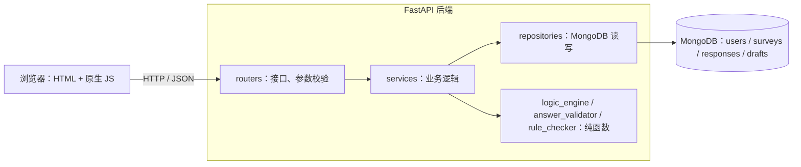

# 系统说明

## 1. 系统概述

一个简化版的在线问卷系统，功能类似问卷星或 Google Forms。注册用户创建问卷并设置题目和跳转规则，发布后得到形如 `/survey/k3Xp9aQ2` 的链接；填写者打开链接后按跳转规则一屏一题作答；创作者查看统计结果、导出 CSV。

## 2. 功能清单

### 2.1 作业需求要求的功能

| 需求 | 实现 |
|------|------|
| 注册、登录 | 用户名 + 密码注册；密码以 bcrypt 哈希存储；登录后获得 JWT 凭证 |
| 用户至少有用户名、密码、注册时间 | `users` 集合的 `username`、`passwordHash`、`createdAt` |
| 只能看到自己创建的问卷 | 所有创作者接口都以 `ownerId` 为条件；访问他人问卷返回 404 |
| 创建问卷：标题、说明、是否匿名 | 编辑页设置标题、说明；分享设置页设置匿名 |
| 发布、设置截止时间、关闭 | 管理页和分享设置页；截止时间实时判断 |
| 每个问卷有可访问的链接 | 8 位随机 slug，链接 `/survey/{slug}` |
| 填写前需要登录 | 默认开启；未登录时引导登录并在登录后回到问卷 |
| 单选题：选项、是否必答 | 支持 |
| 多选题：至少 / 最多 / 必须选 N 项 | `minSelect`、`maxSelect`、`exactSelect` |
| 填空题：文本字数、数字范围、是否整数 | `minLength`、`maxLength`；`min`、`max`、`integerOnly` |
| 跳转：按单选、多选、数字结果跳转，规则可在问卷中设置 | 规则存储在问卷文档中，编辑页可视化设置；单选 3 种、多选 4 种、数字 7 种条件 |
| 按顺序回答、按规则跳转、不合法时提示 | 一屏一题；每点"下一题"由后端校验并计算下一题 |
| 每次填写都保存 | 每次提交插入一份答卷 |
| 多人同时填写、匿名填写、允许多次填写 | 原子操作控制答卷上限；匿名答卷不存身份；"每人一次"由唯一部分索引保证 |
| 统计：单选人数与总人数、多选次数、填空内容、数字平均值 | 一条聚合管道算出全部统计；支持整卷和单题 |

### 2.2 在需求基础上扩展的功能

| 功能 | 说明 |
|------|------|
| 答卷数上限 | 达到上限后链接显示"问卷已收满"，多人同时提交也不会超额 |
| 提交后提示语与外部跳转链接 | 分享设置页配置 |
| 预览 | 创作者在发布前按跳转规则走一遍，不保存答卷 |
| 发布后仍可编辑 | 删除题目或选项改为隐藏，统计保留历史数据；题型不可再改；结构变更时版本号加 1 |
| 编辑冲突检测 | 两个窗口同时编辑时，后保存的一方会收到提示，不会悄悄覆盖 |
| 软删除 | 删除问卷后链接失效，答卷保留 |
| CSV 导出 | 选项 ID 转为文字；防 Excel 公式注入 |
| 断点续填 | 登录用户每答一题自动保存进度，下次打开从上次那题继续；30 天未访问自动清除 |
| 我参与的问卷 | 首页列出填写中和已提交（实名）的问卷，可继续填写或查看自己的答卷 |
| 免登录填写（开关） | 为第二阶段预留；关闭登录要求时必须允许重复填写 |

## 3. 角色

| 角色 | 能做什么 |
|------|---------|
| 创作者 | 创建、编辑、预览、发布、关闭、删除自己的问卷；查看统计、导出数据 |
| 填写者 | 通过链接填写问卷；在"我参与的问卷"中继续填写或查看自己提交过的实名答卷 |

同一个账号既可以是创作者也可以是填写者。

## 4. 页面

页面流程和每个页面的详细内容见 [需求分析与界面设计](需求分析与界面设计.md)。

| 页面 | 路径 | 说明 |
|------|------|------|
| 登录 / 注册 | `/login` | 带 `redirect` 参数时登录后回到原页面（只允许站内路径） |
| 我的问卷 | `/` | "我创建的"与"我参与的"两栏；`/#joined` 直接打开"我参与的" |
| 问卷管理页 | `/surveys/{id}` | 链接、答卷数、填写规则；编辑、预览、发布、关闭、统计、删除 |
| 编辑页 | `/surveys/{id}/edit` | 题目卡片与跳转规则区 |
| 预览页 | `/surveys/{id}/preview` | 与填写页外观相同，不保存 |
| 发布 / 分享设置 | `/surveys/{id}/share` | 谁可以填写、何时停止收集、提交之后 |
| 统计页 | `/surveys/{id}/stats` | 整卷 / 单题统计、导出 CSV |
| 填写页 | `/survey/{slug}` | 404、已结束、需登录、已填写过、填写中、提交成功等状态 |
| 我的答卷 | `/me/responses/{id}` | 只读的答卷 |

界面以"答题卡"为视觉语言：印刷红的框线与题号、`[A]` 括号选项、选中时铅笔涂黑；填写页左侧的定位标记显示进度，被跳转跳过的题以斜线标出。

## 5. 系统架构

分层的约定：

| 层 | 职责 | 约束 |
|----|------|------|
| `routers/` | 接口路径、请求与响应模型、登录依赖 | 不写业务逻辑 |
| `services/` | 状态判断、权限、提交流程、统计结果整理 | 不直接拼 MongoDB 查询 |
| `repositories/` | 全部 MongoDB 查询与更新，每个函数的注释注明对应的访问模式编号 | 只在这一层访问数据库 |
| `logic_engine`、`answer_validator`、`rule_checker` | 跳转计算、答案校验、规则定义校验 | 纯函数，不访问数据库，可单独做单元测试 |

前端不实现任何跳转或校验逻辑，全部调用后端，保证规则只有一份实现。

## 6. 技术选型

| 部分 | 选型 | 理由 |
|------|------|------|
| 数据库 | MongoDB 9.0.2（单机） | 作业要求；问卷题目结构异构、需求会变，文档模型合适（理由详见数据库设计第 11 节） |
| 后端 | Python 3.11 + FastAPI + PyMongo | 类型注解自动生成参数校验和接口文档 |
| 认证 | bcrypt + JWT（PyJWT） | 无状态凭证，不需要额外的会话集合 |
| 前端 | 纯 HTML + 原生 JavaScript，由后端托管 | 作业不要求复杂界面；无需构建工具 |
| 测试 | pytest + FastAPI TestClient + pytest-cov | 接口测试直接调用应用，不需要启动服务 |

## 7. 安全措施

| 风险 | 措施 |
|------|------|
| 密码泄露 | 只存 bcrypt 哈希；`$jsonSchema` 禁止 users 集合出现未定义字段，误写 `password` 字段会被数据库拒绝 |
| 枚举用户名 | 用户不存在与密码错误返回相同提示，并都执行一次哈希比较，耗时相同 |
| 越权访问 | 创作者操作的查询条件都带 `ownerId`；他人问卷与不存在的问卷都返回 404，不暴露是否存在 |
| 伪造作答路径 | 提交时服务端从第一题重新计算路径，路径外的答案一律拒绝 |
| 并发超额、重复提交 | 条件原子更新占名额；唯一部分索引限制每人一份 |
| 匿名泄露身份 | 匿名答卷 `respondentId` 为空，去重标识用 HMAC 生成，无法反推用户；匿名答卷不出现在"我参与的问卷" |
| 外链跳转到恶意脚本 | 结束页外链在数据库层用正则限制为 http / https |
| 登录后跳转到外部网站 | `redirect` 参数只接受站内相对路径 |
| CSV 公式注入 | 以 `= + - @` 开头的文本导出时加单引号 |
| NoSQL 注入 | 管道更新中写入的值用 `$literal` 包裹，以 `$` 开头的文本不会被当成字段引用 |

## 8. 已知限制

- 密钥（`JWT_SECRET`、`HMAC_SECRET`）有默认值，仅用于开发，部署时必须通过 `.env` 修改。
- 没有找回密码、修改用户名等账号管理功能。
- 统计的聚合结果是一个文档，受 MongoDB 16MB 限制；填空内容达到数万条长文本时需要改为分页读取。
- 前端为原生 JS，没有做浏览器兼容性测试，开发时使用 Chromium 内核浏览器。
