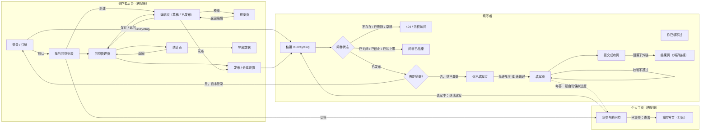
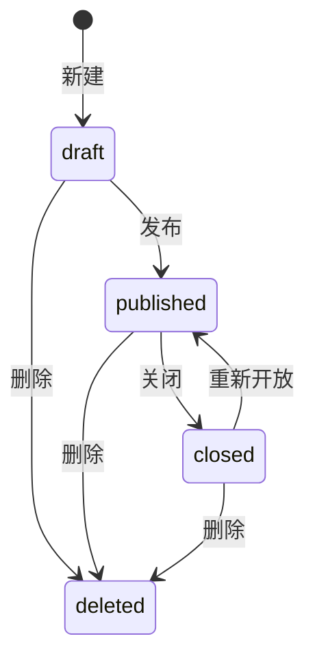
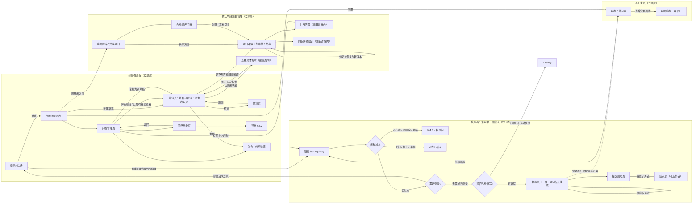

# 需求分析与界面设计

本文档是数据库设计的依据：先确定有哪些页面、每个页面显示什么、能做什么，再推出每个页面对数据库的读写方式（访问模式），最后据此决定集合划分、文档结构和索引（见 `数据库设计.md`）。

## 1. 角色

| 角色 | 说明 |
|------|------|
| 创作者 | 注册登录后创建、编辑、发布问卷，查看统计、导出数据。只能看到和操作自己的问卷 |
| 填写者 | 通过链接打开问卷并填写。按需求第一阶段必须先登录（见 3.1） |

## 2. 页面流程

### 2.1 相对初版流程图的调整

最初的流程图由我（学生）绘制，与 AI 讨论后做了以下修改：

| 修改 | 原因 |
|------|------|
| 登录后 `redirect` 回到链接入口，而不是直接进入填写页 | 登录期间问卷可能刚好被关闭或截止，回到入口会重新检查状态 |
| 增加"你已填写过"节点 | 问卷不允许多次填写时，已登录且填过的用户不应再进入填写页，否则要等到提交时才被拒绝，体验差 |
| 草稿状态的问卷通过链接访问时显示 404 | 未发布的问卷不应对外可见；创作者通过"预览页"查看草稿 |
| "需要身份验证"默认设为"是" | 作业需求原文："填写问卷的人需要先登录"。保留这个开关是为第二阶段可能出现的免登录需求做准备，但第一阶段默认开启，见 3.1 |

### 2.2 问卷状态

`status` 字段只存三个由创作者操作触发的状态；"已截止"和"已达上限"由截止时间和答卷数实时判断，不存储，避免依赖定时任务去改状态。

- `deleted` 不是 `status` 的取值，而是 `deletedAt` 字段有值（软删除），答卷数据保留。
- 填写页入口的判断顺序：已删除或草稿则 404；已关闭、已过截止时间、答卷数达到上限则显示"问卷已结束"；否则进入登录检查。

## 3. 关键需求决策

### 3.1 填写是否需要登录

需求原文要求填写前先登录，因此 `settings.requireLogin` 默认 `true`。"匿名填写"在本系统中的含义是：填写者登录了，但答卷中不保存其身份，创作者看不到是谁填的。

若关闭登录要求（为后续需求预留）：无法可靠地识别同一个人，因此"每人只能填一次"必须配合登录。规则为：`allowMultipleSubmit = false` 时 `requireLogin` 必须为 `true`，编辑页和后端都会检查。

### 3.2 发布后能否编辑

流程图中编辑页支持"已发布"状态。已有答卷引用了题目和选项的 ID，如果随意删除或改题型，历史答卷和统计就会出错。因此规定：

> 【V2：第二阶段修订】下表记录第一阶段实际实现，不作为 V2 发布后编辑规则。新需求要求已发布问卷中的题目不可修改；V2 改为只读，需改题时复制问卷为新草稿。统一流程及逐页处理见第 5 节。

| 操作 | 草稿 | 已发布 / 已关闭 |
|------|------|----------------|
| 修改标题、说明、选项文字 | 可以 | 可以 |
| 新增题目、新增选项 | 可以 | 可以，`version + 1` |
| 修改约束、跳转规则、必答 | 可以 | 可以，`version + 1`，只影响之后的答卷 |
| 调整题目顺序 | 可以 | 可以，`version + 1`（跳转规则仍需满足只能向后跳） |
| 删除题目或选项 | 直接删除 | 改为隐藏（`hidden: true`），填写页不再显示，统计页保留历史数据，`version + 1` |
| 修改题型 | 可以 | 不可以（旧答案的值类型会和新题型对不上） |

### 3.3 填写方式

一屏一题。点击"下一题"时，前端把已作答内容发给后端，后端按跳转规则返回下一题。跳转逻辑只在后端实现一份；提交时后端再完整重放一次路径，防止绕过前端直接提交。

### 3.4 答卷数上限

分享设置可设置答卷数上限（`maxResponses`）。多人同时提交时，若用"先数一下答卷数，再插入"的方式，两个请求可能都看到"还差 1 份"而同时写入，导致超额。因此在问卷文档上维护计数器，用一条带条件的原子更新抢占名额，详见 `数据库设计.md` 第 6 节。

### 3.5 断点续填与"我参与的问卷"（扩展功能）

作业需求没有要求，由我（学生）提出：填到一半关掉页面后，应能从个人主页回到问卷，从上次那道题继续；提交过的实名问卷能回看自己的答案。

| 决策 | 内容与原因 |
|------|-----------|
| 进度保存在服务端 | 登录用户换设备、换浏览器也能续填；未登录的访客不保存进度 |
| 何时保存 | 打开问卷时记录一次访问；每点一次"下一题"保存这道题的答案和路径。点"下一题"本来就要请求后端校验，顺带保存，不增加额外请求 |
| 过期 | 30 天没有再访问的进度由 MongoDB 的 TTL 索引自动删除，不需要定时任务 |
| 问卷被修改 | 再次打开时若问卷版本已变，丢弃旧进度并提示"问卷已更新，请重新填写"，避免旧答案对不上新题目 |
| 提交后 | 删除进度；实名问卷可在"我参与的问卷"中查看自己的答卷 |
| 匿名问卷 | 填写中的进度属于填写人自己，照常显示；**提交后不出现在列表中**。若要列出，就必须另存"某人参与过某问卷"的记录，答卷很少时可能被推测出是谁填的，与"匿名"的承诺冲突 |

## 4. 各页面的信息、操作和数据访问

以下"读写"一栏即访问模式，编号 P1 至 P23 在 `数据库设计.md` 中被引用。

### 4.1 登录 / 注册页

- 显示：用户名、密码输入框；错误提示（用户名已存在、用户名或密码错误）。
- 操作：注册、登录；带 `redirect` 参数时登录后回到原链接。

| 编号 | 读写 | 集合 | 条件 | 依赖的索引 |
|------|------|------|------|-----------|
| P1 | 注册：插入用户 | users | 用户名不能重复 | `username` 唯一 |
| P2 | 登录：按用户名查一条 | users | `{username}` | `username` 唯一 |

### 4.2 我的问卷列表

- 显示每份问卷：标题、状态（草稿 / 进行中 / 已截止 / 已满额 / 已关闭）、答卷数、截止时间、创建时间。
- 操作：新建问卷、进入管理页。

| 编号 | 读写 | 集合 | 条件 | 依赖的索引 |
|------|------|------|------|-----------|
| P3 | 列出自己未删除的问卷，按创建时间倒序 | surveys | `{ownerId, deletedAt: null}` 排序 `createdAt: -1`，只取列表需要的字段 | `{ownerId, deletedAt, createdAt}` |

答卷数直接读 `responseCount`，不需要再查 responses 集合。

### 4.3 问卷管理页

- 显示：标题、状态、链接、答卷数、截止时间、最近更新时间、题目数。
- 操作：编辑、预览、发布 / 分享设置、关闭、重新开放、查看统计、删除。

| 编号 | 读写 | 集合 | 条件 | 依赖的索引 |
|------|------|------|------|-----------|
| P4 | 按 ID 读取问卷（校验属于本人） | surveys | `{_id, ownerId, deletedAt: null}` | `_id` |
| P5 | 关闭 / 重新开放：修改 `status` | surveys | 同上 | `_id` |
| P6 | 删除：写入 `deletedAt` | surveys | 同上 | `_id` |

### 4.4 编辑页

- 基本信息：标题、说明。
- 题目卡片：题型、标题、说明、是否必答；单选 / 多选的选项列表，多选的"至少 / 最多 / 恰好选几个"；文本填空的最少 / 最多字数；数字填空的最小值 / 最大值 / 是否整数。
- 操作：添加题目、编辑、删除（已发布时为隐藏）、上移下移。
- 跳转规则区：每道题若干行"如果答案 [条件] [值] 则跳到 [目标]"，最后一行"否则跳到 [下一题（默认）]"。
  - 条件下拉框按题型给出（单选：选了 / 没选 / 选了其中之一；多选：包含 / 包含任一 / 包含全部 / 恰好是；数字：等于 / 大于 / 小于 / 介于等）。
  - 值：选项从本题选项中下拉选择，数字手动输入。
  - 目标下拉框只列出本题之后的题目和"结束问卷"，所以界面上就只能向后跳。
  - 文本填空题不提供跳转（需求未要求）。
- 保存时后端检查：选项不能为空、多选数量约束自洽、跳转目标存在且在本题之后、运算符适用于题型、选项 ID 属于本题。

| 编号 | 读写 | 集合 | 条件 | 依赖的索引 |
|------|------|------|------|-----------|
| P7 | 打开编辑页：读取整份问卷（含全部题目和规则） | surveys | `{_id, ownerId}` | `_id` |
| P8 | 保存题目 / 规则：更新这一个文档，结构变更时 `version + 1` | surveys | `{_id, ownerId, updatedAt: 打开时读到的值}`（乐观锁，防止两个窗口互相覆盖） | `_id` |

一次查询拿到全部题目、一次更新保存全部修改，是题目内嵌在问卷中的直接原因。

### 4.5 预览页

- 与填写页外观相同，可以走跳转流程，但不检查状态和登录，也不保存答卷；只有创作者本人可用，草稿也能预览。

| 编号 | 读写 | 集合 | 条件 | 依赖的索引 |
|------|------|------|------|-----------|
| P9 | 读取问卷 | surveys | 与 P7 相同 | `_id` |

### 4.6 发布 / 分享设置

- 设置项：是否需要登录、是否匿名、是否允许多次填写、截止时间、答卷数上限、提交成功提示语、结束后跳转的外部链接。
- 显示：填写链接 `/survey/{slug}`，复制按钮。
- 操作：发布（草稿变为已发布）、保存设置。

| 编号 | 读写 | 集合 | 条件 | 依赖的索引 |
|------|------|------|------|-----------|
| P10 | 读取设置 | surveys | `{_id, ownerId}`，只取 `settings`、`slug`、`status` | `_id` |
| P11 | 保存设置 / 发布：整体替换 `settings` 子文档 | surveys | 同上 | `_id` |

设置项集中在 `settings` 子文档中，页面和数据结构一一对应，一次 `$set` 即可保存。

### 4.7 填写入口与状态页（404 / 已结束 / 已填写过）

| 编号 | 读写 | 集合 | 条件 | 依赖的索引 |
|------|------|------|------|-----------|
| P12 | 按链接读取问卷 | surveys | `{slug}` | `slug` 唯一 |
| P13 | 检查当前用户是否已填过（不允许多次时） | responses | `{surveyId, submitterKey}` | `{surveyId, submitterKey}` 唯一部分索引 |

### 4.8 填写页

- 显示：问卷标题、说明、匿名提示；当前题目、进度；校验错误提示（例如"至少选择 2 项""年龄必须是 0 到 120 之间的整数"）。
- 操作：下一题（先校验本题，再由后端计算下一题）、上一题（沿已走路径退回）、提交。

| 编号 | 读写 | 集合 | 条件 | 依赖的索引 |
|------|------|------|------|-----------|
| P14 | 计算下一题：只读问卷，不写库 | surveys | `{slug}` | `slug` 唯一 |
| P15 | 提交：先原子占用名额（`responseCount + 1`），再插入答卷 | surveys、responses | 见 `数据库设计.md` 第 6 节 | `_id`；`{surveyId, submitterKey}` 唯一部分索引 |

### 4.9 提交成功页 / 结束页

- 显示 `settings.completion.message`；若设置了 `redirectUrl`，提供跳转（只允许 http / https 链接）。允许多次填写时显示"再填一次"。
- 数据来自 P12 已读取的问卷，不额外访问数据库。

### 4.10 统计页

- 整卷：总答卷数；逐题展示：
  - 单选：每个选项的人数、占比，以及本题回答人数（被跳过的不计）；
  - 多选：每个选项被选次数、本题回答人数；
  - 文本填空：全部回答列表；
  - 数字填空：全部回答列表、平均值。
- 单题：只看某一题的统计。
- 已隐藏的题目和选项仍然显示，并标注"已删除"。

| 编号 | 读写 | 集合 | 条件 | 依赖的索引 |
|------|------|------|------|-----------|
| P16 | 整卷统计：聚合 | responses | `$match {surveyId}` 后 `$unwind answers`、`$group` | `{surveyId, submittedAt}` |
| P17 | 单题统计：在 P16 的基础上多一个 `$match answers.questionId` | responses | 同上 | 同上 |

### 4.11 导出数据

- 导出 CSV：每份答卷一行，每道题一列（列名为题目标题，选项 ID 转换为选项文字），附加提交时间；实名问卷附加填写者用户名。

| 编号 | 读写 | 集合 | 条件 | 依赖的索引 |
|------|------|------|------|-----------|
| P18 | 按提交时间顺序遍历全部答卷，用游标逐批读取，边读边写文件 | responses（实名时查 users 取用户名） | `{surveyId}` 排序 `submittedAt` | `{surveyId, submittedAt}` |

### 4.12 填写进度的保存与恢复（填写页）

- 打开问卷时：若有上次的进度，直接回到上次那道题，并提示"已恢复上次的进度"，提供"重新开始"。
- 每点一次"下一题"：保存这道题的答案，并把路径截断到这道题再接上下一题（改了前面的答案后，后面的旧路径作废）。

| 编号 | 读写 | 集合 | 条件 | 依赖的索引 |
|------|------|------|------|-----------|
| P19 | 打开问卷：记录访问时间，没有进度则新建（upsert），并读出进度 | drafts | `{userId, surveyId}` | `{userId, surveyId}` 唯一 |
| P20 | 点"下一题"：用一条管道更新原子地写入答案、截断并延长路径（upsert） | drafts | 同上 | 同上 |
| P21 | 提交成功或"重新开始"：删除进度 | drafts | 同上 | 同上 |

### 4.13 我参与的问卷（首页"我参与的"一栏）

- 填写中：问卷标题、状态、已答几题、上次访问时间；问卷仍可填写时显示"继续填写"。
- 已提交（仅实名问卷）：问卷标题、提交时间、"查看我的答卷"。

| 编号 | 读写 | 集合 | 条件 | 依赖的索引 |
|------|------|------|------|-----------|
| P22 | 列出填写中的问卷：按上次访问时间倒序，`$lookup` 取问卷标题和状态 | drafts、surveys | `{userId}` 排序 `lastVisitedAt: -1` | `{userId, lastVisitedAt}` |
| P23 | 列出已提交的实名答卷并 `$lookup` 问卷标题；查看某份答卷时校验 `respondentId` 是本人 | responses、surveys | `{respondentId}` 排序 `submittedAt: -1` | `{respondentId, submittedAt}` |

### 4.14 我的答卷（只读）

- 以答卷样式显示问卷标题、提交时间、每道题和自己的答案；被跳转跳过的题标注"未作答"，已被创作者删除的题标注"已删除"。

## 5. 【V2：第二阶段新增】统一页面流程与功能处理（已实现）

> 【第二阶段实施状态】第 1–5 步已由学生逐步核验；第 6 步已完成最终回归和提交文档整理。下表对应当前已实现页面。

原先单独记录在 `docs/第二阶段/需求与数据设计.md` 中的 V2 需求口径、访问模式、集合演进和迁移顺序，现已完整合并到本节。本文件因此成为第一、二阶段需求与页面设计的统一主文档；原文件只保留为第 1 步设计过程记录，不再作为另一套设计依据。

### 5.1 第一阶段架构与 V2 需求冲突

第一阶段按“打开、编辑一份问卷”的访问模式，将题目完整内嵌于 `surveys.questions`。`responses.answers` 用问卷内 `questionId` 与 `optionId` 保存答案，另记 `surveyVersion`，但不保存当时的题目文字、选项文字及整卷快照。第一阶段还允许发布后更改文字、约束、规则、顺序和隐藏题目；统计、导出和个人答卷使用问卷当前题目解释旧答卷。

V2 要求题目跨问卷复用、对其他用户共享、从任意历史版本分叉或恢复、查看引用并按同一具体版本跨卷统计。仅复制题目文字不能识别“同一题的同一版本”；让多个问卷直接引用一个可变题目又会使旧问卷随之改变。因此 V2 采用“独立题目身份 + 不可变题目版本 + 问卷内嵌快照”：题库负责复用，问卷快照负责填写和跳转，答卷记录实际回答的版本来源。

已发布和已关闭问卷从 V2 起冻结题目定义。过去若曾编辑已发布问卷，旧答卷没有足够信息还原当时的题目文字，系统不会事后猜测其版本，而是在跨卷统计中单列为无法归版数据。

### 5.2 V1 与 V2 的统一页面流程

第 2 节保留第一阶段交付时的页面流程；下图在同一条业务路径中接入题库、版本与共享。原有登录回跳、问卷管理、预览、发布分享、填写状态判断、统计导出和个人主页路径继续存在。新增功能从“我的问卷”和草稿编辑页进入，不另造一套问卷系统。

图中的“复制为新草稿”“选择具体版本”是操作或编辑页内选择器，不要求额外创建空白中转页；“引用情况”“跨卷统计”是题目详情的区域。“已填写过”仍是独立提示状态，不能显示成“问卷已结束”的原因文案。

### 5.3 V2 需求、页面行为与数据归属

| 新需求 | 页面和行为 | 数据归属 |
|---|---|---|
| 保存常用题目 | 题目详情可创建题目及首版；编辑页可将现有题目保存到题库 | `question_items` + `question_versions` |
| 共享给别人 | 题主设置私有、全站登录用户可用或指定用户可用；其他用户可浏览和选用 | `question_items.visibility/sharedUserIds` |
| 旧问卷不受改题影响 | 已发布、已关闭问卷题目只读；复制整卷为草稿后修改 | `surveys.questions` 快照 |
| 历史与恢复 | 显示版本树；从任意旧版分叉；恢复旧版时创建新节点 | `question_versions.parentVersionId` |
| 不同版本并存 | 选题时明确选择具体版本，问卷保存来源版本 ID | `surveys.questions.sourceVersionId` |
| 查看引用 | 本人问卷列标题、状态和所用版本；他人问卷只显示数量 | 查询 `surveys.questions.sourceItemId` |
| 多个命名题库 | 本人创建、改名、删除题库；将题目加入或移出；选题时浏览具体版本 | `question_banks` |
| 跨问卷统计 | 仅合并当前登录用户自己问卷中，同一具体版本的可归版答案 | `responses.answers.questionVersionId` |

新增页面为 `/question-banks`（我的题库、我创建的题目、共享浏览）、`/question-banks/{bankId}`（命名题库详情）和 `/questions/{itemId}`（版本历史、共享、引用与跨卷统计）。`/surveys/{id}/edit` 内嵌具体版本选择器；问卷管理页增加“复制为新草稿”。题库中的题目共享与问卷分享页中的填写权限是两个不同概念，不能放在同一个设置中。

题目版本保存题型、标题、说明、是否必答、选项和约束，但不保存显示顺序、隐藏状态或跳转规则，因为这些内容取决于具体问卷。选入问卷时保留版本中的选项 ID，生成新的本卷 `questionId`，并复制完整正文形成快照。关联来源版本的草稿题不能静默原位改写：题主应创建新版本后显式替换；使用他人共享题的用户可以另存为自己的新题目。未关联的草稿题继续支持第一阶段原位编辑。

新建题目默认私有，题库也只由创建者管理。分享权限附着在题目身份上，适用于该题目的全部版本。撤销分享只阻止新的选用，不破坏已存在的问卷快照；跨卷统计也不会因为题目曾经共享而读取其他用户的答卷。“他人使用数量”按未删除问卷去重，同一问卷重复选入同一道题仍只算一份问卷。

### 5.4 页面与状态：显示、操作和返回位置

| 页面 / 路径 | 第二阶段新增或修订的显示与操作 | 状态、权限和返回处理 | 访问模式 |
|---|---|---|---|
| 登录 `/login` | 保持注册、登录；从题库或题目链接进入时也保存站内返回地址 | 登录后回到原题库/题目页面；填写链接仍回入口重新检查状态，禁止外站回跳 | P1–P2 |
| 我的问卷 `/` | 原“我创建的 / 我参与的”不变；导航增加“我的题库 / 共享题目” | 未登录先到登录页；原问卷列表与参与记录互不受题库筛选影响 | P3、P22–P23 |
| 问卷管理 `/surveys/{id}` | 原状态、链接、预览、分享、统计、删除不变；增加“复制为新草稿”和题目来源概览 | 草稿可进入可编辑状态；已发布/已关闭进入题目只读状态，复制后跳到新草稿编辑页，新 slug、零答卷 | P4–P6、P32 |
| 编辑 `/surveys/{id}/edit` | 草稿保留原题目卡片和问卷专属跳转设置；增加“从题库选题”“保存现有题目到题库”及来源版本标记 | 选择器在本页展示本人题库和有权使用的共享题目，可先选题库再选具体版本；加入后关闭选择器并显示新题。已关联题目改内容须显式生成新版或另存为自己的题；已发布/已关闭隐藏保存、排序、增删、规则按钮，提示复制问卷 | P7–P8、P30–P31 |
| 预览 `/surveys/{id}/preview` | 继续按问卷快照和本卷跳转规则模拟作答 | 不写答卷或进度，关闭后返回原编辑/管理页；共享题目后续改版不改变此预览 | P9 |
| 分享 `/surveys/{id}/share` | 原填写权限、匿名、截止、上限、结束语及链接保持 | 题目共享权限不放在此页，避免与“谁可填写问卷”混淆；发布时确认草稿题目有固定来源版本，发布后题目冻结 | P10–P11 |
| 问卷统计 `/surveys/{id}/stats` 与 CSV | 原整卷、单题、导出保留；有来源版本的题可跳转到该题的版本统计 | 此页仍只统计当前问卷；旧答卷继续进入原问卷统计，跨卷统计的排除提示放在题目详情 | P16–P18、P34 |
| 我的题库/共享题目 `/question-banks` | “我的题库”“我创建的题目”“共享给我的题目”入口；创建命名题库、创建独立题目、检索 | 空题库/无共享题时给出明确空状态；共享题失权后不再允许新选用；编辑页的选题器直接读取这些数据，不必跳转到此页 | P24–P25、P29 |
| 题库详情 `/question-banks/{bankId}` | 显示题目清单及每题最新版本；改名、加题、移题、删除题库；点击题目看版本 | 仅题库所有者管理；删除题库仅移除分类，不删除题目、版本或问卷引用；已撤销授权的共享题标为不可选 | P26、P29 |
| 题目详情 `/questions/{itemId}` | 版本树、版本内容预览、分叉/恢复、共享设置、引用情况、本人问卷同版统计 | 题主可写新版本和改共享；其他获授权用户可只读、选用，或复制成归自己所有的新题。恢复旧版先确认“生成新版本”，不会覆盖旧版。引用列表只列本人问卷，其他用户按问卷去重计数；统计必须明确当前版本和“仅本人问卷” | P25–P28、P33–P34 |
| 填写入口 `/survey/{slug}`、填写页、提交成功页 | 页面流程维持第一阶段；填写内容来自已发布问卷内嵌快照 | 404、已结束、需登录、已填写过、校验失败、断点续填和提交成功均保持原分支；新答卷的版本 ID 由后端记录，不展示给填写者 | P12–P15、P19–P21 |
| 我参与的问卷与我的答卷 | 原续填、查看实名答卷保留 | 题库权限不会改变已提交答卷的可见性；历史匿名答卷仍不出现在本人已提交列表 | P22–P23 |

### 5.5 必须有的页面反馈

- **题目版本选择**：展示版本号、创建时间、父版本及内容预览；默认可突出最新版，但实际加入的是用户确认的具体版本，加入后编辑页标明来源版本。
- **分叉与恢复**：题主选定任意旧版作为父版本；恢复按钮填入旧版内容并生成新版本。选题时旧版与新版继续同时可选；题库列表显示最新版，不自动替换任何问卷已选版本。
- **共享**：公开、指定用户、私有三种状态；指定用户按用户名查找并显示验证错误。失权、被撤销或并发改变权限时，选择器提示刷新并重新选题；既有问卷仍能正常填写。
- **编辑冲突与发布冻结**：草稿继续使用现有 `If-Match` 冲突提示与重新加载。已发布/已关闭的题目编辑请求由后端拒绝，前端显示“复制为草稿”；仅改变共享题的新版本不会使当前问卷旧版本内容变化。
- **统计解释**：跨卷统计固定显示“具体版本 + 仅本人问卷 + 可归版答卷数”，选项名称取不可变版本；旧答卷数量单列说明，避免被误以为计入同版平均值或占比。原问卷统计与 CSV 仍从该问卷路径进入。

### 5.6 V2 数据结构与页面访问的对应关系

| 集合或位置 | 主要字段 | 页面为什么需要它 | 原子边界与索引 |
|---|---|---|---|
| `question_items` | `_id`、`ownerId`、`visibility`、`sharedUserIds`、可选来源键 | 题目列表、共享权限、引用入口 | 身份和共享单文档更新；按所有者、公开、定向分享查询；来源键唯一 |
| `question_versions` | `itemId`、`versionNo`、`parentVersionId`、题目正文 | 版本树、分叉、恢复、具体版本预览 | 插入后正文不修改；`itemId+versionNo` 唯一 |
| `question_banks` | `ownerId`、`name`、`itemIds[]` | 多个命名题库及成员管理 | `$addToSet/$pull`；`ownerId+name` 唯一 |
| `surveys.questions[]` | 原快照字段 + `sourceItemId/sourceVersionId` | 编辑、预览、填写、引用和发布冻结 | 问卷单文档乐观锁更新；来源字段用于引用查询 |
| `responses.answers[]` | 原答案字段 + `questionVersionId` | 精确的同版跨卷统计 | 新提交时从冻结快照写入；旧答案允许缺失 |

`schemaVersion` 升为 2，但读取路径和校验器兼容旧文档。题目版本号通过 `itemId+versionNo` 唯一索引和冲突重试分配；版本号表示创建次序，`parentVersionId` 才表示真正的分叉关系。恢复旧版本同样插入新版本，不修改旧节点。`drafts` 仍使用本卷 `questionId` 和问卷版本，避免题库结构侵入原断点续填路径。

### 5.7 V2 访问模式 P24–P34

第一阶段 P1–P23 继续成立。V2 新增访问模式按页面实际操作编号，数据库结构和索引均由这些读写方式反推。

| 编号 | 用户操作 | 主要读取/写入 | 权限与索引 |
|---|---|---|---|
| P24 | 查看本人题目或共享题目 | `question_items` + 每题最新版 | 本人按 `ownerId`；公开按 `visibility`；定向按多键 `sharedUserIds` |
| P25 | 创建独立题目或复制共享版本 | 新题目身份 + 不可变首版 | 登录用户；复制前检查当前共享权限 |
| P26 | 打开题目详情、查看版本树 | 题目身份 + 按版本号排列的全部版本 | 题主、当前共享用户，或已有本人引用的历史查看者 |
| P27 | 从任意旧版分叉/恢复 | 插入一个新版本 | 只有题主；父版本必须属于本题 |
| P28 | 修改公开/定向/私有共享 | 更新题目身份的共享字段 | 只有题主；指定用户名必须存在且不能是自己 |
| P29 | 管理多个命名题库 | 题库 CRUD，`$addToSet/$pull` 成员 | 仅题库所有者；同名题库由唯一索引拒绝 |
| P30 | 草稿从题库选题或替换版本 | 读具体版本，写问卷题目快照 | 当前版本可访问；问卷必须是本人草稿；支持 `If-Match` |
| P31 | 把现有问卷题保存到题库 | 创建/复用来源身份和版本，必要时收录 | 本人问卷；重复保存不重复建题 |
| P32 | 复制已发布问卷为草稿 | 读原卷，插入新问卷 | 仅原卷所有者；新 ID、slug、零答卷 |
| P33 | 查看题目引用 | 按 `questions.sourceItemId` 查未删除问卷 | 本人问卷返回明细；他人只返回去重数量 |
| P34 | 查看具体版本跨卷统计 | 本人问卷 ID + `answers.questionVersionId` | 只汇总当前用户自己的问卷；旧答案单列 |

### 5.8 V2 典型操作路径

**路径 A：保存和复用自己的常用题**

1. 在 `/question-banks` 新建“课堂常用”题库和独立题目；系统建立题目身份与 v1。
2. 在新问卷编辑页点击“从题库选题”，选择该题 v1；编辑页显示来源版本。
3. 发布问卷后，快照冻结；随后题主从 v1 创建 v2，原问卷仍显示 v1。
4. 创建另一问卷时可选择 v2；两个版本同时存在。

**路径 B：使用别人共享的题**

1. 题主在题目详情把可见范围设为公开或指定当前用户。
2. 当前用户在“共享给我的题目”或编辑页选择器中预览版本并选入草稿。
3. 若共享随后撤销，已发布问卷继续按快照填写；新草稿不能再选该题。
4. 已有引用的用户仍可从问卷来源进入题目详情，查看历史和自己的统计，页面显示“不能再选用”。

**路径 C：修改已发布问卷中的题**

1. 从问卷管理页进入题目只读视图，系统说明题目已冻结。
2. 点击“复制为新草稿”，得到新 ID、slug、零答卷的副本。
3. 题主在题目详情从旧版分叉新版本，再回副本编辑页显式替换。
4. 检查跳转规则后发布副本；原链接、原内容和原答卷保持不变。

### 5.9 V2 迁移与兼容顺序

1. 先备份现有 MongoDB，并记录四个旧集合文档数、问卷题目数、答卷数和 `schemaVersion` 分布；检查模式只输出待建立的题目身份、版本和冲突，不写数据库。
2. 安装兼容旧字段的新校验器和索引。对每个旧问卷题目，以 `(surveyId, questionId)` 为来源键创建单独的私有题目身份和第 1 版；不根据标题自动合并。来源唯一索引保证脚本重复执行时复用同一身份和版本。
3. 在原问卷题目中补 `sourceItemId/sourceVersionId`，但不改变题目内容、顺序、规则和选项 ID。已有 `responses.answers` 保持原样，不补写无法核实的版本 ID。
4. 迁移后核对旧集合数量、问卷内容、答卷内容、原链接、单卷统计和导出；新身份和初始版本数量应等于迁移时的现存题目数。中途失败可以重跑，不删除旧集合或旧字段。
5. 迁移后新提交的关联题目答案写 `questionVersionId`；发布尚未关联的草稿题之前，系统先建立私有来源版本，保证发布后冻结且新答案可以归版。

正式库迁移结果及备份校验见[迁移执行记录](第二阶段/迁移执行记录.md)。对于迁移前曾经发生的发布后改题，只能保存迁移时看到的内容，不能宣称恢复了不存在的历史快照。

### 5.10 V2 实施与核验范围

第二阶段按六步完成：第 1 步固定基线、页面流程和数据设计；第 2 步实现 Schema、索引和幂等迁移；第 3 步实现题目版本与共享；第 4 步实现多题库、问卷引用、复制和冻结；第 5 步实现新答卷归版、跨卷统计及页面；第 6 步完成全量回归与提交文档。每一步完成后均先更新 AI 日志和变更清单，再由学生明确回复“下一步”后继续。
