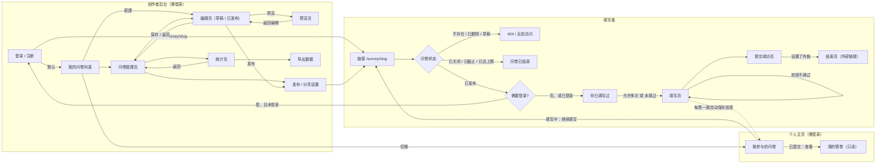
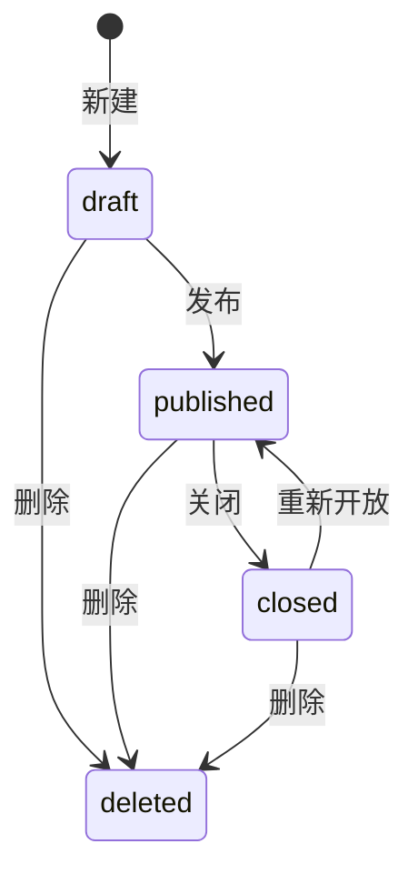

# 需求分析与界面设计

本文档是数据库设计的依据：先确定有哪些页面、每个页面显示什么、能做什么，再推出每个页面对数据库的读写方式（访问模式），最后据此决定集合划分、文档结构和索引（见 `数据库设计.md`）。

## 1. 角色

| 角色 | 说明 |
|------|------|
| 创作者 | 注册登录后创建、编辑、发布问卷，查看统计、导出数据。只能看到和操作自己的问卷 |
| 填写者 | 通过链接打开问卷并填写。按需求第一阶段必须先登录（见 3.1） |

## 2. 页面流程

### 2.1 相对初版流程图的调整

最初的流程图由我（学生）绘制，与 AI 讨论后做了以下修改：

| 修改 | 原因 |
|------|------|
| 登录后 `redirect` 回到链接入口，而不是直接进入填写页 | 登录期间问卷可能刚好被关闭或截止，回到入口会重新检查状态 |
| 增加"你已填写过"节点 | 问卷不允许多次填写时，已登录且填过的用户不应再进入填写页，否则要等到提交时才被拒绝，体验差 |
| 草稿状态的问卷通过链接访问时显示 404 | 未发布的问卷不应对外可见；创作者通过"预览页"查看草稿 |
| "需要身份验证"默认设为"是" | 作业需求原文："填写问卷的人需要先登录"。保留这个开关是为第二阶段可能出现的免登录需求做准备，但第一阶段默认开启，见 3.1 |

### 2.2 问卷状态

`status` 字段只存三个由创作者操作触发的状态；"已截止"和"已达上限"由截止时间和答卷数实时判断，不存储，避免依赖定时任务去改状态。

- `deleted` 不是 `status` 的取值，而是 `deletedAt` 字段有值（软删除），答卷数据保留。
- 填写页入口的判断顺序：已删除或草稿则 404；已关闭、已过截止时间、答卷数达到上限则显示"问卷已结束"；否则进入登录检查。

## 3. 关键需求决策

### 3.1 填写是否需要登录

需求原文要求填写前先登录，因此 `settings.requireLogin` 默认 `true`。"匿名填写"在本系统中的含义是：填写者登录了，但答卷中不保存其身份，创作者看不到是谁填的。

若关闭登录要求（为后续需求预留）：无法可靠地识别同一个人，因此"每人只能填一次"必须配合登录。规则为：`allowMultipleSubmit = false` 时 `requireLogin` 必须为 `true`，编辑页和后端都会检查。

### 3.2 发布后能否编辑

流程图中编辑页支持"已发布"状态。已有答卷引用了题目和选项的 ID，如果随意删除或改题型，历史答卷和统计就会出错。因此规定：

| 操作 | 草稿 | 已发布 / 已关闭 |
|------|------|----------------|
| 修改标题、说明、选项文字 | 可以 | 可以 |
| 新增题目、新增选项 | 可以 | 可以，`version + 1` |
| 修改约束、跳转规则、必答 | 可以 | 可以，`version + 1`，只影响之后的答卷 |
| 调整题目顺序 | 可以 | 可以，`version + 1`（跳转规则仍需满足只能向后跳） |
| 删除题目或选项 | 直接删除 | 改为隐藏（`hidden: true`），填写页不再显示，统计页保留历史数据，`version + 1` |
| 修改题型 | 可以 | 不可以（旧答案的值类型会和新题型对不上） |

### 3.3 填写方式

一屏一题。点击"下一题"时，前端把已作答内容发给后端，后端按跳转规则返回下一题。跳转逻辑只在后端实现一份；提交时后端再完整重放一次路径，防止绕过前端直接提交。

### 3.4 答卷数上限

分享设置可设置答卷数上限（`maxResponses`）。多人同时提交时，若用"先数一下答卷数，再插入"的方式，两个请求可能都看到"还差 1 份"而同时写入，导致超额。因此在问卷文档上维护计数器，用一条带条件的原子更新抢占名额，详见 `数据库设计.md` 第 6 节。

### 3.5 断点续填与"我参与的问卷"（扩展功能）

作业需求没有要求，由我（学生）提出：填到一半关掉页面后，应能从个人主页回到问卷，从上次那道题继续；提交过的实名问卷能回看自己的答案。

| 决策 | 内容与原因 |
|------|-----------|
| 进度保存在服务端 | 登录用户换设备、换浏览器也能续填；未登录的访客不保存进度 |
| 何时保存 | 打开问卷时记录一次访问；每点一次"下一题"保存这道题的答案和路径。点"下一题"本来就要请求后端校验，顺带保存，不增加额外请求 |
| 过期 | 30 天没有再访问的进度由 MongoDB 的 TTL 索引自动删除，不需要定时任务 |
| 问卷被修改 | 再次打开时若问卷版本已变，丢弃旧进度并提示"问卷已更新，请重新填写"，避免旧答案对不上新题目 |
| 提交后 | 删除进度；实名问卷可在"我参与的问卷"中查看自己的答卷 |
| 匿名问卷 | 填写中的进度属于填写人自己，照常显示；**提交后不出现在列表中**。若要列出，就必须另存"某人参与过某问卷"的记录，答卷很少时可能被推测出是谁填的，与"匿名"的承诺冲突 |

## 4. 各页面的信息、操作和数据访问

以下"读写"一栏即访问模式，编号 P1 至 P23 在 `数据库设计.md` 中被引用。

### 4.1 登录 / 注册页

- 显示：用户名、密码输入框；错误提示（用户名已存在、用户名或密码错误）。
- 操作：注册、登录；带 `redirect` 参数时登录后回到原链接。

| 编号 | 读写 | 集合 | 条件 | 依赖的索引 |
|------|------|------|------|-----------|
| P1 | 注册：插入用户 | users | 用户名不能重复 | `username` 唯一 |
| P2 | 登录：按用户名查一条 | users | `{username}` | `username` 唯一 |

### 4.2 我的问卷列表

- 显示每份问卷：标题、状态（草稿 / 进行中 / 已截止 / 已满额 / 已关闭）、答卷数、截止时间、创建时间。
- 操作：新建问卷、进入管理页。

| 编号 | 读写 | 集合 | 条件 | 依赖的索引 |
|------|------|------|------|-----------|
| P3 | 列出自己未删除的问卷，按创建时间倒序 | surveys | `{ownerId, deletedAt: null}` 排序 `createdAt: -1`，只取列表需要的字段 | `{ownerId, deletedAt, createdAt}` |

答卷数直接读 `responseCount`，不需要再查 responses 集合。

### 4.3 问卷管理页

- 显示：标题、状态、链接、答卷数、截止时间、最近更新时间、题目数。
- 操作：编辑、预览、发布 / 分享设置、关闭、重新开放、查看统计、删除。

| 编号 | 读写 | 集合 | 条件 | 依赖的索引 |
|------|------|------|------|-----------|
| P4 | 按 ID 读取问卷（校验属于本人） | surveys | `{_id, ownerId, deletedAt: null}` | `_id` |
| P5 | 关闭 / 重新开放：修改 `status` | surveys | 同上 | `_id` |
| P6 | 删除：写入 `deletedAt` | surveys | 同上 | `_id` |

### 4.4 编辑页

- 基本信息：标题、说明。
- 题目卡片：题型、标题、说明、是否必答；单选 / 多选的选项列表，多选的"至少 / 最多 / 恰好选几个"；文本填空的最少 / 最多字数；数字填空的最小值 / 最大值 / 是否整数。
- 操作：添加题目、编辑、删除（已发布时为隐藏）、上移下移。
- 跳转规则区：每道题若干行"如果答案 [条件] [值] 则跳到 [目标]"，最后一行"否则跳到 [下一题（默认）]"。
  - 条件下拉框按题型给出（单选：选了 / 没选 / 选了其中之一；多选：包含 / 包含任一 / 包含全部 / 恰好是；数字：等于 / 大于 / 小于 / 介于等）。
  - 值：选项从本题选项中下拉选择，数字手动输入。
  - 目标下拉框只列出本题之后的题目和"结束问卷"，所以界面上就只能向后跳。
  - 文本填空题不提供跳转（需求未要求）。
- 保存时后端检查：选项不能为空、多选数量约束自洽、跳转目标存在且在本题之后、运算符适用于题型、选项 ID 属于本题。

| 编号 | 读写 | 集合 | 条件 | 依赖的索引 |
|------|------|------|------|-----------|
| P7 | 打开编辑页：读取整份问卷（含全部题目和规则） | surveys | `{_id, ownerId}` | `_id` |
| P8 | 保存题目 / 规则：更新这一个文档，结构变更时 `version + 1` | surveys | `{_id, ownerId, updatedAt: 打开时读到的值}`（乐观锁，防止两个窗口互相覆盖） | `_id` |

一次查询拿到全部题目、一次更新保存全部修改，是题目内嵌在问卷中的直接原因。

### 4.5 预览页

- 与填写页外观相同，可以走跳转流程，但不检查状态和登录，也不保存答卷；只有创作者本人可用，草稿也能预览。

| 编号 | 读写 | 集合 | 条件 | 依赖的索引 |
|------|------|------|------|-----------|
| P9 | 读取问卷 | surveys | 与 P7 相同 | `_id` |

### 4.6 发布 / 分享设置

- 设置项：是否需要登录、是否匿名、是否允许多次填写、截止时间、答卷数上限、提交成功提示语、结束后跳转的外部链接。
- 显示：填写链接 `/survey/{slug}`，复制按钮。
- 操作：发布（草稿变为已发布）、保存设置。

| 编号 | 读写 | 集合 | 条件 | 依赖的索引 |
|------|------|------|------|-----------|
| P10 | 读取设置 | surveys | `{_id, ownerId}`，只取 `settings`、`slug`、`status` | `_id` |
| P11 | 保存设置 / 发布：整体替换 `settings` 子文档 | surveys | 同上 | `_id` |

设置项集中在 `settings` 子文档中，页面和数据结构一一对应，一次 `$set` 即可保存。

### 4.7 填写入口与状态页（404 / 已结束 / 已填写过）

| 编号 | 读写 | 集合 | 条件 | 依赖的索引 |
|------|------|------|------|-----------|
| P12 | 按链接读取问卷 | surveys | `{slug}` | `slug` 唯一 |
| P13 | 检查当前用户是否已填过（不允许多次时） | responses | `{surveyId, submitterKey}` | `{surveyId, submitterKey}` 唯一部分索引 |

### 4.8 填写页

- 显示：问卷标题、说明、匿名提示；当前题目、进度；校验错误提示（例如"至少选择 2 项""年龄必须是 0 到 120 之间的整数"）。
- 操作：下一题（先校验本题，再由后端计算下一题）、上一题（沿已走路径退回）、提交。

| 编号 | 读写 | 集合 | 条件 | 依赖的索引 |
|------|------|------|------|-----------|
| P14 | 计算下一题：只读问卷，不写库 | surveys | `{slug}` | `slug` 唯一 |
| P15 | 提交：先原子占用名额（`responseCount + 1`），再插入答卷 | surveys、responses | 见 `数据库设计.md` 第 6 节 | `_id`；`{surveyId, submitterKey}` 唯一部分索引 |

### 4.9 提交成功页 / 结束页

- 显示 `settings.completion.message`；若设置了 `redirectUrl`，提供跳转（只允许 http / https 链接）。允许多次填写时显示"再填一次"。
- 数据来自 P12 已读取的问卷，不额外访问数据库。

### 4.10 统计页

- 整卷：总答卷数；逐题展示：
  - 单选：每个选项的人数、占比，以及本题回答人数（被跳过的不计）；
  - 多选：每个选项被选次数、本题回答人数；
  - 文本填空：全部回答列表；
  - 数字填空：全部回答列表、平均值。
- 单题：只看某一题的统计。
- 已隐藏的题目和选项仍然显示，并标注"已删除"。

| 编号 | 读写 | 集合 | 条件 | 依赖的索引 |
|------|------|------|------|-----------|
| P16 | 整卷统计：聚合 | responses | `$match {surveyId}` 后 `$unwind answers`、`$group` | `{surveyId, submittedAt}` |
| P17 | 单题统计：在 P16 的基础上多一个 `$match answers.questionId` | responses | 同上 | 同上 |

### 4.11 导出数据

- 导出 CSV：每份答卷一行，每道题一列（列名为题目标题，选项 ID 转换为选项文字），附加提交时间；实名问卷附加填写者用户名。

| 编号 | 读写 | 集合 | 条件 | 依赖的索引 |
|------|------|------|------|-----------|
| P18 | 按提交时间顺序遍历全部答卷，用游标逐批读取，边读边写文件 | responses（实名时查 users 取用户名） | `{surveyId}` 排序 `submittedAt` | `{surveyId, submittedAt}` |

### 4.12 填写进度的保存与恢复（填写页）

- 打开问卷时：若有上次的进度，直接回到上次那道题，并提示"已恢复上次的进度"，提供"重新开始"。
- 每点一次"下一题"：保存这道题的答案，并把路径截断到这道题再接上下一题（改了前面的答案后，后面的旧路径作废）。

| 编号 | 读写 | 集合 | 条件 | 依赖的索引 |
|------|------|------|------|-----------|
| P19 | 打开问卷：记录访问时间，没有进度则新建（upsert），并读出进度 | drafts | `{userId, surveyId}` | `{userId, surveyId}` 唯一 |
| P20 | 点"下一题"：用一条管道更新原子地写入答案、截断并延长路径（upsert） | drafts | 同上 | 同上 |
| P21 | 提交成功或"重新开始"：删除进度 | drafts | 同上 | 同上 |

### 4.13 我参与的问卷（首页"我参与的"一栏）

- 填写中：问卷标题、状态、已答几题、上次访问时间；问卷仍可填写时显示"继续填写"。
- 已提交（仅实名问卷）：问卷标题、提交时间、"查看我的答卷"。

| 编号 | 读写 | 集合 | 条件 | 依赖的索引 |
|------|------|------|------|-----------|
| P22 | 列出填写中的问卷：按上次访问时间倒序，`$lookup` 取问卷标题和状态 | drafts、surveys | `{userId}` 排序 `lastVisitedAt: -1` | `{userId, lastVisitedAt}` |
| P23 | 列出已提交的实名答卷并 `$lookup` 问卷标题；查看某份答卷时校验 `respondentId` 是本人 | responses、surveys | `{respondentId}` 排序 `submittedAt: -1` | `{respondentId, submittedAt}` |

### 4.14 我的答卷（只读）

- 以答卷样式显示问卷标题、提交时间、每道题和自己的答案；被跳转跳过的题标注"未作答"，已被创作者删除的题标注"已删除"。
