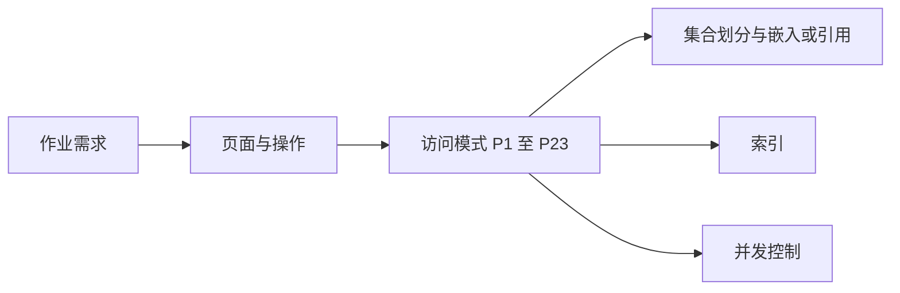
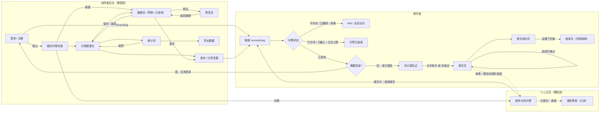
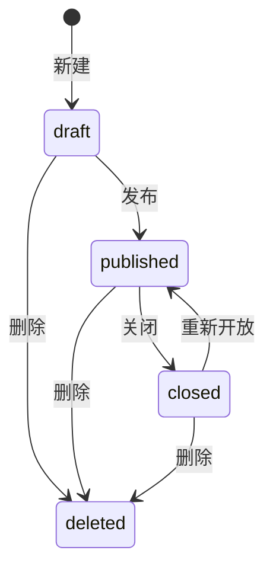
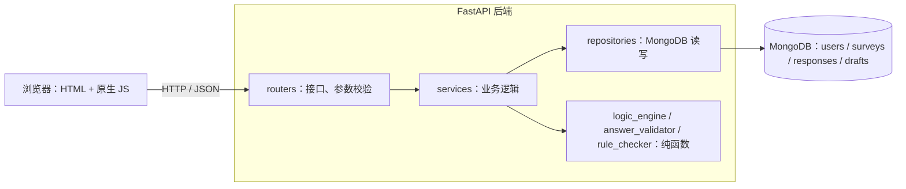
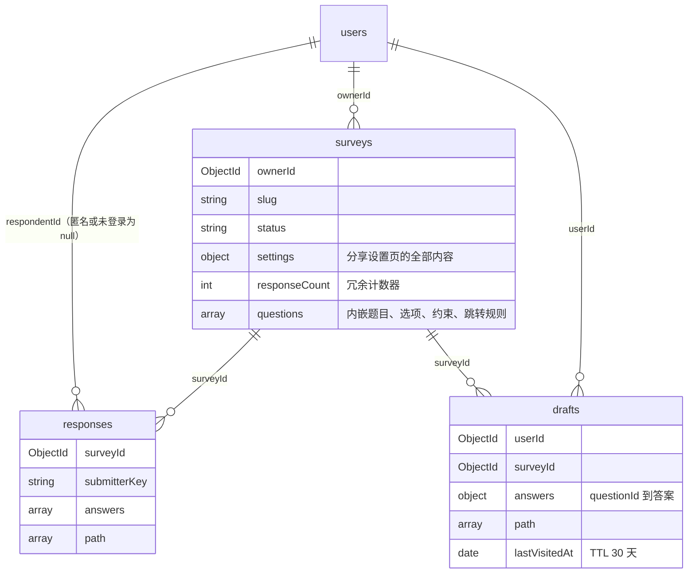
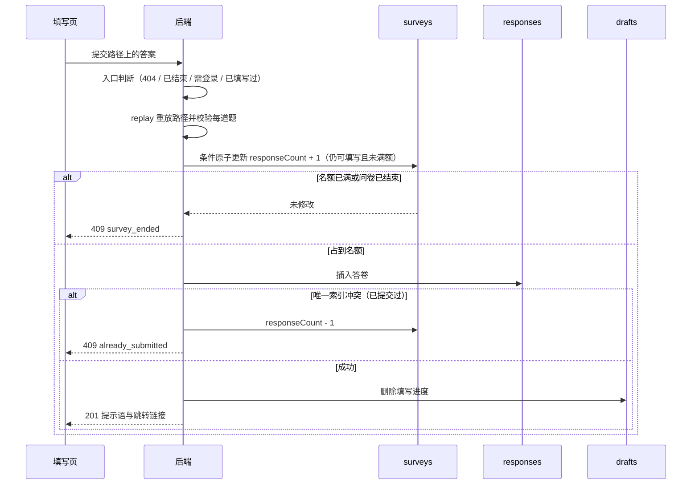
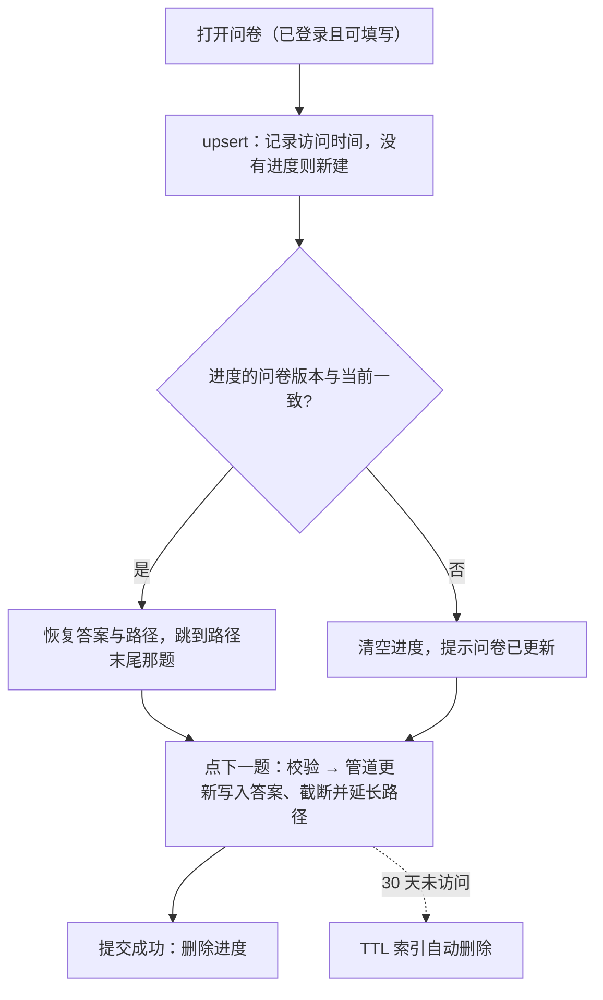
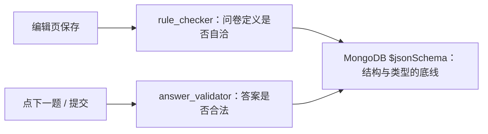
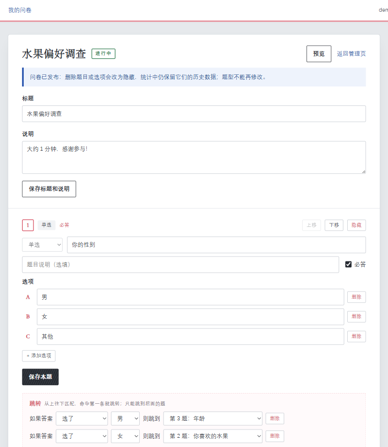
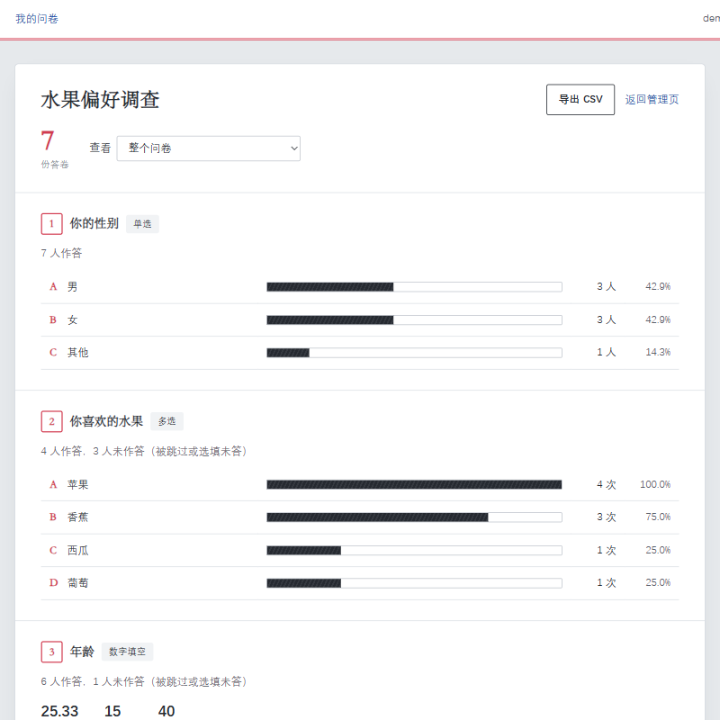

# 项目完成报告：基于 MongoDB 的问卷系统（第一阶段）

## 1. 项目目标

开发一个简化版的在线问卷系统：注册用户创建问卷并通过链接分发，其他用户登录后填写，系统统计结果。按作业要求，重点放在：

- MongoDB 数据库设计：集合划分、文档结构、索引、并发控制，以及设计理由；
- 后端业务逻辑：三种题型的约束校验、可在问卷中配置的跳转逻辑；
- 为第二阶段的需求变更预留扩展空间（第二阶段不允许推倒重做）；
- 全程使用 AI 编程工具，并如实记录使用过程。

最终成果：

| 项目 | 数量 |
|------|------|
| 后端代码（`backend/app`） | 约 1950 行 Python |
| 前端代码（`frontend`） | 约 1390 行 HTML / JS / CSS，9 个页面 |
| 集合校验规则（`schema`） | 4 个集合，约 250 行 JSON |
| 接口 | 31 个 |
| 自动测试 | 242 个，全部通过，代码覆盖率 98% |
| 文档 | 8 份（见 README） |
| Git 提交 | 每个开发步骤单独提交，可逐步查看演进过程 |

## 2. 需求与界面设计

### 2.1 方法：先界面，后数据库

MongoDB 的建模原则是"按应用如何读写数据来组织数据"，所以设计顺序是：需求 → 页面与操作 → 访问模式 → 集合、文档结构、索引。项目刚初始化完，AI 的计划仍是直接设计三个集合。我当即停掉这一步，指出还没有界面分析，并给出自己画的页面流程图，以及题目内嵌、答卷独立、分享设置收成子文档、发布后不真删等数据库要求。之后又就流程和库结构争论了几轮，有的地方我改了自己的流程图，有的地方我否掉了 AI 的方案（见第 7 节，日志 #3 至 #7）。

页面流程由我绘制。讨论中我自己改过的地方包括：填写默认要求登录但保留开关、登录后回到链接入口而不是直达填写页、增加"你已填写过"、草稿外链改为 404。定稿如下，各页面的信息与操作见[需求分析与界面设计](需求分析与界面设计.md)：

填写入口按上图从左到右判断：不存在、已删除或草稿返回 404；已关闭、已过截止时间或答卷数达到上限显示"问卷已结束"；然后才检查登录和"是否已填写过"。每个页面的显示内容和操作被整理成 23 个访问模式（P1 至 P23）。数据库设计中的每个集合、每个索引都对应到具体的访问模式。

### 2.2 关键需求决策

| 问题 | 决定 | 理由 |
|------|------|------|
| 填写是否需要登录 | 默认需要；保留开关 | 需求原文"填写问卷的人需要先登录"；开关为第二阶段预留 |
| "匿名"的含义 | 登录后填写，但答卷不保存身份 | 与"必须登录"同时成立 |
| 每人一次与免登录 | 关闭登录要求时必须允许重复填写 | 不登录无法识别同一个人 |
| 发布后能否编辑 | 可以；删除改为隐藏，题型不可改，结构变更版本加 1 | 已有答卷引用题目和选项的 ID |
| 跳转范围 | 只能向后跳 | 从结构上杜绝死循环 |
| 填写方式 | 一屏一题，下一题由后端计算 | 跳转逻辑只有一份实现 |
| 扩展：断点续填、我参与的问卷 | 实现（我提出） | 改善填写体验，且能体现 TTL、upsert 等 MongoDB 特性 |

### 2.3 问卷状态

`status` 只存创作者操作触发的三个状态。"已截止"和"已达上限"由截止时间和答卷数在入口处实时判断，不写入 `status`，因此不依赖定时任务。`deleted` 不是 `status` 的取值，而是 `deletedAt` 有值（软删除），答卷保留。

## 3. 系统设计

- **技术栈**：Python 3.11 + FastAPI + PyMongo，MongoDB 9.0.2 单机，bcrypt + JWT，前端为纯 HTML 和原生 JS。
- **分层**：MongoDB 查询只出现在 `repositories/` 中，每个函数注明对应的访问模式编号，方便对照设计文档。跳转计算和答案校验是不访问数据库的纯函数，可以单独做单元测试。
- **前端不重复实现规则**：跳转和校验只在后端实现，前端每点"下一题"都询问后端。

界面以"答题卡"为视觉语言：印刷红的框线与题号、`[A]` 括号选项、选中时铅笔涂黑；左侧定位标记显示进度，被跳转跳过的题以斜线标出，让跳转逻辑在填写时可见。

详见[系统说明](系统说明.md)。

## 4. MongoDB 设计

详见[数据库设计](数据库设计.md)，这里概括要点。

### 4.1 集合

| 集合 | 存什么 | 设计要点 |
|------|--------|---------|
| `users` | 账号 | 用户名唯一索引；只存 bcrypt 哈希 |
| `surveys` | 问卷、分享设置、**内嵌的全部题目和跳转规则** | 编辑页、预览、填写都需要整套题目，一次查询拿全、一次更新保存；题型异构，每题只带自己的约束字段 |
| `responses` | 每次提交一份答卷 | 数量无上限、只追加、按问卷聚合，所以单独成集合；答案按原类型存储（数字存数值），记录实际作答路径和问卷版本 |
| `drafts` | 填写进度（扩展） | 一人一问卷一份、反复覆盖、过期可丢弃，生命周期与答卷不同，所以单独成集合 |

### 4.2 为什么适合 MongoDB，而不用关系型结构

| 访问模式 | 关系型 | 本设计 |
|---------|--------|-------|
| 打开问卷（最频繁） | JOIN 题目、选项、约束、规则四五张表，再在程序里拼成树 | 按 slug 查一个文档，结构与页面一致 |
| 保存编辑 | 多张表增删改，需要事务 | 更新一个文档，单文档原子 |
| 题型异构 | 大量可空列或 EAV 表 | 每题只带自己的字段，`$jsonSchema` 限定允许的键 |
| 提交答卷 | 答案拆成多行，多选再拆一层 | 插入一个文档，多选直接存数组 |
| 统计 | GROUP BY + JOIN | 一条聚合管道 |
| 需求变化 | 改表结构、迁移数据 | 新字段按默认值兼容，`schemaVersion` 支持渐进迁移 |

MongoDB 的不足也有对应措施：
- 没有外键：由应用层检查引用；题目和选项只隐藏不删除，问卷只软删除，避免答卷引用悬空。
- 结构灵活容易写入脏数据：四个集合都用 `$jsonSchema` 严格校验。
- 单机部署没有多文档事务：每个业务操作只依赖单文档原子性。

### 4.3 索引

除默认的 `_id` 外共 9 个索引（users 1 个、surveys 2 个、responses 3 个、drafts 3 个），每个都有访问模式支撑，例如：
- 列表页按 ESR 原则建 `{ownerId, deletedAt, createdAt}`，用 `explain` 验证没有内存排序；
- 统计与导出用 `{surveyId, submittedAt, _id}`；
- "每人一次"用 `{surveyId, submitterKey}` 唯一部分索引（只对 `singleSubmission: true` 的答卷生效）；
- 填写进度用唯一索引和 TTL 索引（30 天自动过期）。

`init_db` 以代码中的索引声明为唯一来源，自动删除旧索引、重建定义变化的索引。

### 4.4 并发控制

| 场景 | 做法 |
|------|------|
| 答卷数上限 | "检查仍可填写且未满额"与"计数 + 1"写在同一条条件更新中；写入答卷失败时归还名额 |
| 每人只能填一次 | 唯一部分索引兜底，应用层的检查只用于给出提示 |
| 发布、关闭等状态流转 | 前置状态和权限写进更新条件，一次原子操作 |
| 两个窗口同时编辑 | 以 `updatedAt` 为乐观锁；`updatedAt` 每次严格递增 |
| 填写进度 | 唯一索引 + upsert；管道更新在一条语句内截断并延长路径 |

提交时先重放路径、再占名额、后插入答卷。占名额失败或唯一索引冲突都不会留下超额或重复的答卷；插入失败时把名额减回去。本地是单机 MongoDB，没有多文档事务，所以每一步只改一个文档。

### 4.5 冗余的取舍

只冗余了 4 个字段，每个都写明了理由和保持一致的方法：
- `surveys.responseCount`：列表展示和上限控制需要一个能原子比较的值，可用"重新计数"校准；
- `responses.answers[].type`：统计时直接按题型处理，题型发布后不可改；
- `responses.singleSubmission`：部分索引只能根据本文档的字段过滤；
- `responses.surveyVersion`：区分新旧答卷。

题目文字、选项文字不冗余，统计以问卷当前内容为准。

### 4.6 断点续填

打开可填写的问卷时，按"一人一问卷"做 upsert。进度上的问卷版本和当前版本不一致就清空；一致则回到路径末尾那一题。每点一次"下一题"，用一条管道更新写入答案，并把路径截断到这道题再接上下一题。提交成功后删除进度；30 天没有再访问的进度由 TTL 索引删除。

## 5. 跳转设计

- 规则存储在问卷文档中：`{"when": {"op": "eq", "value": "<optionId>"}, "goto": "<questionId 或 END>"}`，另有"否则跳到" `defaultGoto`。程序中只有一个通用的规则解释器，不写死任何问卷的跳转。
- 运算符按题型提供：单选 3 种（选了 / 没选 / 选了其中之一）、多选 4 种（包含 / 包含任一 / 包含全部 / 恰好是）、数字 7 种（等于、不等于、大于、大于等于、小于、小于等于、介于）。
- 计算顺序：本题规则按顺序匹配，命中第一条即跳转；都不命中走 `defaultGoto`；再没有就按顺序进入下一道未隐藏的题；目标题已隐藏时顺延。
- 只能向后跳，路径长度不超过题目数，从结构上杜绝死循环；调整顺序导致向前跳时拒绝保存。
- 提交时服务端从第一题重放整条路径，拒绝路径之外的答案，防止绕过前端伪造路径。

详见[关键逻辑说明](关键逻辑说明.md)第 1 节。

## 6. 校验设计

校验分三层，分别在不同时机拦截不同的问题。定义校验保证库里的问卷自洽，答案校验保证这一次作答合法，`$jsonSchema` 是绕过后端也写不进脏数据的底线。

| 层次 | 时机 | 负责 |
|------|------|------|
| 问卷定义校验 `rule_checker` | 编辑页每次保存，检查整份问卷 | 选项数、约束自洽、运算符适用于题型、比较值属于本题、跳转目标存在且在后面 |
| 答案校验 `answer_validator` | 每点"下一题"和提交时 | 必答；单选选项有效；多选数量；文本字数（先去首尾空格）；数字范围、整数、拒绝 NaN 和超大整数 |
| 数据库 `$jsonSchema` | 任何写入 | 必填字段、类型、枚举、格式，禁止未定义字段 |

错误提示精确到题目，例如"至少选择 2 项""必须为整数""最多输入 20 个字（当前 23 个）"。答案校验通过后返回规范化的值（字符串 "25" 变为整数 25），跳转判断和入库都用它。

详见[关键逻辑说明](关键逻辑说明.md)第 2 节。

## 7. AI 使用过程

### 7.1 工具与工作方式

- **工具**：Cursor（Agent 模式与 Plan 模式，模型 Claude Opus），使用了内置浏览器做界面测试，以及 frontend-design 技能做界面设计。
- **工作方式**：
  1. 先让 AI 制定计划；
  2. 我在计划中加入"每完成一步就汇报、我确认后再继续"，避免 AI 一次性生成大量我无法审查的代码；
  3. 每一步完成后 AI 跑全部测试、更新《AI 使用日志》、Git 提交，我审查后再确认下一步；
  4. 后期在确认设计稳定后，允许 AI 连续完成第 5 至 8 步。
- 全过程记录在[《AI 使用日志》](AI使用日志.md)中，共 16 条，每条包含提示词原文、得到的结果、是否修改、修改内容。

| 日志 | 内容 |
|------|------|
| #1 | 规划整个作业 |
| #2 | 初始化项目 |
| #3 | 初始化之后我立即指出缺少界面分析，给出自己的页面流程图，并提出数据库要按页面来设计 |
| #4、#5 | 围绕页面流程的两轮争论：我拒绝把页面并成六页，改了登录默认值、回跳、"你已填写过"和草稿外链，并定下一屏一题、只能向后跳 |
| #6、#7 | 围绕数据库的两轮争论：我否掉拆题、答卷内嵌、用事务、发布后锁死等方案，确定内嵌题目、独立答卷、`settings`、`responseCount`、隐藏不删、部分唯一索引和 HMAC；AI 按此写入设计文档和 schema |
| #8 至 #10 | 认证、创作者后台、编辑器、跳转逻辑、填写提交、统计导出 |
| #11、#12 | 前端页面与浏览器测试；我要求重新设计界面 |
| #13、#14 | 我提出断点续填与"我参与的问卷"，AI 设计并实现 |
| #15 | 整理测试用例 |
| #16 | 系统说明、API 说明、关键逻辑说明、README 和本报告 |

### 7.2 AI 帮了什么

- **规划与拆解**：根据作业要求和评分权重拆出步骤；提醒第二阶段占 70%，计划里预留了 `schemaVersion` 这类扩展点。题目用稳定 ID、发布后只隐藏不删除，是我在 #3、#6 里定的。
- **数据库设计**：在 #4 至 #7 的争论里提出过另外几套做法（题目独立成集合、答卷内嵌、用事务包住计数和插入、发布后禁止修改、答案里保存选项文字快照、"每人一次"先查再插）。最终结构按我的要求落实后，由 AI 写成 `$jsonSchema`、索引声明、设计文档和测试，并补上与关系型结构的对比。断点续填阶段，AI 设计了 `drafts` 集合、TTL 索引和管道更新截断路径。
- **代码实现**：全部后端、前端、校验规则和测试代码由 AI 编写，约 5000 行。
- **测试**：编写 242 个自动测试，包括并发测试和用 `explain` 验证索引使用的测试；用内置浏览器完整走通页面流程。
- **文档**：生成需求分析、数据库设计、API 说明、关键逻辑说明、测试用例等文档初稿。

### 7.3 AI 做错了什么

| 问题 | 怎么发现的 | 怎么处理的 |
|------|-----------|-----------|
| 计划里没有界面和访问模式分析，初始化后仍准备直接设计三个集合 | 我看完初始化结果后立即指出 | 停掉写 schema，先用我画的页面流程图定访问模式（日志 #3） |
| 把页面收成 6 个：列表直达编辑，分享设置并进编辑页，取消预览 | 对照我的流程图 | 管理页保留为中心，预览、分享、统计、导出分开（日志 #4） |
| 建议登录后直接进入填写页；跳转可以跳到任意题，保存时再查环 | 讨论流程时 | 登录后回到链接入口重新检查状态；只能向后跳（日志 #4、#5） |
| 建议题目独立成集合、答卷内嵌或用事务、不存 `responseCount`、发布后禁止修改、答案里冗余选项文字 | 讨论数据库时 | 题目内嵌、答卷独立、条件更新占名额、发布后隐藏不删、统计以当前问卷文字为准（日志 #6） |
| 建议"每人一次"在代码里先查再插，匿名问卷无法去重 | 讨论索引时 | 唯一部分索引；匿名用 HMAC，能去重但不能反推身份（日志 #7） |
| 导出排序只按提交时间，同一毫秒的答卷顺序不稳定 | 自动测试失败 | 加 `_id` 作为第二排序键并调整索引 |
| 初始化脚本无法重建定义变化的同名索引 | 修改索引后报错 | 比较索引定义，不同则删除重建 |
| 时间带微秒，与 MongoDB 的毫秒精度不一致，乐观锁永远冲突 | 编写乐观锁时发现 | 生成时间时截断到毫秒 |
| 同一毫秒内两次保存的 `updatedAt` 相同，乐观锁失效 | 全量测试偶发失败 | 管道更新使 `updatedAt` 严格递增 |
| 查询"是否已填过"时没有带上部分索引的过滤条件，用不上索引 | 核对执行计划 | 补上条件并用测试验证 |
| 并发测试看似覆盖了"占名额失败"，实际上那段代码从未执行 | 覆盖率报告 | 补充结果确定的测试 |
| 设计文档声称"只在 repositories 层访问数据库"，但有两处服务直接查库 | 编写系统说明时核对 | 把两处查询移到 repositories |
| 错误提示带英文前缀；错误提示在页面底部看不到；窄屏布局错乱 | 浏览器测试 | 逐项修正 |
| 界面过于简陋，是通用的白卡片加蓝按钮 | 我提出 | 以"答题卡"为题材重新设计 |
| 演示数据脚本第一次运行报错；修改测试文件时误加了重复测试；把覆盖率临时文件提交进仓库 | 运行时报错 / 自查 | 当即修正 |
| 测试中同时发出两个有先后依赖的浏览器操作，顺序颠倒，误以为程序出错 | 查看服务端日志 | 改为逐步操作 |

### 7.4 我改了什么、决定了什么

- **工作流程**：要求逐步汇报、确认后再继续；在 AI 每步汇报后审查结果。初始化之后没有同意直接设计集合。
- **设计方法**：初始化一结束就指出缺少界面分析，要求先确定页面和每个页面的信息、操作，再设计数据库。
- **页面流程**：自己绘制了页面流程图，包括问卷管理页作为中心、预览、分享设置、导出、外链结束页，以及 404 / 已结束等状态分支。AI 要把页面并成六页，我没有接受。讨论之后我自己改了流程图：填写默认要求登录但保留开关、登录后回到链接入口、增加"你已填写过"、草稿外链改为 404，并定下一屏一题、只能向后跳。
- **数据库**：自己提出并在争论里维持的结构是：题目内嵌在问卷中，答卷单独成集合，分享设置收成 `settings` 子文档，用 `responseCount` 做上限而不是现算或事务，发布后删除改为隐藏、题型不可改、结构变更 `version + 1`，问卷软删除。索引上要求唯一部分索引实现"每人一次"，匿名用 HMAC，列表索引带上 `deletedAt`，编辑用 `updatedAt` 做乐观锁。AI 提出的拆表、答卷内嵌、多文档事务、发布后锁死、选项文字快照、先查再插，都没有采用。
- **界面**：认为初版界面过于简陋，要求重新设计。
- **新功能**：提出"缓存最近访问的问卷和答题记录、在个人主页继续填写或查看"的需求，确认 AI 的方案后实现。

### 7.5 体会

（请本人填写。可以参考的方向：AI 生成代码的速度与需要审查的地方；为什么"先界面后数据库"很重要；测试和覆盖率在发现 AI 错误中的作用；逐步确认的工作方式是否有效。）

## 8. 测试结果

详见[测试用例](测试用例.md)，完整运行输出见 `docs/test-results/pytest-output.txt`。

- **自动测试**：242 个全部通过，用时约 74 秒；后端代码覆盖率 98%。
- **覆盖范围**：作业要求的六类（创建问卷、添加题目、跳转逻辑、校验、提交问卷、统计），以及认证与权限、数据库约束与索引、并发、断点续填。
- **几项关键结果**：
  - 8 个用户同时争抢 3 个名额，恰好 3 个成功；同一用户 6 个线程同时提交，恰好 1 个成功，计数器正确；
  - 5 份固定答卷的统计结果与手算一致（如平均年龄 27.5、苹果 100%）；
  - 伪造作答路径被拒绝；
  - 列表、统计、导出、"我参与的"等查询都使用索引且没有内存排序。
- **手工测试**：在浏览器中完成 13 项手工测试，包括创建、设置跳转、分享设置校验、登录跳回、三种校验提示、跳转、提交与重复提交、访客填写、断点续填、查看我的答卷，并在 1280 像素和 390 像素宽度下检查布局。

| 页面 | 截图 |
|------|------|
| 编辑页：题目与跳转规则 |  |
| 统计页 |  |
| 我参与的问卷 |  |

## 9. 遇到的问题及解决方法

| 问题 | 解决 |
|------|------|
| 设计数据库时缺少依据 | 先做页面与访问模式分析（P1 至 P23），再按访问模式决定结构和索引 |
| 单机 MongoDB 没有多文档事务，提交答卷涉及计数器和答卷两个集合 | "条件原子更新占名额 → 插入答卷 → 失败归还"，只依赖单文档原子性；提供"重新计数"修正极端情况 |
| 多人同时提交可能超过上限、同一人可能重复提交 | 条件原子更新；唯一部分索引 |
| 匿名与"每人一次"矛盾：不存身份就无法去重 | `submitterKey` 用 HMAC 生成：可去重、不可反推 |
| 发布后修改问卷会使旧答卷对不上 | 题目和选项用稳定 ID；删除改为隐藏；不可改题型；版本号记入答卷 |
| 跳转可能形成死循环 | 只允许向后跳，保存时检查 |
| 同一毫秒内的数据导致排序不稳定、乐观锁失效 | 加 `_id` 作为第二排序键；`updatedAt` 严格递增 |
| 部分索引用不上 | 查询中带上与过滤条件一致的谓词 |
| 修改索引定义后无法自动更新 | `init_db` 比较定义后重建 |
| 统计要同时得出多种结果 | `$facet` 一次聚合；单题统计复用同一管道 |
| 以 `$` 开头的文本在管道更新中被当成字段引用 | 写入值用 `$literal` 包裹 |
| 测试太慢 | 测试中降低 bcrypt 轮数 |

## 10. 第二阶段准备

### 10.1 已预留的扩展点

- 所有文档带 `schemaVersion`，可按版本写迁移脚本，或在读取时兼容旧数据。
- 题目和选项用稳定 ID，只隐藏不删除；答卷记录 `surveyVersion` 和 `path`，支持按版本统计、路径分析。
- 分享设置集中在 `settings` 子文档；免登录填写的开关和 `submitterKey` 的访客形式已实现。
- 校验规则在 `schema/*.json`，索引在 `db.py` 的 `INDEXES` 中声明，`init_db` 统一同步。
- 题型、运算符分别集中在 `answer_validator`、`logic_engine`、`rule_checker` 的映射表中，新增题型或运算符只需扩展这些表和 `$jsonSchema` 枚举。
- 第一阶段完成时在 Git 中打标签 `v1.0`，第二阶段的修改可以用 `git diff v1.0` 完整呈现。

### 10.2 第二阶段报告需要说明的内容（模板）

| 项目 | 内容 |
|------|------|
| 第一阶段的设计 | 引用本报告第 4 至 6 节 |
| 新需求带来了哪些问题 | （第二阶段填写） |
| 为什么需要修改原设计 | （第二阶段填写） |
| 修改了哪些部分 | （第二阶段填写，附 `git diff v1.0` 统计） |
| 数据结构如何变化 | （第二阶段填写：字段、集合、索引、`schemaVersion` 的变化） |
| 程序如何调整 | （第二阶段填写） |
| 兼容性问题与数据迁移 | （第二阶段填写：旧数据如何读取或迁移） |
| 如何保证旧功能仍然可用 | 第一阶段的 242 个测试必须继续通过；新增需求的测试 |
