# 项目完成报告：基于 MongoDB 的问卷系统（第二阶段 / V2）

> 【V2：第二阶段新增】本报告只说明第二阶段需求变化、设计演进、实现、迁移和验证。第一阶段原报告完整保留在[《项目完成报告》](项目完成报告.md)，不在本文件中改写。

## 1. 项目目标

第二阶段不是重新开发问卷系统，而是在第一阶段 FastAPI、MongoDB 和原生前端架构上解决“题目不能复用和追踪版本”的问题。第一阶段的问卷创建、条件跳转、填写、断点续填、提交、单卷统计和导出继续保留；V2 新增以下能力：

- 把题目保存为独立、可复用的题目身份；
- 为同一道题建立不可变版本历史，可从任意旧版分叉或恢复；
- 支持私有、全站登录用户共享和指定用户共享；
- 为一个用户建立多个命名题库；
- 从题库选择具体版本加入问卷，同时保留完整问卷快照；
- 查看题目被哪些问卷引用，并保护其他用户的问卷隐私；
- 按同一道题的同一具体版本，在本人问卷之间汇总答案；
- 冻结已发布问卷的题目定义，需要修改时复制为新草稿。

第二阶段实际完成情况如下：

| 项目 | V2 完成结果 |
|------|------|
| 后端代码（`backend/app`） | 2676 行 Python |
| 前端代码（`frontend`） | 1833 行 HTML / JavaScript / CSS，11 个页面 |
| MongoDB 集合与 Schema | 7 个集合、7 份 `$jsonSchema`，兼容 V1 文档 |
| HTTP 接口 | 50 个方法/路径组合 |
| 业务索引 | V1 的 9 个保留，V2 新增 8 个，共 17 个（不计 `_id`） |
| 自动测试 | 268 个全部通过，代码覆盖率 96% |
| 迁移结果 | 4 份旧问卷中的 11 道题建立 11 个身份和 11 个初始版本；旧答卷和草稿保留 |
| 过程证据 | AI 使用日志、第二阶段变更清单、迁移执行记录和测试输出 |

## 2. 需求与界面设计

### 2.1 方法：仍然先界面，后数据库

第一阶段已经证明，MongoDB 结构必须从实际页面如何读取和写入数据反推。第二阶段最初可以把题库理解成一组独立页面，但这样会与原有问卷管理、编辑、发布、填写和统计流程割裂。因此我要求把 V2 功能接回第一阶段页面流程，再决定题目身份、版本、题库和问卷快照之间的关系。

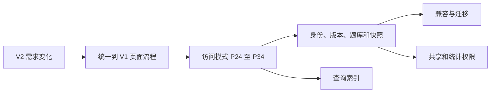

V2 没有替换原页面，而是在原流程中增加入口：

| 原页面或入口 | 【V2 新增/修订】操作 |
|---|---|
| 我的问卷 | 增加“我的题库”导航，原创建和参与列表不变 |
| 问卷管理页 | 显示题目来源，增加“复制为新草稿” |
| 问卷编辑页 | 增加“从题库选题”“保存到题库”和具体版本选择器 |
| 发布与分享 | 发布时固定题目来源；题目共享不与问卷填写权限混在一起 |
| 问卷统计 | 继续显示单卷统计，并提供来源版本入口 |
| 新增题库列表 | 管理多个命名题库、本人题目和共享题目 |
| 新增题库详情 | 改名、增删题目、查看题目最新版本 |
| 新增题目详情 | 查看版本树、共享、引用和同版跨卷统计 |
| 填写页 | 页面流程不变；提交时由后端记录具体题目版本 |

完整页面流程、逐页信息和 P24–P34 见[需求分析与界面设计](需求分析与界面设计.md)第 5 节。

### 2.2 关键需求决策

| 问题 | 最终决定 | 原因 |
|---|---|---|
| 题目版本是否直接替代问卷内题目 | 不替代；选入问卷时复制完整快照 | 填写和跳转必须独立于题库后续变化 |
| 版本是否允许修改 | 不允许；每次修改创建新版本 | 保证旧问卷和统计所指内容不变 |
| 如何恢复旧版 | 以旧版为父节点创建新版本 | 不覆盖历史，同时保留恢复动作 |
| 版本号是否表示父子关系 | 否；版本号表示创建顺序，父子关系看 `parentVersionId` | 支持从任意旧版本分叉 |
| 跳转规则是否放入题目版本 | 不放入 | 跳转目标和顺序属于具体问卷 |
| 撤销共享是否破坏已有问卷 | 不破坏；只禁止新的选择和复制 | 已发布问卷必须继续可填写 |
| 他人引用如何显示 | 只给数量，不给标题、用户和答卷 | 防止共享题目变成隐私查询入口 |
| 跨卷统计统计谁的数据 | 只统计当前用户自己的问卷 | 共享题目不等于共享答卷 |
| 旧答案是否补版本 ID | 不补 | 缺少当时题目快照，不能可靠推断 |

### 2.3 问卷和题目版本状态

V1 的问卷状态仍为草稿、已发布、已关闭。V2 修订的是题目编辑权限：只有草稿允许修改题目、选项、顺序和跳转；已发布和已关闭问卷的题目定义只读。

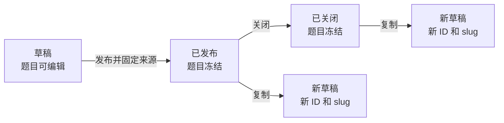

题目版本则是只增不改的树。题主可从任意节点建立新版本；恢复与普通分叉使用同一个写入操作。问卷选择的是一个确定版本，不会自动升级到最新版本。

## 3. 系统设计

第二阶段继续使用 FastAPI 分层后端、原生 JavaScript 前端和 MongoDB。V2 新增的模型、仓储、服务和路由没有改变 V1 填写引擎的职责。

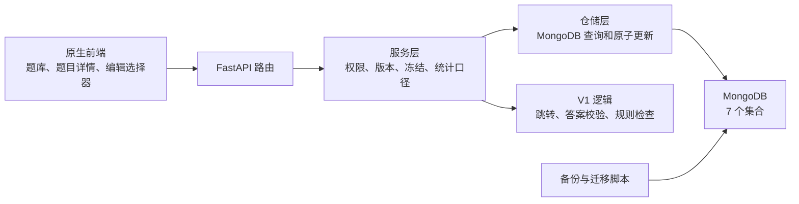

后端新增三组业务能力：

- 题目身份与版本：创建身份和首版、列版本树、分叉/恢复、共享设置；
- 题库与问卷引用：题库 CRUD、成员维护、选择具体版本、保存现有题、复制问卷、引用查询；
- 答案归版与跨卷统计：提交时写版本 ID，只在本人问卷中统计同一具体版本。

原 `logic_engine`、`answer_validator` 和 `rule_checker` 继续处理问卷内快照。这样 V2 的题库层不会把填写路径变成跨集合实时拼接。

## 4. MongoDB 设计

详见[数据库设计](数据库设计.md)第 13 节。V2 最重要的设计是“独立版本 + 问卷快照”的混合结构。

### 4.1 集合

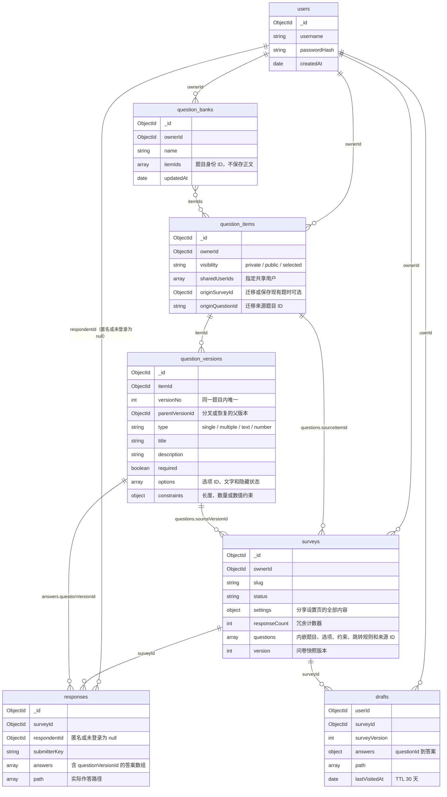

| 集合 | V2 中的职责 |
|---|---|
| `users` | 原账号集合，继续被问卷、题目、题库和草稿引用 |
| `surveys` | 保留完整题目快照和问卷专属规则；题目增加来源身份/版本 ID |
| `responses` | 保留独立答卷；新答案可增加具体版本 ID |
| `drafts` | 继续保存填写进度，不受题库结构影响 |
| `question_items` | 稳定题目身份、所有者、共享方式和可选迁移来源 |
| `question_versions` | 不可变题目正文、版本号和父版本 |
| `question_banks` | 用户命名分类，只保存题目身份 ID 数组 |

题目版本保存题型、标题、说明、必答、选项和约束；问卷快照另外保存本卷 `questionId`、顺序、隐藏、跳转规则和默认去向。二者不能合并，因为同一个题目版本在不同问卷中的位置和跳转目标不同。

### 4.2 为什么仍然适合 MongoDB

| 访问模式 | 关系型拆表 | V2 MongoDB 设计 |
|---|---|---|
| 打开已发布问卷 | 连接问卷、题目版本、选项、规则，并处理版本当前权限 | 一次读取 `surveys` 的冻结快照 |
| 查看版本历史 | 连接题目身份、版本和选项表 | 按 `itemId+versionNo` 读取独立版本文档 |
| 管理题库 | 题库成员关联表 | 一个题库文档内维护 `itemIds[]` |
| 提交答卷 | 答卷、答案、多选值多表写入 | 插入一份答卷文档，答案为数组 |
| 跨卷统计 | 多表连接并限定问卷所有者 | 先确定本人问卷，再按版本 ID 聚合答卷 |
| 结构演进 | 改表和迁移所有行 | V1/V2 字段可选，`schemaVersion` 渐进兼容 |

MongoDB 没有外键，因此服务层必须检查题目所有者、版本归属、分享权限和问卷所有者；`$jsonSchema` 负责集合内部结构，唯一索引负责并发下的身份和版本冲突。

### 4.3 索引

V1 的 9 个索引全部保留。V2 新增 8 个索引：

| 索引 | 目的 |
|---|---|
| `surveys.question_usage` | 按来源题目查询未删除问卷，并区分所有者 |
| `responses.version_survey_answers` | 在指定问卷集合中读取具体版本答案 |
| `question_items.owner_items` | 我的题目按创建时间列表 |
| `question_items.public_items` | 公开共享题目列表 |
| `question_items.shared_items` | 指定用户共享题目列表 |
| `question_items.uniq_legacy_origin` | `(originSurveyId, originQuestionId)` 幂等迁移 |
| `question_versions.uniq_item_version` | 同一题版本号唯一并按版本读取 |
| `question_banks.uniq_owner_bank_name` | 同一用户不能创建同名题库 |

### 4.4 一致性和并发控制

| 场景 | 做法 |
|---|---|
| 创建题目和首版 | 题目身份先建立，首版唯一索引兜底；没有首版的身份不作为可用题返回 |
| 并发创建版本 | 读取下一版本号，插入时由 `itemId+versionNo` 唯一索引检查，冲突后重读重试 |
| 修改共享 | 更新条件同时包含 `_id+ownerId`，只有题主可写 |
| 题库加题 | `$addToSet` 防止重复；移题使用 `$pull` |
| 草稿选择版本 | 先检查当前访问权，再用问卷状态和 `updatedAt` 乐观锁写入整份快照 |
| 发布问卷 | 发布前确保每道题都有固定来源；状态与来源快照一次更新 |
| 提交答卷 | 沿用 V1 的路径重放、条件占名额和失败补偿；从冻结快照附加版本 ID |

### 4.5 冗余的取舍

V2 有意把题目正文同时保存在 `question_versions` 和 `surveys.questions[]`。这不是无依据的重复：前者用于复用和历史，后者用于稳定填写、跳转和单卷统计。两份数据只在“选题或发布固定来源”时复制，之后不要求同步；问卷快照指向来源版本只是为了追踪，不是运行时外键。

`responses.answers[].questionVersionId` 也是有目的的冗余。若统计时再从问卷当前内容推断版本，就会重新引入历史歧义；提交时从冻结快照写入可以确定当次答案属于哪个版本。

### 4.6 数据迁移与兼容

迁移按“预检 → 备份 → 应用 → 审计”执行：

1. `--check` 统计旧数据和冲突，不写数据库；
2. 备份四个旧集合并计算 SHA-256；
3. 以 `(surveyId, questionId)` 为来源键，为每道现存题建立独立身份和 v1；
4. 给问卷题目补来源 ID，不修改题目正文、顺序、规则和旧答卷；
5. 再次运行时复用来源唯一键，保证幂等；
6. 审计旧集合数量和 BSON 内容，问卷只允许增加来源字段和 Schema 版本。

正式库迁移前后保持 8 个用户、4 份问卷、10 份答卷和 1 份草稿；11 道题建立 11 个身份和 11 个初始版本。旧答卷继续进入原单卷统计，但因没有可信版本 ID，在跨卷统计中单列为无法归版数据。

## 5. 题目版本、共享与引用设计

题目身份和版本分开：`question_items` 回答“这是谁的题、谁能使用”，`question_versions` 回答“某一版的正文是什么”。共享设置改变身份的可访问范围，不修改任何版本正文。

版本树的规则如下：

- 首版 `versionNo=1`、`parentVersionId=null`；
- 新版可以选择同一题目的任意历史版本作为父节点；
- 恢复旧版是复制旧版正文并建立一个新节点；
- 旧版本不更新、不删除，已引用问卷不会自动升级；
- 使用他人共享题时，可选择具体版本加入草稿，也可复制成自己的独立题目身份。

共享有三种状态：`private`、`public`、`selected`。撤销共享后，其他用户不能新选题或复制版本；已经保存进问卷的快照继续使用。已有本人引用的用户仍可查看来源历史和自己的统计，但不能借此读取题主或其他用户的问卷详情。

引用查询分两部分返回：当前用户自己的问卷提供标题、状态和所用版本；其他用户的引用只按问卷去重后返回数量。软删除问卷不进入引用结果。

## 6. 校验与权限设计

V2 在 V1 的规则校验、答案校验和数据库 Schema 之外，增加版本和共享权限校验。

| 层次 | 检查内容 |
|---|---|
| 版本正文校验 | 复用 V1 题型、选项、约束校验；父版本必须属于同一题目 |
| 题目访问权限 | 题主、公开、指定共享或已有本人引用；无权时不泄露私有题是否存在 |
| 题目写权限 | 只有题主可以创建新版本或修改共享 |
| 题库权限 | 只有题库所有者可以改名、增删成员或删除题库 |
| 问卷编辑权限 | 只有本人草稿可以增删、排序、替换版本和修改跳转 |
| 发布冻结 | 已发布/已关闭的题目编辑 API 返回 409 `published_question_locked` |
| 引用隐私 | 本人问卷返回明细，其他人的问卷只返回去重数量 |
| 跨卷统计 | 只使用当前用户自己、未软删除的问卷和精确版本答案 |
| 数据库底线 | 七个集合的 `$jsonSchema`、唯一索引和 ObjectId 类型检查 |

跨卷统计按题型生成结果：单选计各选项次数和比例；多选按选项分别计数；数字计算数量、最小值、最大值和平均值；文本保留回答列表。所有结果明确显示具体版本、本人问卷数、可归版答案数和无法归版数。

## 7. AI 使用过程

### 7.1 工具与工作方式

- **工具**：第二阶段使用 Codex 进行全工作区审计、设计、代码与文档修改，使用 PowerShell 和 pytest 执行检查，并使用本地浏览器完成关键页面流程核验。
- **工作方式**：先提交完整实施计划，再按六个步骤逐步完成。每一步只处理计划中列明的范围，随后运行相应检查、更新 AI 日志和变更清单，等待我明确回复“下一步”。
- **记录**：[AI 使用日志](AI使用日志.md)保留 V1 的 #1–#16，V2 从 #17 继续记录原提示词、工具、结果、我的调整和实际修改。

| 日志 | 第二阶段内容 |
|---|---|
| #17–#20 | 审计第一阶段工作区、制定 V2 计划、要求记录 AI 日志，并把题库流程接回原页面流程 |
| #21 | Schema、索引、备份和幂等迁移 |
| #22 | 题目身份、不可变版本、分叉/恢复和共享权限 |
| #23 | 多题库、问卷选题、保存现有题、引用、复制和发布冻结 |
| #24 | 新答卷归版、跨卷统计、页面和浏览器流程 |
| #25 | 全量回归、迁移核验和提交文档整理 |
| #26 以后 | 根据核验意见继续完善 V2 文档、数据库图和阶段报告拆分 |

### 7.2 AI 帮了什么

- 扫描现有代码、Schema、测试和文档，建立 V1 与 V2 的差异基线；
- 把题目身份、不可变版本、问卷快照和答案归版拆成可实现的数据结构；
- 编写备份、预检、迁移和审计脚本，并通过唯一来源键保证重跑安全；
- 实现题目版本、共享、多题库、问卷引用、复制、冻结及跨卷统计；
- 为权限、撤销共享、迁移幂等、旧数据兼容和统计口径增加自动测试；
- 按每轮核验意见调整页面流程和提交文档。

### 7.3 AI 做错了什么

| 问题 | 怎么发现的 | 怎么处理的 |
|---|---|---|
| 最初把题库画成独立局部流程，没有说明如何进入 V1 管理和编辑页面 | 我对照第一阶段《需求分析与界面设计》追问 | 将两阶段页面合并为统一流程，补逐页入口、返回和权限 |
| 数据库 V2 最初只给一张简化 ER 图，无法表达内嵌快照和答案归版 | 我检查《数据库设计》时发现图为空且说明不完整 | 改为集合引用图和文档内嵌图，并补七集合、引用链和索引表 |
| 撤销共享后的统计读取和题目详情权限一度不一致 | 浏览器流程和针对性测试 | 统一“已有本人引用可看历史和本人统计，但不能新选用”的规则 |
| 最终回归时曾有两个 pytest 进程同时清理测试库 | 大量无共同业务原因的失败 | 停止竞争进程，在单进程环境重新执行并保存可信输出 |
| 早期报告把 V1、V2 写在同一份文档 | 我要求保留原版 V1 并按原结构另写 V2 | 恢复 V1 报告，新增本 V2 报告 |

### 7.4 我改了什么、决定了什么

- 要求继续使用第一阶段架构，不重做系统；
- 要求每一步完成后先核验，不允许一次性推进；
- 要求 V2 页面与第一阶段完整流程统一，而不是只画题库局部页面；
- 确认“独立版本 + 问卷快照”方案和已发布问卷冻结规则；
- 确认撤销共享只影响新引用，既有问卷保持可用；
- 确认跨卷统计只汇总本人问卷的同一具体版本；
- 确认旧答卷不伪造版本归属，而是单列无法归版数据；
- 要求保留 V1 报告，V2 报告按 V1 的结构和写作方式单独形成。

### 7.5 体会

第二阶段最重要的经验是，数据库演进不能只考虑新集合能否保存数据，还要说明旧数据能知道什么、不能知道什么。旧答卷没有当时的题目快照，因此无法可靠恢复历史版本；如果为了让跨卷统计看起来完整而强行归版，反而会制造错误数据。最终保留旧单卷统计、对新答案精确归版、对旧答案单列，是比“全部纳入统计”更可信的处理。

页面流程同样影响数据设计。只有明确题库从哪里进入、具体版本在哪里选择、撤销共享后用户还能看到什么、已发布问卷如何修改，才可能确定哪些数据属于题目版本、哪些属于问卷快照。逐步核验使这些边界在实现前后都能被检查，而不是到最终报告时才补解释。

AI 能快速生成迁移、权限和统计代码，也能把边界变成测试，但它容易先给出局部可运行方案，而忽略与原系统和提交文档的一致性。因此我需要持续对照作业要求、V1 设计和实际页面，对 AI 的图、报告与测试结论进行核验。

## 8. 测试结果

详见[测试用例](测试用例.md)，第二阶段最终输出保存在 `docs/test-results/pytest-output-stage2.txt`。

- **自动测试**：268 个全部通过，用时 169.07 秒；1954 条语句中未覆盖 80 条，覆盖率 96%。
- **V1 回归**：创建、编辑、跳转、校验、填写、并发提交、单卷统计、导出、断点续填和个人答卷继续覆盖。
- **V2 测试**：Schema 和索引、迁移预检/应用/审计、版本分叉/恢复、共享与撤销、多题库、问卷选题、复制、发布冻结、答案归版、引用隐私和跨卷统计。
- **浏览器流程**：在临时数据库完成创建题库、创建题目、建立 v2、将 v1 加入问卷、发布冻结、复制为草稿和查看版本统计；测试后清理临时数据。

### 8.1 【V2：第二阶段新增】功能测试截图

2026-10-29 使用 Codex 侧边栏内置浏览器连接本机临时数据库 `survey_system_stage2_shots`，以题主 `v2shot_owner`、共享接收者 `v2shot_bob` 和填写者账号重新走通 V2 页面流程。演示数据和正式数据库隔离，截图完成后停止临时服务并清理该临时库。

| V2 功能与验证点 | 实际页面截图 |
|---|---|
| **多个命名题库与本人题目**：题库列表显示“课堂常用题库”、题目数量，以及本人创建题目的最新版本 v2 | 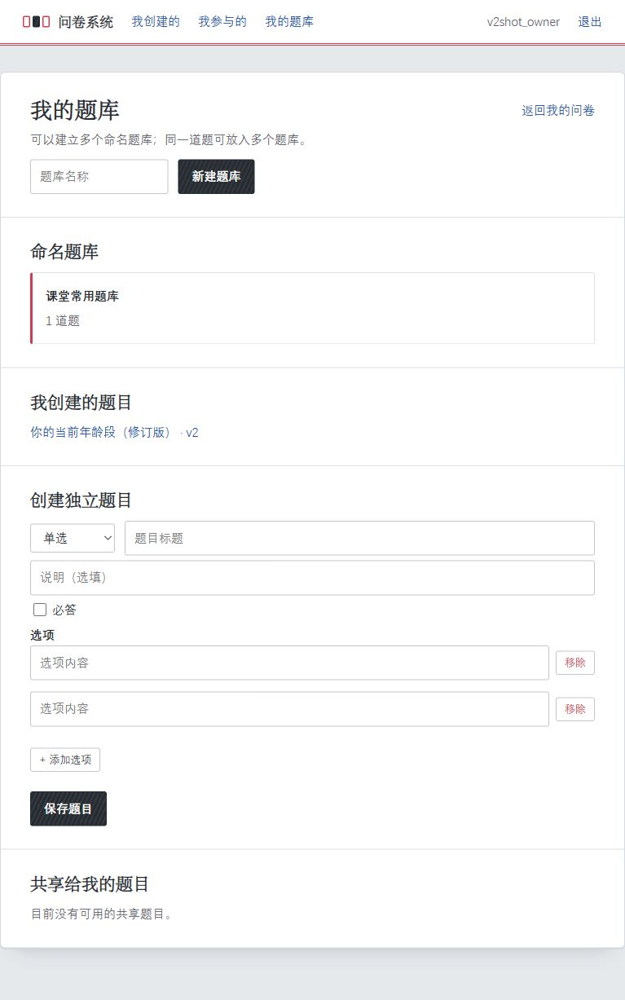 |
| **题库成员管理**：题库详情显示 1 道题、最新版本和移出/加入入口；题库分类不改变题目版本 | 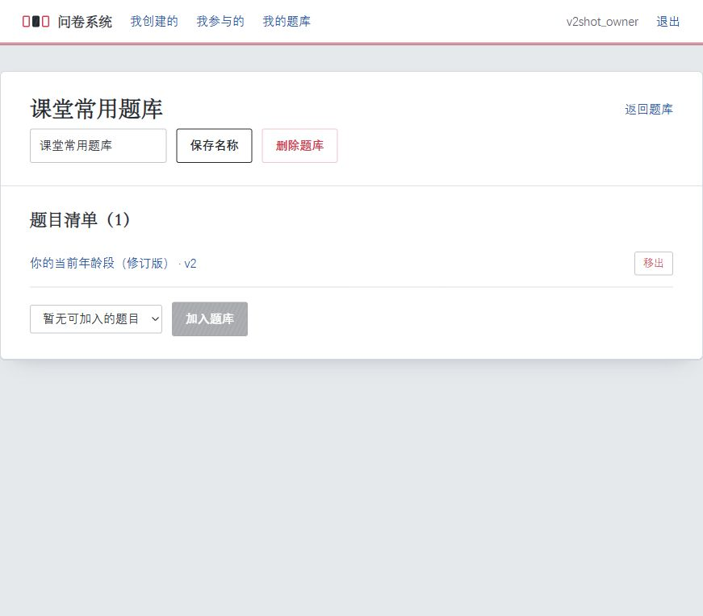 |
| **版本历史、分叉、共享、引用和统计**：同一详情页保留 v1/v2，显示父版本、定向共享用户、四份本人引用和具体版本统计 | 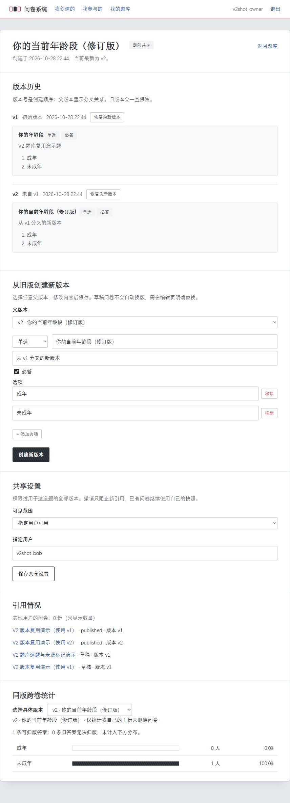 |
| **编辑页选择具体版本**：题库选择器同时显示题目、v2、父版本和内容预览；问卷原题标明来源 v1，不会自动升级 | 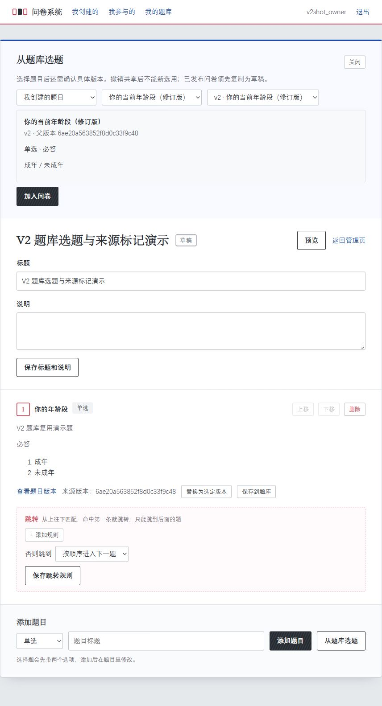 |
| **发布后复制入口与来源追踪**：已发布问卷管理页显示答卷数、来源题目和“复制为新草稿” | 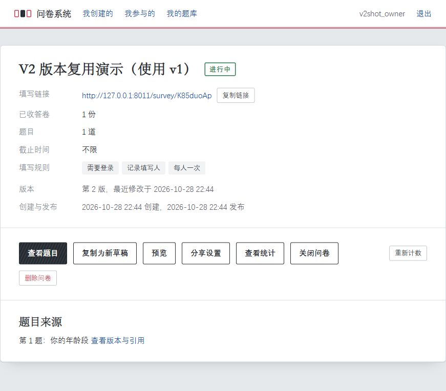 |
| **发布后题目冻结**：编辑页明确提示题目、选项、顺序和跳转规则已冻结，只提供查看来源及复制草稿入口 | 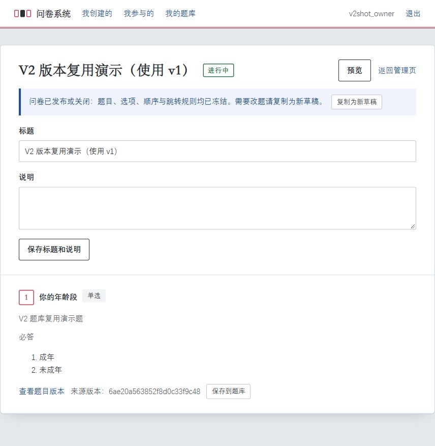 |
| **定向共享接收视图**：`v2shot_bob` 的“共享给我的题目”显示题目最新版本和“定向共享”，但没有题主的题库管理权限 | 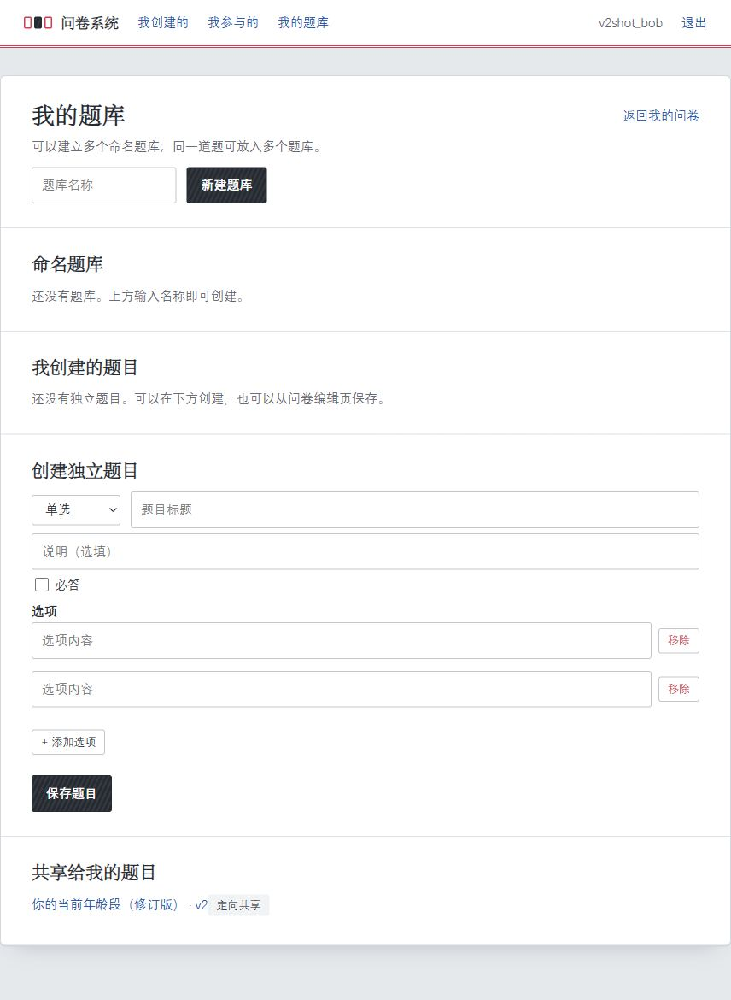 |
| **同版跨卷统计**：明确限定 v2、本人 1 份未删除问卷、1 条可归版答案和 0 条无法归版数据，选项分布为未成年 100% | 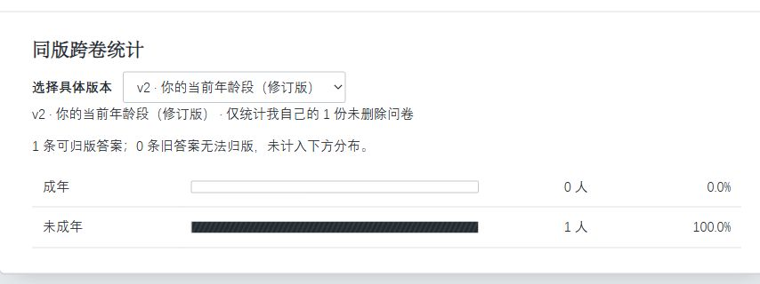 |

截图中的 ObjectId、账号、问卷和答卷均来自独立临时测试库，不属于正式提交数据。页面结果与自动测试 C01–C07 的统计、权限和冻结断言一致。

正式数据库只读核验结果：8 个用户、4 份问卷、10 份答卷、1 份草稿、11 个题目身份；11 道问卷题均已关联来源，没有待迁移题目和冲突。

## 9. 遇到的问题及解决方法

| 问题 | 解决 |
|---|---|
| 相同题目文字不等于同一题 | 新建稳定 `question_items` 身份，不按标题自动合并 |
| 同一题修改后旧问卷不能跟着改变 | 版本正文不可变，问卷保存选定版本的完整快照 |
| 从旧版恢复可能破坏历史 | 恢复操作创建新版本，旧节点保持不变 |
| 版本正文和问卷跳转规则边界不清 | 版本保存通用题目正文；顺序、隐藏和跳转仍归问卷 |
| 发布后改题会让历史答卷解释变化 | V2 冻结题目定义；需要修改时复制为新草稿 |
| 撤销共享可能使已有问卷失效 | 权限只控制新选用；既有问卷继续使用快照 |
| 共享题目可能泄露其他用户数据 | 引用只显示他人问卷数量；统计只读取本人问卷 |
| 旧答卷没有题目版本 | 不猜测归版；保留单卷统计，跨卷统计单列 |
| 迁移中断或重复执行可能产生重复题目 | 来源唯一部分索引 + 幂等脚本 + 备份审计 |
| 单机 MongoDB 没有多文档事务 | 缩小原子边界、唯一索引兜底、失败重试并避免覆盖旧数据 |
| 图只画集合关系仍解释不清结构 | 同时画集合引用和文档嵌入，并用字段表和文本引用链兜底 |

## 10. 第二阶段总结与已知限制

V2 在不破坏 V1 填写模型的前提下增加了可复用题目、不可变版本、共享、多题库、引用查询和同版跨卷统计。核心不是把题目简单拆成新集合，而是建立“题目身份 → 不可变版本 → 问卷冻结快照 → 新答卷精确归版”的完整链条。

当前限制如下：

- 迁移前已发生的题目文字变化无法从现有数据还原；
- 跨卷统计只汇总当前用户自己的问卷，不提供团队级答卷共享；
- 版本号表示创建顺序，查看分叉关系必须结合 `parentVersionId`；
- 删除题库不会删除题目，删除或撤销共享也不会级联破坏既有问卷；
- 前端使用原生 JavaScript，关键流程已在 Chromium 内核浏览器核验，但未覆盖全部浏览器。

第二阶段提交材料与要求对应如下：

| 要求 | 文件 |
|---|---|
| 可运行代码与配置 | `backend/`、`frontend/`、`README.md` |
| MongoDB Schema 与索引 | `schema/`、`backend/app/db.py`、[数据库设计](数据库设计.md) |
| 系统、API 和关键逻辑 | [系统说明](系统说明.md)、[API 说明](API说明.md)、[关键逻辑说明](关键逻辑说明.md) |
| 需求和页面 | [需求分析与界面设计](需求分析与界面设计.md)第 5 节往后 |
| 迁移过程 | `backend/scripts/`、[迁移执行记录](第二阶段/迁移执行记录.md) |
| 测试步骤、输入、输出和结果 | [测试用例](测试用例.md)、`docs/test-results/pytest-output-stage2.txt` |
| AI 使用过程 | [AI 使用日志](AI使用日志.md) |
| V2 文件变更 | [第二阶段变更清单](第二阶段变更清单.md) |
